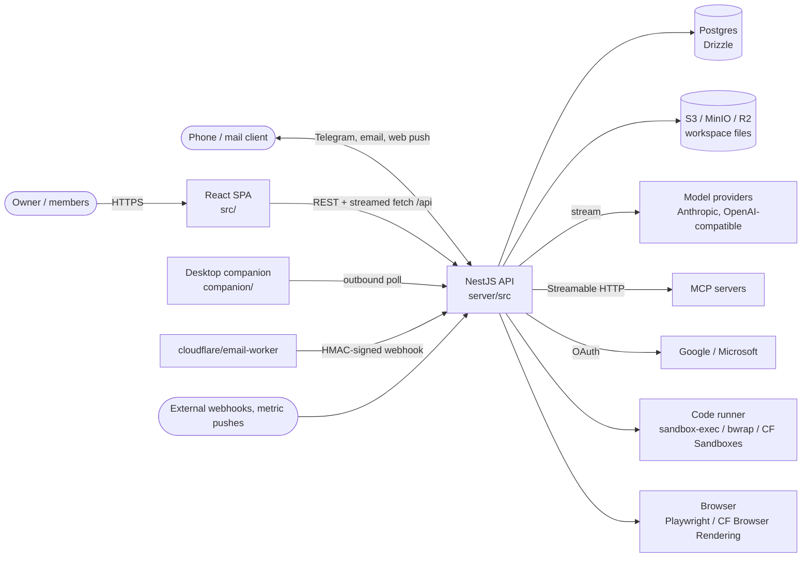
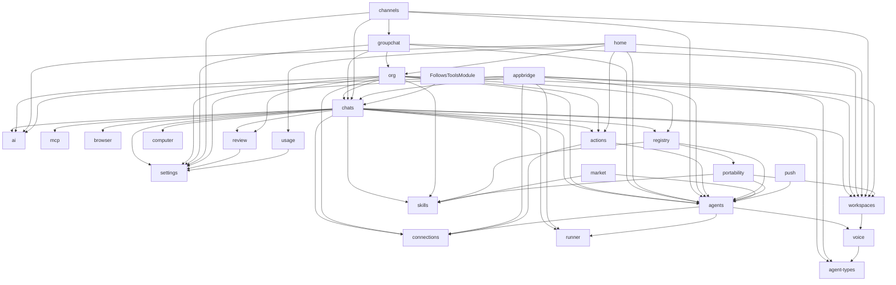
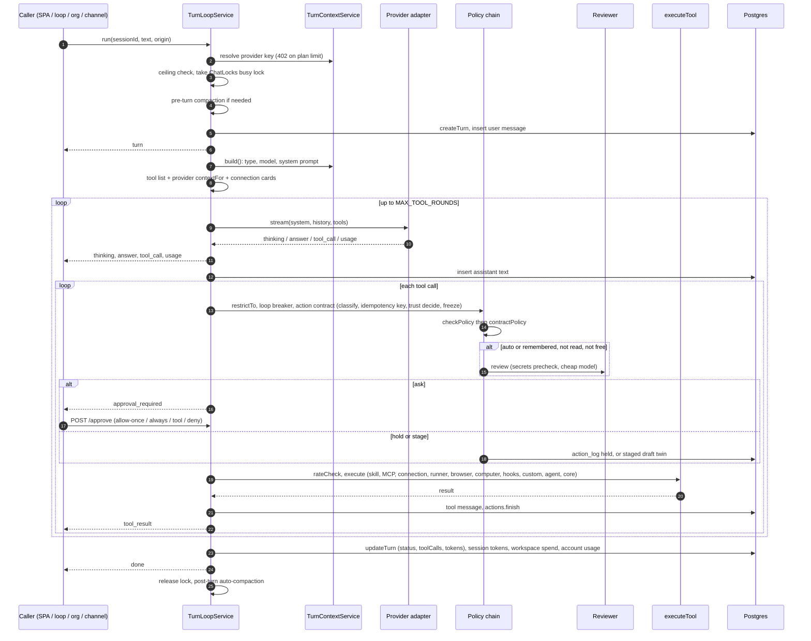
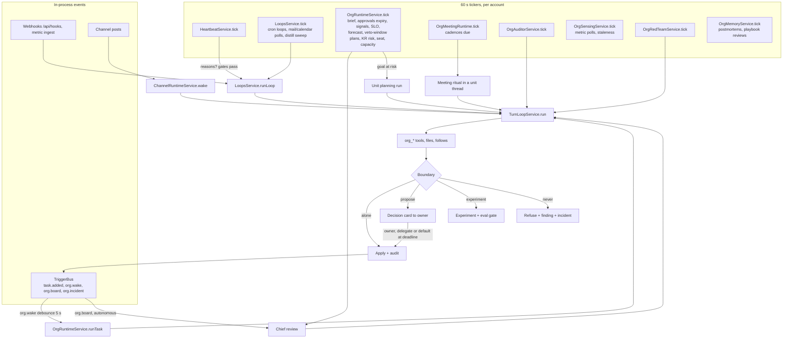

# Architecture

Last updated: 2026-11-02

This document describes how yaam-chat is built: the runtime pieces, the
backend modules, the turn loop, the autonomy engine that runs a company of
agents, the data model, storage, eventing, security, the SPA, testing and
deployment. It was written by reading the code. File paths are relative to the
repository root, and `file:line` citations refer to `main` as of the date
above. Where a design doc and the code disagree, this document follows the
code and says so in [§13](#13-where-docs-and-code-disagree).

Contents:

1. [System context](#1-system-context)
2. [Runtime components](#2-runtime-components)
3. [Backend module map](#3-backend-module-map)
4. [The turn loop](#4-the-turn-loop)
5. [The autonomy engine](#5-the-autonomy-engine)
6. [Data model](#6-data-model)
7. [Storage layout](#7-storage-layout)
8. [Eventing](#8-eventing)
9. [Security model](#9-security-model)
10. [Frontend architecture](#10-frontend-architecture)
11. [Testing strategy](#11-testing-strategy)
12. [Deployment](#12-deployment)
13. [Where docs and code disagree](#13-where-docs-and-code-disagree)

## 1. System context

The owner (and, in accounts mode, invited members and viewers) uses a
browser SPA. The SPA talks to one NestJS API over JSON and streamed HTTP.
The API owns all state in Postgres and an S3-compatible bucket. It calls
model providers, MCP servers, connected SaaS APIs and sandboxes on behalf of
agents. Agents also reach people outside the browser through Telegram, email
and web push.



Everything that matters runs in the API process: there are no queues or
separate workers. Background work runs on in-process 60-second tickers
([§5](#5-the-autonomy-engine)) and in-process event emitters
([§8](#8-eventing)). The process therefore holds state that a second replica
would not see (chat locks, the workspace event bus, provider health, debounce
timers); see [§12](#12-deployment).

## 2. Runtime components

| Component | What it is | Code |
|---|---|---|
| SPA | React 19 + Vite, one context store, lazy-loaded views. Served by Vite in dev (`:5175`, proxies `/api`), by a Cloudflare Worker in hosted environments. | `src/`, `vite.config.ts`, `infra/cloudflare/worker.js` |
| API | NestJS 11 on Express 5, global prefix `/api`, port 8790. `bootstrap.ts` installs the account-context middleware first, a 40 MB JSON limit that keeps the raw body for HMAC checks, a CORS allowlist and shutdown hooks that drop open SSE connections. | `server/src/main.ts`, `server/src/bootstrap.ts` |
| Postgres | Drizzle ORM. Idempotent boot migrations under an advisory lock. PGlite in tests. | `server/src/database/` |
| Object storage | Any S3 API (MinIO in dev, R2 in hosted). One prefix per workspace. | `server/src/storage/` |
| Model providers | A provider-neutral streaming interface with an Anthropic adapter (also used for Anthropic-compatible endpoints), an OpenAI-compatible adapter (OpenAI, DeepSeek, Kimi, GLM, Gemini, custom) and an Echo dev provider. | `server/src/ai/` |
| MCP | A minimal Streamable HTTP client with OAuth 2.1 discovery. Tools appear as `mcp_<server>_<tool>`. | `server/src/mcp/` |
| Connections | Google (Gmail, Calendar, Drive) and Microsoft (mail, calendar, files) over OAuth, curated verb sets, per-agent grants, pollers for triggers and sensing. | `server/src/connections/` |
| Code runner | `run_js` / `run_python`: a local OS sandbox (macOS `sandbox-exec`, Linux `bwrap --unshare-all`) or Cloudflare Sandboxes behind `cloudflare/runner-worker`. 10 s default, 30 s max, 32 KB output. | `server/src/runner/runner.service.ts:1-65` |
| Browser | `browser_open/read/act/screenshot`: local Playwright Chromium (one incognito context per turn) or Cloudflare Browser Rendering. | `server/src/browser/` |
| Computer companion | A paired, outbound-only CLI on the user's machine. It polls `/api/computer/work` and runs `computer_*` actions inside the scopes the user chose. | `companion/`, `server/src/computer/` |
| Channels | Telegram bot, per-agent email addresses (inbound via `cloudflare/email-worker`, outbound via Cloudflare Email Sending or Resend), web push with VAPID. | `server/src/channels/`, `server/src/push/` |
| Registry | Local and federated (`REGISTRY_URL`) publish/install for agents, skills, mini apps and company blueprints. | `server/src/registry/` |

## 3. Backend module map

`server/src/app.module.ts` wires one NestJS module per domain. Layering
inside a module is controller → service → repository (Drizzle). Six modules
are `@Global()`: `DatabaseModule`, `StorageModule`, `FilesModule`,
`AccountsModule`, `SharedModule` and `FollowsModule`. The auth strategy is
bound once in `AppModule` (`AUTH_STRATEGY`: `TokenAuthStrategy` for
`AUTH_MODE=single`, `SessionAuthStrategy` or the experimental
`SuiteJwtStrategy` for `accounts`), with `AuthGuard`, `WorkspaceAccessGuard`
and `HttpLoggingInterceptor` registered globally.

### Modules

| Module | Responsibility | Key services and files |
|---|---|---|
| `config` | Typed env configuration and fail-fast validation. | `configuration.ts`, `validation.ts` |
| `database` | Drizzle handle (`DRIZZLE_DB`, account-scoped) and boot migrations. | `database.module.ts`, `migrator.ts`, `schema.ts` |
| `accounts` | Tenancy, magic-link sign-in, plans (`free`, `hosted`, `byo`), usage, provider-key resolution, billing seam. | `AccountsService`, `account-context.ts`, `scoped-db.ts`, `session-auth.strategy.ts`, `suite-jwt.strategy.ts`, `plans.ts` |
| `shared` | Several people on one workspace: members, invites, flow rules, `WorkspaceAccessGuard`. | `SharedService`, `workspace-access.guard.ts` |
| `storage` | S3 client, workspace-scoped keys, preview classification. | `StorageService`, `storage.keys.ts`, `preview.util.ts` |
| `files` | `WorkspaceFs`: the versioned workspace filesystem and agent homes; also provides `WorkspaceEventBus`. | `workspace-fs.service.ts`, `agent-home.ts`, `fs-http.ts` |
| `status` | `GET /api/status` readiness and liveness. | `StatusService` |
| `workspaces` | Workspace CRUD, durable workspace memory, quiet hours, monthly token stop. | `WorkspacesService`, `quiet-hours.ts`, `spend.util.ts` |
| `agent-types` | Provider/model/persona presets; API keys sealed at rest. | `AgentTypesService` |
| `agents` | Durable agents: charter, dashboard, kanban, loops, inbox events, lessons, checkpoints; `TriggerBus`. | `AgentsService`, `AgentMemoryService`, `chats/trigger-bus.ts` |
| `ai` | Provider adapters, retry, stream timeout, health and degradation, context windows, pricing. | `AiProviderFactory`, `ProviderHealthService`, `anthropic-ai.provider.ts`, `openai-ai.provider.ts` |
| `chats` | Sessions and transcripts, the turn loop, context assembly, core tools, compaction, loops and triggers, distillation, the heartbeat. | `TurnLoopService`, `TurnContextService`, `ToolsService`, `CompactionService`, `LoopsService`, `HeartbeatService`, `DistillService`, `ChatLocks` |
| `skills` | Instruction-pack skills offered as `skill_<name>` tools; built-ins seeded on boot. | `SkillsService`, `builtin-skills.ts` |
| `search` | Workspace search over sessions, messages and files. | `SearchService` |
| `mcp` | MCP server config, discovery, calls. | `McpService`, `mcp-client.ts`, `mcp-oauth.ts` |
| `settings` | App-wide settings in `app_settings`. | `SettingsService` |
| `connections` | OAuth connections, grants, tool definitions, context cards, pollers. | `ConnectionsService`, `connections.tools.ts`, `connections.poll.ts`, `cards/` |
| `runner` | Sandboxed code execution. | `RunnerService` |
| `harness` | Coding-agent CLIs (Claude Code, Codex, Pi, DeepSeek via Claude Code) as the `code_agent` tool: detection, per-run temp dir synced through WorkspaceFs, settings at `/api/harness` (docs/coding-harnesses.md). | `HarnessService`, `harness-commands.ts`, `harness-workdir.ts`, `harness-config.ts` |
| `browser` | The browser tool and its two backends. | `BrowserService`, `page-model.ts` |
| `computer` | Desktop companion pairing, scopes, action queue, audit. | `ComputerService`, `CompanionGuard`, `computer-scopes.ts` |
| `review` | The independent action reviewer (a second, tool-less model call). | `ActionReviewService`, `review-prompt.ts` |
| `actions` | Action classes, the action log, idempotency, rate limits, staging, the trust ledger and policy. | `ActionsService`, `TrustService`, `action-classes.ts`, `trust-policy.ts` |
| `appbridge` | The capability-checked bridge for mini apps: data, SQL, LLM, connections, compute. | `AppBridgeService`, `AppLlmService`, `AppDataService`, `AppConnectionsService`, `AppComputeService` |
| `channels` | Telegram and email channels. | `TelegramService`, `EmailService`, `email-sender.ts` |
| `push` | Web push subscriptions and delivery (dependency-free VAPID and aes128gcm). | `PushService`, `web-push.ts` |
| `usage` | Per-agent and per-workspace token and dollar usage. | `UsageService` |
| `voice` | Transcription on upload and optional TTS. | `TranscriptionService` |
| `portability` | AGENT.json v2, memory importers, `SKILL.md`. | `PortabilityService`, `importers.ts`, `skill-md.ts` |
| `registry` | Publish, scan and install agents, skills, mini apps and blueprints; ratings. | `RegistryService`, `app-scan.ts` |
| `market` | The pack catalog (generated from `packs/` and profession packs) and the connectors directory. | `MarketService`, `authored-packs.generated.ts`, `connectors.catalog.ts` |
| `security` | `GET /api/security`, the published policy summary. | `security.controller.ts` |
| `org` | The company: organisations, units, tasks, intent, runtime, approvals, audit, auditor, signals, SLOs, capital, meetings, memory, playbooks, knowledge, roles, blueprints, bootstrap, sensing, incidents, red team, trust bridge, predictions, experiments, reconciliation, boundary, evals, capacity, the owner's seat, the chief of staff, the `/org/` mirror. | 37 services in `server/src/org/` (see [§5](#5-the-autonomy-engine)) |
| `groupchat` | Channels, members, messages, threads, reads, channel files, task links; who speaks after a post. | `GroupChatService`, `ChannelRuntimeService`, `mentions.ts`, `workspace-events.ts` |
| `follows` | Who follows which thread or task; what changed since they looked; the `follow` tools. | `FollowsService`, `follows.tools.ts` (`FollowsToolsModule`) |
| `home` | The owner's mission control: one read-only aggregate. | `HomeService`, `home-activity.ts`, `home.types.ts` |

### Dependencies

Arrows read "imports". Global modules (database, storage, files, accounts,
shared, follows) are omitted for clarity; every module can inject them.



Two patterns keep this graph acyclic:

- **Hooks instead of imports.** `chats` must not import `org`, `groupchat` or
  `follows`, yet their tools and context must reach a turn. They register
  themselves at boot: `TurnLoopService.setOrgTools` and `addToolProvider`
  (`server/src/chats/turn-loop.service.ts:421-431`), and
  `HeartbeatService.addReasonProvider` / `addContextProvider`
  (used by `org-runtime.service.ts:269-270`, `org-chief.service.ts:72-73`,
  `org-meeting-runtime.service.ts:166`).
- **In-process buses.** `TriggerBus` lives in `agents` (the emitting side)
  so `LoopsService` and `OrgRuntimeService` can listen without `agents`
  importing either (`server/src/agents/agents.module.ts`,
  `server/src/chats/trigger-bus.ts`). `WorkspaceEventBus` lives in the global
  `files` module so file changes and channel events share one stream.

## 4. The turn loop

Every model turn goes through one async generator,
`TurnLoopService.run(sessionId, { text, attachments?, origin?, confined? })`
(`server/src/chats/turn-loop.service.ts:489`). `origin` is `user`, `loop` or
`channel`; it decides which gates apply.

### Entry points

| Caller | Origin | Where |
|---|---|---|
| `POST /api/chats/:id/turns` (the SPA) | `user` | `chats.controller.ts:102-142` |
| Group-channel wake (a mention or an unprompted reply) | `user`, so an agent behaves in a channel exactly as in a private chat | `groupchat/channel-runtime.service.ts:360` |
| Scheduled and event loops; the heartbeat (a loop named `heartbeat`) | `loop` | `chats/loops.service.ts:434-511`, `chats/heartbeat.service.ts:233-235` |
| Org task runs and task-free turns | `loop` | `org/org-runtime.service.ts:825-897`, `:484-488` |
| Auditor, evals, red team, meetings, "ask the company" | `loop` | `org-auditor.service.ts:273`, `org-evals.service.ts:382`, `org-redteam.service.ts:188`, `org-meeting-runtime.service.ts:474`, `org-knowledge.service.ts:220` |
| Telegram and email | `channel` | `channels/telegram.service.ts:232`, `channels/email.service.ts:312` |
| Mini app `agent.ask` | default (`user`) with `confined: true` | `appbridge/app-bridge.service.ts:271` |

### Sequence



### Context assembly

`TurnContextService.build` (`server/src/chats/turn-context.service.ts:125-221`)
joins these parts of the system prompt, in order:

1. the agent type's persona;
2. for an agent session: identity (`You are the durable agent "<name>"`), the
   charter, self-maintenance instructions (dashboard, apps, kanban and
   follows, `search_history`, `draft_skill` / `revise_skill`, delegation), a
   **lessons digest** capped at 12 rows and 3,500 characters with audience
   filtering for shared workspaces (`server/src/agents/agent-memory.service.ts:81-82`),
   the filesystem and home instructions, the assigned folder, and pending
   owner feedback (drained when read);
3. workspace memory;
4. the consented user profile;
5. an attribution notice in shared workspaces;
6. formatting rules and the `QUICK_REPLIES` protocol.

The turn loop then appends each tool provider's `contextFor` (the org task
brief, the channel context and so on) and the connection context cards
(`turn-loop.service.ts:625-643`).

History is the `user` and `assistant` messages past the compaction cutoff,
with the compaction summary prepended (`server/src/chats/chats.repository.ts:307-316`,
`turn-loop.service.ts:1446-1448`). Earlier rounds' tool calls and results are
stored as `tool` messages but are not replayed to the model. Attachments go on
the last user message: up to 8 files, text sliced to 30k characters, up to 4
images of 3 MB or less, and voice notes as transcripts
(`turn-loop.service.ts:1094-1128`). Follows reach an agent through its
heartbeat prompt, not the system prompt.

### Provider resolution

- **Agent type** (`turn-context.service.ts:74-91`): the session's type, then
  the agent's pinned type, then an enabled type matching the agent's
  provider, then the `defaultAgentTypeId` setting, then the first enabled
  type, then Echo.
- **Model**: `session.model || agent.model || type.model` (`:209`). In org
  runs, model routing by task class (`cheap | standard | strong`,
  `server/src/org/org-routing.ts`) writes the routed model onto the session
  unless the agent pins one (`org-runtime.service.ts:863-884`).
- **Key**: `AccountsService.resolveProviderKey` throws `PlanLimitException`
  (HTTP 402) for a missing BYO key or a spent hosted ceiling.
- **Adapter**: `AiProviderFactory.get` (`server/src/ai/providers.factory.ts:22-40`).
- **Reliability**: `fetchWithRetry` retries a 429, 5xx or network error twice
  (1 s, then 3 s, with jitter) before streaming starts
  (`server/src/ai/provider-retry.ts`); `PROVIDER_TIMEOUT_MS` (default 300 s)
  bounds each streamed round (`provider-timeout.ts`).
- **Failover**: three transient failures in five minutes mark a provider
  family degraded for a ten-minute cooldown (`server/src/ai/provider-health.ts:26`).
  `fallbackFor` then picks an enabled type from another family with the same
  tools and prompt, and the turn records `degraded { from, to }`
  (`turn-context.service.ts:109-123`, `turn-loop.service.ts:568`).

### Tools

The list for a turn is built at `turn-loop.service.ts:599-624`:

| Family | Names | Source |
|---|---|---|
| Core | `fs_list/read/write/edit/append/delete/restore/search`, `web_search`, `web_fetch`, `slides_create`, `http_request` | `chats/tools.service.ts:104-339` |
| Agent self-tools (agent sessions) | `update_dashboard`, `save_app`, `list_tasks`, `add_task`, `update_task`, `save_tool`, `delegate_task`, `search_history`, `draft_skill`, `revise_skill`, `update_user_profile` | `chats/tools.service.ts:162-290` |
| Custom HTTP tools | `tool_<name>` | `agents/agents.service.ts:76` |
| Skills | `skill_<name>` | `skills/skills.service.ts:42` |
| MCP | `mcp_<server>_<tool>` | `mcp/mcp.module.ts:221` |
| Connections | Gmail, Calendar, Drive, Microsoft verbs, for granted agents | `connections/connections.tools.ts` |
| Runner, browser, computer | `run_js`, `run_python`; `browser_*`; `computer_*` | `runner/`, `browser/`, `computer/computer-scopes.ts` |
| Coding agents (agent sessions) | `code_agent` (a provider hook; streams `tool_progress`) | `harness/harness.service.ts` |
| Hooks (agent sessions) | `org_*` (the runtime's tool matrix by role and scope), channel tools, `follow` / `unfollow` / `list_follows`, org memory, incidents, governance, sensing, experiments, predictions, meetings, `trust_status` | `setOrgTools`, `addToolProvider` |

`restrictTo` then filters the list; the auditor runs with a read-only set.
`executeTool` routes a call in this order: skill, MCP, connection, runner,
browser, computer, provider hook, custom tool, agent self-tool, core
(`turn-loop.service.ts:1132-1260`). Unknown tools return an error result to
the model.

### Policy chain

For each tool call (`turn-loop.service.ts:693-1040`):

1. **Sandbox recorder.** In a red-team or eval replay nothing executes; calls
   are recorded.
2. **Computer tools** are refused unless `origin === 'user'`.
3. **`restrictTo`** refuses tools outside the allowed set.
4. **Same-call loop breaker** (a provider's `onToolCall`): three identical
   calls end the turn.
5. **Action contract** (`ActionsService`, `server/src/actions/`):
   - `classify` assigns a class: `read`, `internal_write`,
     `external_reversible`, `external_irreversible` or `money`. Unknown tools
     default to `external_reversible`
     (`server/src/actions/action-classes.ts:169-180`).
   - For non-read calls, `keyFor` derives an idempotency key as the sha256 of
     session, agent, tool and canonical input, unique per account
     (`action-classes.ts:248-250`). A succeeded external call inside the
     dedupe window replays; a held or staged one waits.
   - `trust.effective` gives the agent's level for that class (0 proposes, 1
     acts and notifies, 2 acts with a peer check, 3 acts), capped by the
     owner's ceilings. `decide()` maps level and class to `run`,
     `run_notify`, `cosign`, `stage` or `hold`
     (`server/src/actions/trust-policy.ts:70-85`).
   - Free internal tools (`fs_*` writes, self-tools, `org_*` record tools)
     run. An incident freeze on the class forces `hold`.
   - `cosign` asks an agent on another model family; no co-signer falls back
     to ask, stage or hold. `stage` runs a draft twin (for example
     `gmail_send` becomes `gmail_draft`) for the owner's key
     (`action-classes.ts:218-223`).
6. **Legacy loop queue.** A loop turn without a contract turns outward
   mutations into an `action_pending` inbox event.
7. **Routed approval.** A mutating call on another member's connection
   pauses for that member only.
8. **`checkPolicy`** (`:1299-1341`): the Ask/Auto verdict. Skills are
   read-only; MCP is never read-only; unknown tools ask; computer tools
   always ask; confirm-always tools (`gmail_send`) ask; Auto mode runs; read
   tools run; remembered grants run; everything else asks.
9. **`contractPolicy`** (`:1351-1369`) overlays the trust decision:
   `run`, `run_notify` and `cosign` become `auto`. Two-key classes
   (irreversible and money) are never remembered and never auto-run without
   a decision.
10. **Reviewer** (`server/src/review/action-review.service.ts`): for
    `auto` or `remembered` non-read calls that are neither free nor
    co-signed. A regex precheck for secrets and PII forces at least `ask`;
    then one cheap-model call with no tools, capped at 300 tokens, which
    never sees the agent's system prompt. A deny, or any non-allow on a
    non-user turn, refuses the call and writes an inbox event; on a user
    turn a non-allow becomes `ask`.
11. **Ask.** `approval_required` is streamed and `awaitDecision` waits for
    `POST /api/chats/:id/approve` (`allow-once`, `allow-always` for the exact
    input, `allow-tool`, `deny`). It auto-denies after 10 minutes or on
    abort.
12. **Execute.** `rateCheck` applies outbound rate limits, then
    `executeTool`, then `actions.finish` (and a notification for
    `run_notify`).

The prompt-injection canary is not in this path. It lives in the red-team
run ([§9](#9-security-model)).

### Streaming

`POST /api/chats/:id/turns` answers with `text/event-stream`: `data: <json>`
lines and a `: ping` every 15 seconds. A client disconnect calls `stop()`.
Event types (`TurnEvent`, `turn-loop.service.ts:103-128`): `turn`,
`compacted`, `thinking`, `answer`, `tool_call`, `approval_required`,
`tool_result` (with `review`, `actionClass`, `actionId`, `held`), `usage`,
`budget`, `browser`, `computer`, `error`, `done`. The SPA reads the stream
with `fetch` and a reader, not `EventSource`, so the auth header travels
with it (`src/lib/api.ts`).

### Compaction

`CompactionService` (`server/src/chats/compaction.service.ts`) replaces older
provider history with a structured summary written by the model (at most
8,000 characters; at least 4 messages to fold). The threshold is the
`compactionThresholdTokens` setting (capped at 95% of the model's window),
or `compactionThresholdPct` (30–95, default 70% of
`contextWindowFor(model)`); the `COMPACTION_THRESHOLD_TOKENS` env value
(default 120000) applies only when no percentage is set and it is lower
(`compaction.service.ts:35-46`). It is also capped at 80% of a context-kind
token ceiling. The estimate is the larger of chars/4 over history, summary
and system-plus-tools overhead, and the provider-reported context. It runs
before a turn that would exceed the threshold, after every turn, and on
`/compact`. It shares the per-chat busy lock (`ChatLocks`, an in-memory set)
with turns, so a chat runs one turn or one compaction at a time. The visible
transcript is never rewritten.

### Ceilings and stops

- `MAX_TOOL_ROUNDS` (default 24) rounds per turn.
- The session token ceiling: a `spend` ceiling refuses before and during a
  turn; a `context` ceiling refuses only when auto-compaction is off.
- The workspace monthly token stop (`spendStatus`,
  `server/src/workspaces/spend.util.ts`): loop turns get 403 and one
  `budget_stop` event a day; user turns continue with a `budget` event.
- The hosted plan's monthly dollar ceiling (402).
- Org dollar envelopes reserved before every org run ([§5](#capital)).
- Breakers: same-call loop, no-progress backoff, provider degradation,
  incident freezes, per-channel rate limits.
- `stop()` aborts the per-chat `AbortController`; the turn settles as
  `stopped`.

### What a turn writes

`chat_turns` (status, `toolCalls` records, skills used, tokens, `degraded`),
`chat_messages` (user, assistant per round, every tool result as `tool`),
`chat_sessions` (title, remembered approvals, tokens, `contextTokens`),
`workspaces.spendTokens`, `account_usage`, `action_log` for every non-read
call, `trust_records` on a co-sign deny or a replay, and `agent_events` for
queued, refused, held or routed calls.

## 5. The autonomy engine

Autonomy is a set of in-process tickers and event listeners that start turns.
None of them is a separate worker.



### Heartbeat

`HeartbeatService` (`server/src/chats/heartbeat.service.ts`) gives every agent
a gated heartbeat. A 60-second ticker runs per account
(`:129-179`) and, for each agent with the heartbeat on, fires when the
effective cron matches. Tunables (`heartbeat-config.ts`): cron
`*/30 * * * *` by default (at least every 5 minutes), a daily run cap of 12
(0–48) and a stale threshold of 30 minutes; the workspace's
`heartbeatDefaults` and the agent's own columns override within bounds.

Gates, in order (`:210-229`): loops disabled, heartbeat disabled, the member
paused in its org, quiet hours, the spend stop, **no reasons** (the beat
ends as `empty` with no model call: a quiet heartbeat), the daily cap.

Reasons are free-text lines, at most 5 per source and 15 in all
(`:244-266`), from:

- built-in sources: stale kanban tasks, unhandled inbox events (excluding the
  agent's own loop and system events), unanswered channel mentions within 7
  days, and `FollowsService.wakeReasons`;
- registered reason providers: `org` (open tasks by urgency, key results due
  a check-in; `org-runtime.service.ts:505-524`), `chief` (breached handoffs;
  `org-chief.service.ts:169-179`) and `meetings` (a ritual the agent
  facilitates later today).

Context providers add up to 1,500 characters: `org` (mission, vision and the
operating-profile line) and `chief` (the operating system's state: rituals
coming up, overdue decisions, stale risks, breached handoffs). The follows
digest becomes a "Following" section. The beat then runs
`LoopsService.runLoop(agent, { name: 'heartbeat', … })` and writes
`heartbeat_state`.

### Loops and triggers

`LoopsService` (`server/src/chats/loops.service.ts`) ticks every 60 seconds:
cron loops in `agents.loops` fire once per matching minute
(`chats/cron.util.ts`, five fields, server-local time); every tenth minute
`distillSweep` distills up to five idle sessions into the agent's brain.
Event triggers (`chats/loop-def.ts`) are `mail` and `calendar` (polled every
5 minutes by default, at least 2), `task` (from `TriggerBus.onTaskAdded`,
debounced, self-queued tasks skipped) and `webhook`
(`POST /api/hooks/:agentId/:loopName`, timing-safe secret check, rate
limited). `runLoop` uses a per-loop session `Loop · <name>` in Auto mode,
frames the trigger payload as untrusted `<trigger>` data, runs the turn with
`origin: 'loop'` and writes a `loop_run` event and a journal entry.

### Org runtime

Organization mode is `workspaces.orgMode ∈ off | supervised | autonomous`
(`org-mode.service.ts`). `OrgRuntimeService`
(`server/src/org/org-runtime.service.ts`, the largest service) owns:

- **Event-driven member runs.** `TriggerBus` `org.wake` (reasons
  `assignment | comment | approval | review | manual | trigger | rewake |
  dependency`) is debounced per task and agent (5 s), then `runTask` routes
  the model, **reserves** the agent, project and company envelopes (80%
  warning, 100% refusal) and runs the turn with the task brief as context.
- **Breakers.** No-progress backoff of 2, 4, 8 and 30 minutes, then the task
  is blocked with a `no_progress` breaker; three identical tool calls end a
  run. `pause()` is the kill switch: it drops queued wakes, reviews and plans
  and aborts in-flight runs.
- **The tick** (every 60 s, per org): the daily brief at `briefHour`,
  approval expiry (72 h), charter checks every 10 minutes, signals, SLO
  samples and the burn forecast every 5 minutes, plans whose veto window
  closed, the autonomous chief's daily review, the key-result risk sweep
  (`OrgIntentService.sweepRisk`, which wakes the unit lead's planning once
  per goal per day), and the registered `seat` (every minute) and `capacity`
  (every 5 minutes) tickers.
- **Chief reviews.** Board events (`blocked`, `escalation`, `budget_warn`,
  `goal`, `signal`) coalesce into one chief review with a 10-minute
  cooldown, in autonomous mode.
- **The org tool matrix** offered to members by role and scope
  (`server/src/org/scopes.ts`).

Other org tickers: the auditor (60 s, due per `auditCadenceDays`), meetings
(60 s), red team (60 s, due per `redteam.cadenceDays`), sensing (60 s),
memory (60 s), experiments (15 min), predictions (1 h), reconciliation
(daily), blueprint outcomes (1 h).

**Units** (`org-units.service.ts`): every member with reports leads a unit
with its own board, `#<slug>` channel and goal subtree; the root unit is
`#company`, led by the chief. Membership follows the chart.

**Tasks** (`org-tasks.service.ts`): statuses `backlog, waiting, todo,
claimed, in_progress, in_review, blocked, done, cancelled`; classes `triage,
research, synthesis, review, ops, general`; three review rounds before
escalation; claiming is one atomic `UPDATE … WHERE status = 'todo' AND
claimedBy IS NULL RETURNING`, audited as `task_claim`. WIP limits and
deadlines come from `org-capacity.service.ts`; executable `done_when` checks
from `org-checks.ts`.

**Intent** (`org-intent.service.ts`): vision, objectives and key results
(rows in `org_goals`) with metric, target, owner and due date; check-ins;
the risk sweep; the why chain.

### Chief of staff operating system

`server/src/org/chief-os.ts` is pure and calls no model:

- `diagnoseProfile` reads the values, culture, mission and vision and derives
  a stage (`early | growth | scale`), a culture type (`clan | adhocracy |
  market | hierarchy | balanced`) and speed, rigour and writing norms. The
  owner's explicit answers win.
- `deriveOperatingSystem` turns the profile into bounded tunables
  (`chief.proxyLevel`, objectives per vision, key results per objective,
  check-in cadence, pre-read hours, handoff SLA, decision-overdue hours, risk
  review days, `chief.memoFirst` and more), a decision protocol and the root
  rituals (standup, weekly review, retro, board), each a cron or none.
- `chiefLoops` installs four cron loops on the chief: the operating-system
  sweep, the weekly business review pack, the monthly operating review and
  the quarterly planning kickoff.
- `seedArtifacts` writes the ledger once at onboarding:
  `/org/operating-system.md`, `decisions.md`, `risks.md`, `scorecard.md`,
  `issues.md`, `handoffs.md`, `values.md`; `OrgLayoutService` then generates
  `/org/README.md`, `calendar.md`, `rituals/` and `goals/` from the records.

`OrgBootstrapService` applies all of this at onboarding.
`OrgChiefService` exposes the operating system's state to the chief's
heartbeat. Rituals are `org_cadences` rows (defaults: standup
`30 9 * * 1-5`, weekly review `0 16 * * 5`, retro `30 16 * * 5`, board
`0 9 * * 1` at the root; `org-meetings.service.ts:94-99`).
`OrgMeetingRuntime` runs each as a bounded thread in the unit channel
(`meeting.roundCap` 3, `usdCap` $1, `dailyCap` 4) and writes minutes and
decisions.

### Tunables

Company tunables live as JSON on `organizations.tunables`. One registry,
`TUNABLES` (`server/src/org/org-tunables.ts`), holds each key's default,
bounds, description and area; each domain registers its own
(`chief-`, `governance-`, `incident-`, `memory-`, `meeting-`, `experiment-`,
`sensing-`, `org-assurance-tunables.ts`, `follows/follow-tunables.ts`).
`tunable()` clamps reads to the bounds; `OrgService.setTunable` validates
and audits writes as `tunable_set`. Heartbeat tunables are separate
(workspace and agent columns).

### Boundary

`server/src/org/boundary.ts` is the self-modification boundary as data. A
rule is `{ id, kind, match, verdict, reason, everyone?, delegable }` with a
verdict of `alone`, `experiment`, `propose` or `never`. Kinds cover
tunables, cadences, routing, playbooks, charters, roles, hires, reorgs,
terminations, scope changes, budget, the constitution, caps, the external
floor, trust ceilings, audit settings, the audit chain, the kill switch,
frozen classes, delegation, eval cases and member settings. Tunables are
matched by key prefix: `audit.`, `redteam.` and `boundary.` are `never`;
`actions.`, `trust.`, `incidents.`, `evals.`, `seat.`, `slo.`,
`capital.vetoWindowMinutes`, `chief.proxyLevel` and others are `propose`;
the rest are `alone`.

The rules bind agents (the chief and `agent:*`), not humans, except rows
marked `everyone` (the audit chain). `OrgBoundaryService` binds into
`OrgService.gate`, and the runtime's tool paths call `boundaryRoute`, which
turns `propose` into a decision card stamped with the rule. `experiment`
changes are refused with a pointer to `org_propose_experiment`. A `never`
attempt writes a `boundary_violation` audit row, raises a critical signal and
opens an incident.

### Approvals and decision cards

`OrgApprovalsService` handles 18 kinds (hire, scope_widen, reorg,
budget_raise, strategy, external, terminate, escalation, tune, cadence,
routing, charter_change, blueprint, human_review, metric_source, two_key,
experiment, member_settings). Each card carries
(`server/src/org/decision-cards.ts`) a recommended action, alternatives,
reversibility (`reversible | costly | irreversible`), confidence, a deadline
(`seat.deadlineHours`, default 48) and a default action. The default is deny
for irreversible, money and boundary-routed cards, and approve only for kinds
the owner allowed (on by default for tune, cadence and routing).
`OrgSeatService.applyDefaults` applies it at the deadline. Kinds can be
delegated (`org_delegations`) to a person or a role; an agent delegate decides
through a judge on another model family. Constitution, caps, the kill switch,
the external floor, trust ceilings, audit settings and delegation itself are
never delegable. `decide` runs `beforeApply` gates (such as evals) and then
the per-kind appliers.

### Audit, auditor and incidents

- **Audit log** (`org-audit.service.ts`): append-only and hash-chained.
  `hash = sha256(orgId, seq, actor, action, refType, refId, payload,
  prevHash, createdAt)`, appends serialized per org, payloads capped at
  4 KB; `verify()` reports gaps and mismatches. `OrgCapitalService.replay`
  reconstructs any day.
- **Auditor** (`org-auditor.service.ts`): a separate role on its own cadence
  and dollar cap that samples accepted tasks, scope widenings, spend commits,
  autonomous actions and drift candidates with read-only tools plus
  `org_audit_finding` / `org_audit_close`. It prefers a different model family
  from the workers, rotates its seat, and the owner spot-checks its calls.
- **Signals and SLOs** (`org-signals.service.ts`, `org-slo.service.ts`):
  a model-free observer, deduplicated per kind, ref and day, and the pulse.
- **Incidents** (`org-incidents.service.ts`): severity `minor | major |
  critical`, one open per kind and ref. Containment is cumulative: 0 note,
  1 pause the member, 2 freeze an external action class
  (`organizations.frozenClasses`), 3 drop to supervised; the level per
  severity is tunable. Major and critical incidents schedule a postmortem
  retro. Incidents are fed by breakers, failed checks, reverts, critical
  findings, budget stops, tool-error streaks, red-team breaches and the
  owner. `OrgTrustBridge` lets the trust ledger lower levels on an incident.

### Sensing, experiments, evals

- **Sensing** (`org-sensing.service.ts`, `org-checks.ts`): metric sources of
  kind `http_json`, `webhook`, `connection` (gmail_unread, gmail_matching,
  calendar_events_week, drive_changed) or `manual_attested`. Agents may
  propose a source; only the owner activates one (a `metric_source` card).
  A bound key result takes its value only from its source. Stale sources
  raise `metric_stale`. Executable task checks: `metric_at_least`,
  `metric_increased`, `http_status`, `http_json_match`, `file_exists`,
  `file_matches`, `connection_query`.
- **Experiments** (`org-experiments.service.ts`): a hypothesis, the change,
  a metric, a window, a revert rule and a baseline; a daily early stop on
  harm; a verdict at the end (kept, reverted, or extended then reverted).
- **Predictions** (`org-predictions.service.ts`): forecasts scored with a
  Brier score or normalized error; calibration per member.
- **Reconciliation** (`org-reconciliation.service.ts`): daily, claimed
  versus measured (key-result overclaims, accepted tasks re-checked, brief
  numbers).
- **Evals** (`org-evals.service.ts`): golden sets per role harvested from
  verified work, replayed record-only and graded by a judge on another
  family; a regression beyond `evals.regressionMargin` blocks a charter,
  playbook or routing rollout.

### Capital

`OrgCapitalService` (`org-capital.service.ts`) calls no model. Envelopes are
`org_budgets` rows scoped to the company, an agent or a project, reset
monthly; runs reserve before the call and settle after. Spend rolls up to key
results and objectives (cost per outcome), allocations say what an envelope
buys, the burn forecast raises `burn_forecast`, and structural plans of the
autonomous chief wait `capital.vetoWindowMinutes` (default 30) as `org_plans`
rows before `applyDue` applies them (or run as a dry run). Value events
(`org_value_events`) feed `/org/outcomes.md`.

### Memory, knowledge, playbooks

`OrgMemoryService` schedules postmortems (failed objectives, escalations,
repeated breakers, critical findings) and writes lessons; `OrgPlaybooksService`
keeps playbooks as skills that a reviewer other than the author accepts;
`OrgKnowledgeService` answers "ask the company" with citations verified
against the record; `OrgMeetingsService` keeps the decision log.

### Follows

`FollowsService` (`server/src/follows/follows.service.ts`) tracks targets
`thread`, `org_task` and `agent_task`. Following is automatic for whoever
started, commented, owns, is assigned, reviews or was mentioned, and manual
otherwise. `recordActivity` marks the target unseen for every follower but
the actor. An agent hears through its heartbeat (`wakeReasons`, debounced by
`follow.wakeDebounceMinutes`, and the `digest`, `follow.contextItems` items);
a person gets one `follow` inbox event per target until they look, inside
quiet hours.

### Home

`HomeService` (`server/src/home/home.service.ts`) answers
`GET /api/workspaces/:id/home` by reading the services that own each fact:
needs, recap, goals, team, activity, spend, health, upcoming and recent
files, computed in parallel; a failing section is listed in `partial`. Its
only write is the visit row `home.visit:<ws>:<actor>` in `app_settings`.
`home-activity.ts` collapses routine loop runs per agent and day and merges
rituals across units.

## 6. Data model

`server/src/database/migrator.ts` holds 49 idempotent migrations, the last
being `0048-follows`. Each migration inspects `information_schema` before
changing anything. `runPgMigrations` (`:1931-1955`) takes
`pg_advisory_lock(727274)`, creates `__migrations (id TEXT PRIMARY KEY,
appliedAt)`, and runs every entry whose string id is not yet recorded, in
array order. On every boot it also runs `ensureAccountColumns`, which adds
`accountId TEXT DEFAULT 'single'` and an index to every table except
`__migrations` and `accounts`, and marks orphaned `running` turns as errors.
`schema.ts` declares the same 76 tables for Drizzle. Tests run the same
migrator on PGlite.

| Domain | Tables (migration) |
|---|---|
| Accounts | `accounts`, `account_sessions`, `account_login_tokens`, `account_usage` (0023) |
| Workspaces and sharing | `workspaces` (0001); `workspace_members`, `workspace_invites`, `workspace_flow_rules`, `member_channels`, `org_humans` (0027) |
| Agents | `agents`, `agent_types` (0001); `agent_tasks` (0005); `agent_events`, the inbox (0007); `agent_lessons` (0015); `heartbeat_state` (0034) |
| Chats | `chat_sessions`, `chat_turns`, `chat_messages` (0001); the task link and auto-archive days on `chat_sessions`, the agent default on `agents` (0051, [chat-archiving.md](chat-archiving.md)) |
| Skills and settings | `skills` (0002); `mcp_servers`, `app_settings` (0003); `skill_outcomes` (0022-portability-skill-outcomes); `loop_state` (0022-loop-state) |
| Connections and devices | `connections`, `connection_grants` (0011); `push_subscriptions` (0021); `computer_runners`, `computer_actions` (0024) |
| Registry | `registry_items`, `registry_installs`, `registry_ratings` (0025); `registry_outcomes` (0036) |
| Org core | `organizations`, `org_members`, `org_goals` (objectives and key results), `org_projects`, `org_tasks`, `org_runs`, `org_budgets`, `org_grants`, `org_approvals`, `org_audit`, `org_messages` (0026) |
| Group chat | `channels`, `channel_members`, `channel_messages`, `channel_reads` (0029, seeds `#general`) |
| Units, intent, meetings | `org_units` (0030); `org_checkins` (0031); `org_meetings`, `org_decisions`, `org_cadences` (0032) |
| Assurance | `org_signals`, `org_slo_samples`, `org_audits` (0033) |
| Capital, blueprints, memory | `org_allocations`, `org_plans` (0035); `org_blueprint_imports` (0036); `org_playbooks` (0037) |
| Sensing | `org_metric_sources`, `org_metric_samples`, `org_task_checks` (0039) |
| Actions and trust | `action_log`, `trust_records`, `trust_levels` (0040) |
| Incidents | `org_incidents` (0041) |
| Experiments | `org_experiments`, `org_predictions` (0043) |
| Evals and the seat | `org_eval_cases`, `org_eval_runs`, `org_delegations`, `org_value_events` (0044) |
| Files | `workspace_files`, `workspace_file_revisions` (0047) |
| Follows | `follows` (0048) |
| Task keys | `task_key_counters`; the prefix on `org_units.taskKey` and `agents.taskKey`, the key on `org_tasks.key` and `agent_tasks.key` (0052, [tasks-keys.md](tasks-keys.md)) |

The other migrations only add columns or backfill (for example 0038 assigns
agents to workspaces). Mini apps have no table: their definitions are on the
`agents` row (0004) and their data is in files.

## 7. Storage layout

All of a workspace's objects live under one prefix, so listing, search and
deletion are prefix operations. `workspaceFileKey`
(`server/src/storage/storage.keys.ts:11-27`) validates every segment against
`[A-Za-z0-9._-]+` and rejects `.`, `..` and empty segments; the key is the
isolation boundary between workspaces.

```
workspaces/<wsId>/
├── agents/<handle>/            an agent's home (agents.homeDir)
│   ├── LESSONS.md, JOURNAL.md  its file brain
│   ├── knowledge/              durable reference notes
│   ├── apps/<appId>/           mini-app state and data
│   ├── work/                   drafts not yet ready to share
│   └── .checkpoints/<date>/    a daily brain snapshot, 14 kept, read-only
├── org/                        the company's shared folder (server/src/files/layout.ts)
│   ├── README.md, calendar.md, rituals/<unit>.md, goals/   generated indexes
│   ├── operating-system.md, decisions.md, risks.md, scorecard.md,
│   │   issues.md, handoffs.md, values.md      (seeded once by the chief OS)
│   ├── meetings/<unit>/<yyyy>/<yyyy-mm-dd>-<kind>.md   minutes
│   ├── reports/, briefs/, planning/, proposals/, archive/   the chief's outputs
│   ├── <function>/             sales, customer, operations, …: cadence, kpis, team, okrs, reports, audits
│   ├── playbooks/<slug>.md     mirrored records (below)
│   ├── experiments/<id8>-<slug>.md
│   ├── evals/<role>.md
│   ├── outcomes.md
│   └── metrics.md
├── channels/<slug>/            a channel's folder; agents in the channel see it as shared/
├── uploads/                    composer attachments
├── <any shared folder>/
└── .revisions/<sha1(path)>/<version>   kept bodies, hidden from list, read and write
```

- **Homes** (`server/src/files/agent-home.ts`): `<handle>` is the slugified
  agent name, made unique with `-2`, `-3`…, fixed at creation. Legacy
  bucket-root `agents/<agentId>/` homes are moved at boot or lazily.
- **Permissions** (`WorkspaceFs.assertCanWrite`,
  `server/src/files/workspace-fs.service.ts:167-181`): anyone writes shared
  paths; an agent writes only its own home under `agents/`; `.checkpoints`
  is read-only; `.revisions` is internal; the `system` actor bypasses these.
- **Versioning**: every write records version, size and author kind (`user`,
  `agent`, `system`) and author in `workspace_files`, and keeps the previous
  body as a revision (newest 20). Writers pass `expectedVersion`; a mismatch
  is `FileConflictError`, mapped to 409 with the current version and who
  wrote it (`fs-http.ts`). Delete keeps the last body, `restore` is itself a
  revision, and a move carries metadata and revisions. Every change emits
  `file.changed`.
- **Layout** (`server/src/files/layout.ts`): every server writer builds
  its path there; `OrgLayoutService` (`server/src/org/org-layout.service.ts`)
  writes the generated indexes from the audit log and moves files written
  under earlier conventions at boot (docs/filesystem.md "Layout").
- **Mirrors** (`server/src/org/org-mirror.service.ts`): playbooks,
  experiments (with predictions), evals, outcomes and metrics are written as
  markdown by the `system` author only when the text changed, from
  fire-and-forget hooks in the owning services, with a backfill at boot.
  Each file says it is a mirror; edits are overwritten by the next change.
- **Quotas**: none are enforced on the bucket; caps exist only for mini-app
  data collections (4 MB) and blueprints (256 KB).

## 8. Eventing

- **WorkspaceEventBus** (`server/src/groupchat/workspace-events.ts`): an
  in-process `EventEmitter` keyed `ws:<id>`. Events: `channel_message`,
  `channel_typing`, `channel_stream`, `task_update`, `channel_update`,
  `channel_approval` (filtered per actor) and `file.changed`. Listener errors
  are swallowed.
- **TriggerBus** (`server/src/chats/trigger-bus.ts`): an in-process emitter
  for `task.added`, `task.status`, `org.wake`, `org.board` and
  `org.incident`; listeners are wrapped so they cannot break the write that
  emitted.
- **SSE streams** (all hand-written `data: <json>` frames with 15-second
  pings):
  - `GET /api/workspaces/:id/events`: the workspace bus (a `hello` frame
    first). The store reconnects with backoff from 1 to 30 seconds
    (`src/store.tsx:540-570`).
  - `POST /api/chats/:id/turns`: one turn ([§4](#streaming)).
  - `POST /api/agents/:id/apps/:appId/llm/stream`: a mini app's model call,
    relayed into the iframe over `postMessage`.
- **Inbox events** (`agent_events`): written by `AgentsService.addEvent` from
  about 25 services (turn loop, loops, actions, groupchat, follows and most
  org services). Quiet hours set `deliverAfter`; `silent` events are never
  pushed. Telegram, email and web push each deliver on their own 60-second
  sweep and keep their own delivered-at column. The SPA polls unread counts
  (60 s) and the Inbox view (30 s); in organization mode the Inbox merges
  approvals, plans, tasks, incidents and follows (`src/lib/inbox.ts`).

## 9. Security model

The full threat model is [security.md](security.md). The mechanisms:

- **Authentication** (`server/src/common/auth.guard.ts`): one bound
  `AuthStrategy`. `AUTH_MODE=single` uses an optional `YAAM_API_TOKEN`
  bearer (no token means open, with a boot warning). `AUTH_MODE=accounts`
  uses an HttpOnly, SameSite=Lax `yaam_session` cookie minted by an email
  magic link and stored hashed. Public routes are an explicit list
  (`auth-strategy.interface.ts:57-78`): status, security, auth, the public
  registry, signed email inbound, metric ingest, loop webhooks and the
  companion routes, each of which checks its own secret.
- **Tenancy** (`server/src/accounts/scoped-db.ts`,
  `account-context.ts`): the account lives in AsyncLocalStorage, and the
  injected Drizzle handle ANDs `accountId = current` into every select,
  update and delete and stamps inserts. Raw `db.execute` and `unscoped(db)`
  are deliberate escape hatches.
- **Workspace scoping** (`server/src/shared/workspace-access.guard.ts`): an
  `X-Yaam-Workspace` header naming a shared workspace rebinds the request to
  the owner's account with a `Viewer`. Viewers may only read; members are
  kept off owner-only routes.
- **Secrets**: provider keys and connection tokens are sealed with
  AES-256-GCM keyed from `TOKEN_ENCRYPTION_KEY` (`common/secretbox.ts`).
- **SSRF guard** (`server/src/common/url-guard.ts`): every server-side fetch
  (web tools, custom tools, MCP and OAuth metadata, the browser) resolves the
  host and refuses private, loopback, link-local and metadata, CGNAT and
  multicast addresses, re-checking each redirect hop.
- **Sandboxing**: agent code never runs inside the API process. The local
  runner spawns it under `sandbox-exec` or `bwrap`, the hosted one in
  Cloudflare Sandboxes (no network, scratch-only
  writes, time and output caps). The browser holds no credentials and refuses
  password fields. The computer companion is outbound-only, scope-limited,
  approved per action and has three kill switches.
- **Prompt-injection defences**: untrusted inputs are framed as data, not
  instructions: trigger payloads (`<trigger>`), connection content
  (`<connection-content>`), other agents' messages and channel posts. Loop
  and channel turns cannot use the computer, and the reviewer and trust
  policy gate outward actions regardless of what the model was told. The red
  team (`org-redteam.service.ts`) plants a canary nonce in a sandboxed copy of
  real inbound content and runs a record-only session; a tool call carrying
  the nonce is a breach (a critical finding and an incident that pauses the
  member).
- **Sealed HTML**: every iframe is `sandbox="allow-scripts"` with the CSP
  from `src/lib/sandbox.ts` (`default-src 'none'`, inline scripts only, no
  forms, no base). `sealHtml` injects it into artifacts and HTML previews;
  mini apps get the same CSP plus the bridge shim (`AppHost.tsx`). Markdown
  is rendered to React elements, never `innerHTML`.

## 10. Frontend architecture

- **Shell.** `src/main.tsx` renders `App` and registers the push service
  worker. `src/App.tsx` nests `AuthProvider` → `AuthGate` (sign-in in
  accounts mode) → `AppProvider` → `ErrorBoundary` → the layout: activity
  bar, secondary rail (`Rails.tsx`), main pane and `ArtifactPanel`, with a
  stacked phone layout and bottom navigation. Heavy views are lazy-loaded.
- **State.** `src/store.tsx` is one React context (`AppProvider`, `useApp`)
  holding layout, the section, workspaces and `me`, agents, sessions, live
  turn items, artifact state, the org pane and focus, and badges. Data
  arrives through REST (`src/lib/api.ts`), the workspace SSE stream, and
  per-view polls.
- **Sections** (`Section` in `store.tsx`, labels in `Shell.tsx`):

  | Id | Label | Notes |
  |---|---|---|
  | `overview` | Home | mission control (`HomeView`, `HomeBoard`) |
  | `home` | Chat | chats and channels, with chat, channel, agent and file sub-views |
  | `inbox` | Inbox | organization mode; includes Following |
  | `workspace` | Company | organization mode; grouped rail of units and panes (`OrganizationView`, `Org*View`) |
  | `artifacts` | Artifacts | the workspace tree (`FilesView`, with `ArtifactTree` and `ArtifactViewer`; legacy `?section=files` lands here) |
  | `apps` | Apps | mini apps |
  | `market` | Market | Agents, Connectors, Community, Companies |
  | `settings` | Settings | |
  | `agents` | (none) | the full directory, linked from Home |

- **Navigation and deep links.** There is no router library in use;
  navigation is `app.go(section)` plus query parameters (`?section=`,
  `?agent=`, `?org=`, `?workspace=`, `?pane=`, and legacy aliases) and hash
  links handled by a `hashchange` listener: `#/chat/<sessionId>`,
  `#/ws/<id>/org/<pane>`, `#/ws/<id>/org/board?task=<taskId>`
  (`src/lib/links.ts`) and `#/ws/<id>/channel/<slug>[/<messageId>]`
  (`src/lib/channels.ts`). Links to the panes in `ORG_PANES_IN_ARTIFACTS`
  (`ask`, `playbooks`, `metrics`, `experiments`, `outcomes`, `evals`) open
  Artifacts.
- **`src/lib`.** `api.ts` (typed client and stream readers), `schemas.ts`
  (loose zod checks), `md.tsx` (markdown), `sandbox.ts` (CSP and
  `sealHtml`), `artifacts.ts` (tree grouping into Shared and Agents),
  `home.ts`, `inbox.ts`, `links.ts`, `channels.ts`, `org.ts` / `org2.ts` /
  `org3.ts` (pure helpers for key-result pace, plans, citations, sensing and
  trust), `cron.ts`, `triggers.ts`, `diff.ts`, `pricing.ts`, `push.ts`,
  `voice.ts`, `registry.ts`, `onboarding.ts`, `account.ts`, `icons.tsx`,
  `util.ts`.
- **Rendering.** `src/lib/md.tsx` builds React elements directly. It
  supports headings, lists with task boxes, GitHub callouts, fenced code with
  copy, GFM tables, reference chips (`#goal:`, `#task:` …), `@mention` chips
  and rich fences (`chart`, `kv`, `steps`, `callout`, `details`,
  `progress`). Links are limited to http(s) and mailto; an unterminated
  fence renders as code so streaming does not jump. Chat, channels, the
  artifact viewer, agent pages and Home all use it.

## 11. Testing strategy

- **Backend** (`tests/`, 66 suites): `node:test` run by `tsx`
  (`npm test`). `tests/helpers.ts` boots PGlite (in-memory Postgres), runs
  the real migrator, wraps the handle with the real `scopeDb`, and supplies
  an in-memory storage double and scripted AI providers. Services are
  constructed directly, so most suites never start Nest or a network
  listener; `backend-http.test.ts` and `backend-security.test.ts` boot a
  minimal hand-assembled Nest app on an ephemeral port to exercise the auth
  boundary over the wire (the full `AppModule` needs a real pool and S3).
  Concurrency defaults to 3 files; use `TEST_CONCURRENCY=2` on a busy machine.
- **Frontend** (`web-tests/`, 24 suites, vitest + jsdom + Testing Library): pure `lib`
  helpers and key components (Home, the Inbox's Following view, markdown,
  the sandbox, deep links, artifacts). At most 2 workers by default
  (`VITEST_MAX_WORKERS`).
- **Companion** has its own tests under `companion/test/`.
- Conventions: each feature ships with its tests; org features have one
  suite each (`backend-org-*.test.ts`), sharing `org-governance-harness.ts`.

## 12. Deployment

- **Image**: `Dockerfile` builds the server and SPA on `node:22-alpine` and
  runs `node server/dist/main.js` on 8790. The API does not serve static
  files.
- **Hosted** ([environments.md](environments.md)):
  `deploy/docker-compose.prod.yml` runs the GHCR image with Postgres 17 on a
  VPS, bound to localhost behind a host-level `cloudflared` tunnel.
  `infra/cloudflare/worker.js` serves `dist/` from Workers Static Assets and
  proxies `/api/*` unbuffered (SSE must pass through). Files are in R2.
- **Edge workers**: `cloudflare/email-worker` (inbound mail, HMAC-signed to
  the API) and `cloudflare/runner-worker` (Cloudflare Sandboxes for the
  runner).
- **Configuration**: `.env.example` documents every variable;
  `server/src/config/validation.ts` fails fast in production.
- **Single process.** Chat locks, the event buses, provider health and the
  tickers are in memory, and migrations take an advisory lock but the tickers
  do not. Run one API replica per database; horizontal scaling would need a
  shared bus and leader election for the tickers.

## 13. Where docs and code disagree

Found while writing this document; the code is taken as the truth.

- Group-channel wakes run with `origin: 'user'`
  (`groupchat/channel-runtime.service.ts:360`), not a channel origin, so an
  agent in a channel gets the same gates as in a private chat. This matches
  the intent that agents behave the same everywhere, but it means a
  channel post can lead to an Ask-mode approval flow rather than the
  loop/channel rules described for Telegram and email.
- `ask` is in `ORG_PANES_IN_ARTIFACTS` (`src/store.tsx:35`), so an old Ask
  link opens Artifacts, but `/org/` has no Ask file
  (`org-mirror.service.ts` mirrors only playbooks, experiments, evals,
  outcomes and metrics). `POST /api/workspaces/:id/org/ask`
  (`OrgKnowledgeService`) still exists, but no SPA view calls it (`orgAsk`
  in `src/lib/api.ts` is unused).
- `secretbox` stores values as `plain:` when `TOKEN_ENCRYPTION_KEY` is unset;
  only hosted deployments are required to set it.
- `react-router-dom` is a dependency, but nothing under `src/` imports it.
- `storage.keys.ts` mentions quotas; none are enforced.
- Two migrations share the number 0022 (`0022-loop-state`,
  `0022-portability-skill-outcomes`), and `0023-accounts` sits after 0026 in
  the array. Both are harmless because ids are strings run in array order.
- `src/store.tsx` comments still call the Company section "the Workspace
  section" and say there is "no separate Company section"; the UI label is
  Company.
- `COMPACTION_THRESHOLD_TOKENS` is effectively ignored once a
  `compactionThresholdPct` setting exists or when it is larger than the
  percentage of the window.
- Earlier rounds' tool results are stored but not replayed to the model
  (`chats.repository.ts:307-316`); docs that describe the transcript as the
  model's full history overstate it.
- The heartbeat has no fixed "reasons" enum; reasons are free-text lines
  from registered providers.
