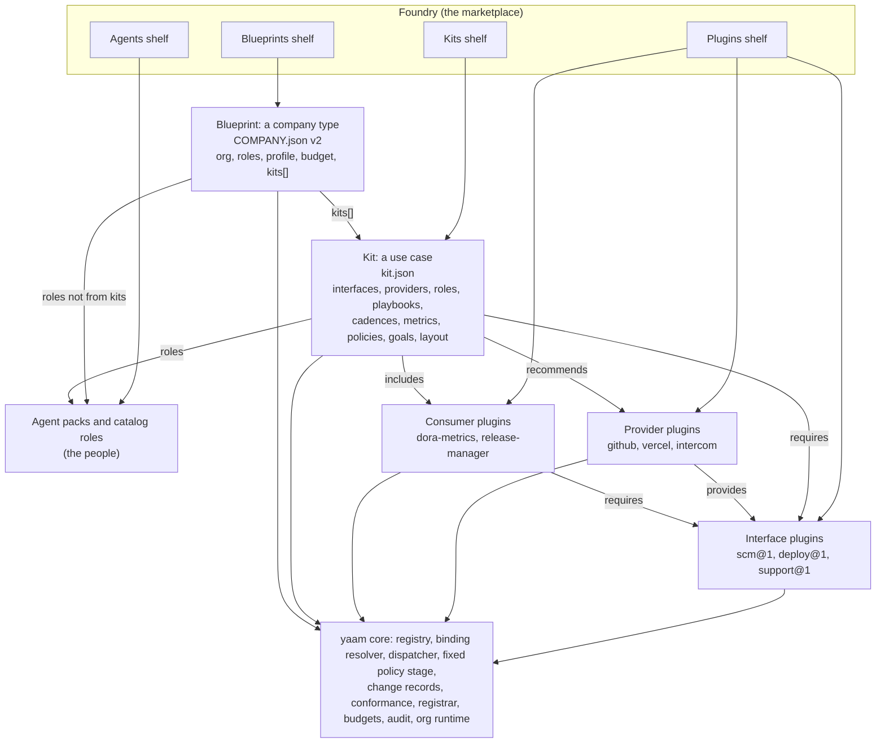
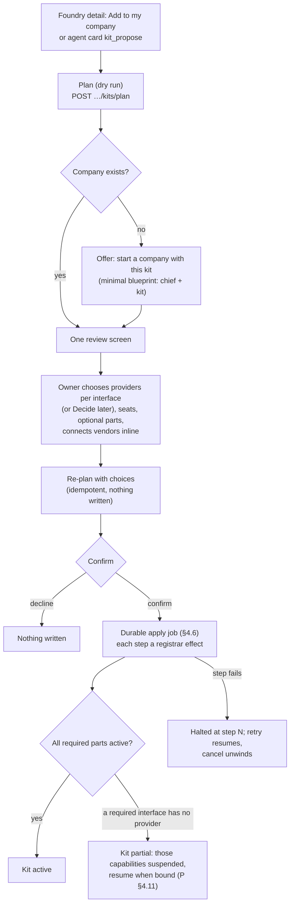

# Foundry: kits, blueprints and the marketplace

Status: **design**, 3 November 2026; **Foundry's shelves shipped** 4
November 2026 (Blueprints, Kits as previews, Agents, Plugins; see
"Shipped as (Foundry shelves)" under §11). Kits are pending: nothing
installs from the Kits shelf yet. It builds on `docs/plugins.md` and
`docs/blueprints.md` (shipped).

Sources:

- **[P §n]** cites a section of `docs/plugins.md`; **[B §n]** of
  `docs/blueprints.md`; **[R: …]** and **[D: …]** the two reports that
  plugins.md cites (*Agent harness plugin architectures* and *DeepSeek
  Harness plugin architecture*, in `reports/` outside the repository).
- Code citations are paths on `main` as of the date above.

The one-line version: **plugins are parts, kits are use cases, blueprints
are company types, and Foundry is where you get all three.**

- A **plugin** is a part: an interface (`scm@1`), a provider (GitHub) or
  a consumer (a pack or a metric set) [P §3.1].
- A **kit** is one use case, ready to run: the interfaces it needs, the
  providers it recommends, the agents who do the work, their playbooks,
  rhythm, metrics and dashboards, the stricter policies it asks for,
  starter goals and the folders it adds. "Ship Software" is a kit.
  "Support Desk" is a kit. A running company can add kits over time.
- A **blueprint** is a company type: today's `COMPANY.json` [B §1], plus
  the kits that company runs and which of their rhythms feed the chief of
  staff's operating system. "SaaS startup" is a blueprint.
- **Foundry** replaces today's Market. It has four shelves: Blueprints,
  Kits, Agents and Plugins.

A kit adds no power that its parts do not already declare. Every class,
egress host, secret and data-sharing line still comes from a plugin
manifest, and every consent is still the owner's. A kit is content and
choices on top of the enforcing core [P §2].

Contents:

1. [Naming and concepts](#1-naming-and-concepts)
2. [The kit manifest, `kit.json`](#2-the-kit-manifest-kitjson)
3. [Blueprint v2](#3-blueprint-v2)
4. [Install](#4-install)
5. [Upgrade, customisation, uninstall](#5-upgrade-customisation-uninstall)
6. [Rating by outcomes](#6-rating-by-outcomes)
7. [Trust](#7-trust)
8. [Foundry UX](#8-foundry-ux)
9. [Registry and data model](#9-registry-and-data-model)
10. [Starter catalog](#10-starter-catalog)
11. [Phased plan](#11-phased-plan)
12. [Open questions for the owner](#12-open-questions-for-the-owner)

## 1. Naming and concepts

### 1.1 The layers



Everything below the core line is declarative. The core is the only thing
that runs, decides or enforces [P §2.1].

### 1.2 Glossary

| Term | What it is | Format | Registry kind | Defined in |
|---|---|---|---|---|
| **Interface plugin** | A capability contract: operations, classes, change kinds, events, metrics | `plugin.json`, role `interface` | `plugin` | [P §3.3] |
| **Provider plugin** | One vendor's implementation of an interface | `plugin.json`, role `provider` | `plugin` | [P §3.3] |
| **Consumer plugin** | Skills, packs, playbooks, metrics written against interfaces | `plugin.json`, role `consumer` | `plugin` | [P §3.6] |
| **Agent pack** | One agent's charter, skills and loops; the people | `packs/*.md` frontmatter, AGENT.json v2 | `agent` | `docs/agent-catalog.md` |
| **Catalog role** | A hireable seat: charter template, scopes, tier, `fits` | `server/src/org/roles/catalog.ts` | none (data) | [B §5] |
| **Playbook** | Instruction text the company's agents follow, as `SKILL.md` | `SKILL.md` | `skill` (standalone) | [B §1] |
| **Kit** | One use case: parts, people, rhythm, measures and guardrails, installable into a company | `kit.json` (`yaam-kit/1`) | `kit` | this document |
| **Blueprint** | One company type: org, profile, budget and the kits it runs | `COMPANY.json` (`yaam-company/2`) | `company` | [B], §3 here |
| **Foundry** | The marketplace: shelves of blueprints, kits, agents and plugins | — | — | §8 here |
| **Shelf** | One department of Foundry | — | — | §8 here |

Three words already in use keep their meaning: a **pack** is an agent, a
**playbook** is instruction text, a **template** is an agent template.
That is why the new types are not called any of those.

### 1.3 Kits replace bundles

`docs/plugins.md` §6.9 defined a **bundle**: an installable set of plugins
with default configuration, under one review, with non-security settings
layered and a resolved-config view. A kit is that, plus people, rhythm and
measures. Two composition units would mean two kinds of layer in the
resolved-config view, two review screens and two uninstall paths for what
an owner sees as one thing ("I added Ship Software").

**Decision: bundles become kits.** There is one composition package, the
kit. A kit that only lists plugins, bindings and settings is exactly the
old bundle. Every rule of §6.9 carries over unchanged and now applies to
kits:

- one review, every consent; nothing is approved implicitly because it
  came in a kit;
- a kit overrides only non-security `settings` of its member plugins,
  whole value per key, no deep merge, no removal;
- security fields are never overridable by any layer;
- bindings a kit proposes apply only when the owner confirms them;
- layers, in order: plugin defaults, then each kit in install order, then
  the owner's workspace overrides; the resolved-config view names the
  layer of every value.

This change edits `docs/plugins.md` in a few places: §6.9 is renamed
"Kits and the resolved-config view", the registry kind `bundle` becomes
`kit`, `plugin_installs.bundleId` becomes `kitInstallId`, the settings
layer `bundle:<id>` becomes `kit:<installId>`, the bundle install endpoint
moves to the kit endpoints in §9 here, and Phase 7b ("Starter bundle")
points to §11 here.

### 1.4 The naming decision

**Recommended: Foundry · Blueprint · Kit · Plugin.** "Foundry, where
companies are forged."

- **Foundry** says what the place is for: making companies, not browsing
  apps. It does not collide with any word in the product.
- **Blueprint** is already shipped (`COMPANY.json`, the Companies tab,
  Settings › Organization › Blueprint). Renaming it would cost more than
  it buys.
- **Kit** is a set of parts with instructions for one job. It is short,
  it reads well in a sentence ("add the Support Desk kit"), and it implies
  composition without implying code. The only use in code is the private
  method `installChiefKit` in `server/src/org/org-bootstrap.service.ts`,
  which installs the chief's pack skills and loops; rename it to
  `installChiefPack` when kits land.
- **Plugin** keeps plugins.md's meaning.

Two alternatives, briefly:

| Scheme | Company type · Use case · Parts | For | Against |
|---|---|---|---|
| **A. Market · Template · Playbook · Plugin** | Template · Playbook · Plugin | The most familiar SaaS words (Notion templates, HubSpot playbooks); no learning | "Playbook" already means a `SKILL.md` instruction text everywhere in yaam, and "template" means an agent template; the shipped Blueprint name would go; "Market" says nothing about companies |
| **B. Exchange · Blueprint · Module · Plugin** | Blueprint · Module · Plugin | Keeps Blueprint; "module" is neutral and composable | "Exchange" suggests trading and prices, and the registry deliberately has no payments (`docs/registry.md` §6); "module" sounds like code, and kits have none; it collides with Nest modules in the codebase vocabulary |

The risk with Foundry is that other products use it (Palantir Foundry,
Azure AI Foundry, Foundry VTT). It is a common noun and the use here is
generic, but a trademark check is open question 1.

## 2. The kit manifest, `kit.json`

### 2.1 Folder convention

```
ship-software/
├── kit.json                 the manifest, the only file the core must read
├── README.md                shown on the Foundry detail page and the review screen
├── CHANGELOG.md
├── icon.svg                 sanitised; rendered as an image, never inline
├── playbooks/<name>.md      SKILL.md files written against interfaces
└── layout/<fn>/…            seed files for folders the kit adds under /org/<fn>/
```

A kit contains no code, no images to pull and nothing that runs at
install, as for plugins [P §1, non-goals]. It is published as a signed
archive with a sha256, like a plugin [P §7.2].

### 2.2 Fields

`format` is `"yaam-kit/1"`. The validator is strict, as
`validateBlueprint` is today: unknown fields are refused, strings are
bounded and checked for invisible unicode, and a misconfigured kit fails
loudly with the field path [P §3.3; D: "A plugin is four exports…"].

**Identity**

| Field | Type | Meaning |
|---|---|---|
| `format` | `"yaam-kit/1"` | The manifest schema version |
| `id` | `name@registry` | Same namespace rules as plugins [P §3.3]: `yaam`, a verified publisher, `community`, `local` |
| `name`, `summary`, `description`, `homepage`, `license` | `string` | Display |
| `version` | semver | The kit's version. The permission diff, not the number, decides consent (§5) |
| `publisher` | `{ id; name; verifiedDomain? }` | Checked by the registry, never trusted from the manifest |
| `segment` | `'business' \| 'personal'` | Which Foundry segment lists it (§8.5) |
| `functions` | `string[]` | Business function ids from `BIZ_FUNCTIONS` (`server/src/market/segments.ts`). The kit may add units and folders only for these |
| `fits` | `string[]` | Profile tags for ranking, like a role's `fits` (`rankRoles` in `server/src/org/roles/catalog.ts`) |
| `companyTypes` | `string[]` | Hints for browsing by company type (`saas`, `agency`, `ecommerce`, …). Never a restriction |

The **tier** is not declared. The registry computes it from the namespace
and signature, then takes the strictest of the kit and its parts (§7.1).

**Parts**

| Field | Type | Meaning |
|---|---|---|
| `requires` | `{ yaamCore: Range; interfaces: string[]; optionalInterfaces?: string[] }` | Interface ranges, written `name@range` as in plugins (`"scm@^1"`). A required interface must have an installed interface plugin and, to be active, a bound provider. An optional one adds features when present |
| `plugins` | `Array<{ id; range; why; optional?: boolean }>` | Consumer plugins the kit includes (metric sets, packs, verify checks). Interface plugins are pulled in by `requires`; providers come from `recommends` and the owner's choice |
| `recommends.providers` | `Record<iface, Array<{ id; range?; why; trial?: boolean }>>` | Per interface, providers in ranked order. The first is preselected; the rest are alternatives. `trial: true` marks a mock provider for trying the kit without a vendor account. A recommendation is never a binding |
| `recommends.cards` | `string[]` | Native connection cards (`docs/integrations.md` §5a) for capabilities that are still core (mail, calendar, files until [P §10] Phase 8). Recommended, never granted, as in blueprints [B §1] |
| `bindings` | `Array<{ interface; scope; provider: '$choice' \| string }>` | Default bindings. `scope` is `{ kind: 'workspace' }`, `{ kind: 'unit', unit: <unit key> }` or `{ kind: 'resource', pattern }` [P §4.2]. `$choice` is the provider the owner picks for that interface in the review. A kit **never replaces an existing binding**: if the scope is already bound, the plan shows "keeps GitLab for scm" and moves on |
| `dependsOn` | `Array<{ kit; range }>` | Other kits this kit builds on. The plan offers to add a missing dependency in the same review (§4.5) |
| `conflicts` | `Array<{ kit; range?; why }>` | Kits that cannot run beside this one. The plan refuses to install both |

**People**

| Field | Type | Meaning |
|---|---|---|
| `units` | `Array<{ key; title; function; parent: '$root' \| <unit key>; lead: <role key> }>` | Units the kit creates, or maps onto existing ones (§4.4) |
| `roles` | `Array<KitRole>` | The seats the kit staffs (below) |

```ts
type KitRole = {
  key: string;                       // "eng-head"; unique in the kit
  role: string;                      // catalog role id, e.g. "engineering-manager" (its packId supplies the pack)
  title: string;                     // "Head of Engineering"; the owner may rename at install
  unit: string;                      // a unit key
  reportsTo: '$chief' | string;      // a role key in this kit, or the chief
  hire: 'required' | 'recommended' | 'optional';   // required: the kit is incomplete without it
  count?: { default: number; min: number; max: number };   // for specialists; max is bounded by fan-out ≤ 5
  modelTier?: 'cheap' | 'standard' | 'strong';     // defaults to the role's tier
  monthlyUsd?: number;               // the envelope; defaults to the role's estMonthlyUsd
  grants: Record<string, 'read' | 'write'>;        // per interface; resolved to the bound provider's connection at hire
  playbooks?: string[];              // kit playbooks this seat carries, beside its pack's own
};
```

Grants are proposals. They become per-agent, per-connection grants
[P §6.4] only when the owner confirms them in the review, and only on the
provider bound at that time. A kit cannot grant a provider's vendor
extras; that stays the owner's separate toggle.

**Rhythm, measures and guardrails**

| Field | Type | Meaning |
|---|---|---|
| `playbooks` | `string[]` | Paths to `SKILL.md` files. Frontmatter may carry `requires` and `tools` (canonical `iface.op` names only). The publish-time lint refuses a playbook that names a tool of an interface the kit does not require, a vendor tool, or an `/org/` path outside the layout |
| `cadences` | `Array<KitCadence>` | Rituals and routines, derived from the profile (§2.3) |
| `metrics` | `Array<{ id; from?: '<plugin>#<metric>'; def?: MetricDef; direction: 'up' \| 'down'; headline?: boolean; unit? }>` | Either a reference to a metric an interface or consumer plugin defines, or an inline `MetricDef` in plugins.md's fixed vocabulary [P §3.3]. No code. `headline` metrics are offered to the scorecard (§3.3) |
| `dashboards` | `Array<{ id; title; unit; tiles: Array<{ metric; show: 'number' \| 'trend' \| 'number+trend'; target?: string }>; placement: Array<'unit' \| 'home'> }>` | Declarative dashboards the core renders on the unit's page and, if the operating system feeds them, on Home |
| `policies` | `Array<{ id; match; require; why }>` | Requested stricter treatment, in plugins.md's shape [P §3.3]: `match` on `operation`, `changeKind` and `bind`; `require` is `two_key`, `cosign`, `owner_key` or `class:<Class>`. Applied only if it raises [P §4.3]. A policy's `match` may not reference a kit setting (a setting could otherwise be edited to make a policy miss) |
| `goals` | `Array<GoalTemplate>` | Starter objectives with key results tied to the kit's metrics; proposed, never set (§2.4) |
| `layout` | `Array<{ path; readme?; seed?: string[] }>` | Folders and seed files under `/org/<fn>/`, `fn` in `functions` (§2.5) |
| `settings` | JSON Schema | **Non-security** settings, validated at save, with defaults. `x-derive` gives profile-derived defaults; `x-tunable` registers a setting as a tunable the chief may tune within bounds (§2.3) |
| `outcomes` | `string[]` | The metric ids the kit is rated on (§6) |

What a kit may **not** contain, by construction: `egress`, `secrets`,
`connections`, `identity`, `dataSharing`, `tools`, `runtime`, `classes`,
or any field that names a vendor host. Those exist only in plugin
manifests and are shown in the kit's review because the review reads the
member plugins. The validator refuses a kit that carries any of them.

### 2.3 Cadences: defaults that derive, never fixed

The owner's rule is that cadences, thresholds and rituals are per-workspace
tunables shaped by the company's values, culture and vision, never fixed
defaults (`docs/company-vision.md` §1b; `docs/chief-of-staff.md` §3). A
kit therefore never declares "weekly". It declares a **base rhythm, the
rules that flex it, and the bounds** it must stay in. The core evaluates
the rules against the profile diagnosis that `diagnoseProfile`
(`server/src/org/chief-os.ts`) already computes, with no model, and writes
the result with the profile line that justified it.

```ts
type KitCadence = {
  id: string;                         // "sprint-planning"
  kind: 'planning' | 'standup' | 'weekly_review' | 'retro' | 'board'   // meeting kinds (MEETING_KINDS)
      | 'routine'                     // a playbook run on a schedule by one seat
      | 'event';                      // a playbook run when an interface event arrives
  unit: string;                       // a unit key
  owner: string;                      // a role key; never the chief (chief-of-staff.md §4, calendar)
  purpose: string; output: string;    // written into /org/calendar.md
  playbook?: string;                  // for routine and event
  rhythm?: { every: '1d' | '1w' | '2w' | '3w' | '4w' | '1mo' | '1q'; days?: 'weekdays' | string[]; time?: string; sameAs?: string };
  trigger?: { event: string; where?: { path: string; in?: unknown[]; equals?: unknown } };   // for event
  enabledWhen?: string;               // a condition (below); absent means on
  flex?: Array<{ when: string; rhythm?: Partial<KitCadence['rhythm']>; enabled?: boolean; why: string }>;
  bounds?: { min: string; max: string };
  preRead?: string[];                 // "dashboard:delivery", "metric:lead_time"
  feedsOperatingSystem?: boolean;     // default true for meeting kinds (§3.3)
};
```

Conditions are a closed vocabulary over the diagnosis and the install:
`stage:early|growth|scale`, `culture:clan|adhocracy|market|hierarchy|balanced`,
`norm:speed|rigour|writing`, `role:<key>` (that seat is filled),
`interface:<name>` (that interface has a bound provider) and
`setting:<key>=<value>`, joined with `and`, `or` and `not`. There are no
expressions, the lesson of dsh's `!!js` config [P §3.2; D: "Profiles,
bundles and whole-value patches compose the running harness"]. The first
matching `flex` rule wins; a result outside `bounds` is clamped and noted,
as blueprint tunables are [B §1].

After install, the cadence belongs to the company. The unit lead or the
chief changes it with `org_set_cadence` (why = the profile line), and the
change is a workspace customisation that an upgrade never overwrites
(§5.1). Kit `settings` marked `x-tunable` register under `kit.<name>.*`
in area `kits` through `registerTunables` (`server/src/org/org-tunables.ts`),
with the schema's minimum and maximum as the bound, so the chief can tune
them like any other threshold. They never parameterise a gate [P §3.3].

A cadence whose `owner` seat is not filled (a `recommended` seat the
owner unticked) falls back to the unit's lead, unless its `enabledWhen`
names that seat. Playbooks are referred to by their file's basename
(`release-train` for `playbooks/release-train.md`).

Two core additions follow from this, both small:

- `org_cadences` gains an interval in weeks (`everyWeeks`, 1–4), because
  cron cannot say "every second Monday" (sprints). `retroGap` in
  `server/src/org/meetings-calendar.ts` already handles one such case.
- The change record emits a bus event per transition (`change.transitioned`
  with `kind`, `state`, `ref`), so metrics can count verified releases and
  rollbacks. [P §4.8] audits every transition already; this asks for the
  event too.

### 2.4 Goals are proposed, never set

The intent cascade starts with the CEO's vision (`docs/company-vision.md`
§2), so a kit cannot create objectives. Its `goals` are templates:

```ts
type GoalTemplate = {
  id: string;
  objective: string;
  for: string;                        // the role key whose planning adopts it
  keyResults: Array<{ text: string; metric: string;
                      target: { default: number; early?: number; growth?: number; scale?: number } }>;
};
```

At install the core writes them, with targets chosen by stage, to a
proposal file, `/org/proposals/<yyyy-mm-dd>-<kit>-goals.md`, and gives
the named head a task: "Adopt or adapt the kit's goals at the next
planning." The head's `<fn>-okr-planning` playbook
(`docs/agent-catalog.md`, "Business catalog") then sets real objectives
under the company's vision, or explains why not.

### 2.5 Layout additions

`layout` adds folders under a function's folder, `/org/<fn>/`, beside the
fixed core (`FUNCTION_LAYOUT` in `server/src/files/layout.ts`: `README.md`,
`cadence.md`, `kpis.md`, `team.md`, `okrs`, `reports`, `audits`,
`processes`). Rules:

- `fn` must be one of the kit's `functions`; no top-level `/org/` paths and
  no names from the fixed core.
- Seed files are written once and never over an existing file, as
  onboarding seeds the ledger (`docs/chief-of-staff.md` §4).
- `layout.ts` gains a registered-additions list, so the existing test
  that checks every `/org/` path a playbook names (`docs/agent-catalog.md`)
  also accepts kit paths, and the Artifacts tree orders them after the
  fixed core.
- On uninstall the files stay (§5.4).

### 2.6 Example: the Ship Software kit

```json
{
  "format": "yaam-kit/1",
  "id": "ship-software@yaam",
  "name": "Ship Software",
  "summary": "Turn tickets into reviewed, tested, deployed and monitored code, with an engineering team and its rhythm.",
  "version": "1.0.0",
  "publisher": { "id": "yaam", "name": "yaam", "verifiedDomain": "yaam.chat" },
  "license": "Apache-2.0",
  "segment": "business",
  "functions": ["engineering"],
  "fits": ["software", "saas", "app", "api", "engineering", "deploy", "developer", "code", "product"],
  "companyTypes": ["saas", "open-source", "agency"],

  "requires": {
    "yaamCore": "^1.0",
    "interfaces": ["scm@^1", "ci@^1", "deploy@^1", "observability@^1"],
    "optionalInterfaces": ["issues@^1"]
  },
  "plugins": [
    { "id": "dora-metrics@yaam", "range": "^1", "why": "The four DORA metrics over scm, deploy and observability events." },
    { "id": "release-manager@yaam", "range": "^1", "why": "Release verify checks and the weekly-release playbook." }
  ],
  "recommends": {
    "providers": {
      "scm": [
        { "id": "github@yaam", "why": "Most common host; also provides ci through GitHub Actions." },
        { "id": "gitlab@yaam", "why": "Self-hosted or GitLab-first teams." },
        { "id": "scm-mock@yaam", "trial": true, "why": "Try the kit without a vendor account." }
      ],
      "ci": [
        { "id": "github@yaam", "why": "GitHub Actions; no extra connection if scm is GitHub." },
        { "id": "buildkite@verified", "why": "Self-hosted build agents." },
        { "id": "ci-mock@yaam", "trial": true, "why": "Fixtures." }
      ],
      "deploy": [
        { "id": "vercel@yaam", "why": "Web front ends and serverless." },
        { "id": "fly@yaam", "why": "Long-running services." },
        { "id": "deploy-mock@yaam", "trial": true, "why": "Fixtures." }
      ],
      "observability": [
        { "id": "sentry@yaam", "why": "Errors and releases." },
        { "id": "datadog@verified", "why": "Metrics, logs and traces." },
        { "id": "observability-mock@yaam", "trial": true, "why": "Fixtures." }
      ],
      "issues": [
        { "id": "linear@yaam", "why": "Fast issue tracking." },
        { "id": "github@yaam", "why": "GitHub Issues, if scm is GitHub." }
      ]
    }
  },
  "bindings": [
    { "interface": "scm", "scope": { "kind": "workspace" }, "provider": "$choice" },
    { "interface": "ci", "scope": { "kind": "workspace" }, "provider": "$choice" },
    { "interface": "deploy", "scope": { "kind": "workspace" }, "provider": "$choice" },
    { "interface": "observability", "scope": { "kind": "workspace" }, "provider": "$choice" },
    { "interface": "issues", "scope": { "kind": "unit", "unit": "engineering" }, "provider": "$choice" }
  ],

  "units": [
    { "key": "engineering", "title": "Engineering", "function": "engineering", "parent": "$root", "lead": "eng-head" }
  ],
  "roles": [
    { "key": "eng-head", "role": "engineering-manager", "title": "Head of Engineering", "unit": "engineering",
      "reportsTo": "$chief", "hire": "required", "modelTier": "strong",
      "grants": { "scm": "write", "ci": "read", "deploy": "read", "observability": "read", "issues": "write" },
      "playbooks": ["sprint-planning", "postmortem"] },
    { "key": "swe", "role": "engineering-software-engineer", "title": "Software Engineer", "unit": "engineering",
      "reportsTo": "eng-head", "hire": "required", "count": { "default": 2, "min": 1, "max": 3 },
      "grants": { "scm": "write", "ci": "read", "issues": "write" },
      "playbooks": ["pr-review"] },
    { "key": "qa", "role": "engineering-qa", "title": "QA Engineer", "unit": "engineering",
      "reportsTo": "eng-head", "hire": "recommended",
      "grants": { "scm": "write", "ci": "read", "issues": "write" },
      "playbooks": ["pr-review"] },
    { "key": "sre", "role": "engineering-sre", "title": "Site Reliability Engineer", "unit": "engineering",
      "reportsTo": "eng-head", "hire": "recommended",
      "grants": { "scm": "read", "ci": "read", "deploy": "write", "observability": "read" },
      "playbooks": ["release-train", "incident-response", "on-call-handoff", "postmortem"] }
  ],

  "playbooks": [
    "playbooks/sprint-planning.md",
    "playbooks/pr-review.md",
    "playbooks/release-train.md",
    "playbooks/incident-response.md",
    "playbooks/postmortem.md",
    "playbooks/on-call-handoff.md"
  ],

  "cadences": [
    { "id": "sprint-planning", "kind": "planning", "unit": "engineering", "owner": "eng-head",
      "purpose": "Pick the sprint goal and commit tasks against the unit's key results.",
      "output": "a sprint goal and committed tasks with owners",
      "rhythm": { "every": "2w", "days": ["mon"], "time": "10:00" },
      "flex": [
        { "when": "norm:speed or culture:adhocracy", "rhythm": { "every": "1w" }, "why": "a speed-valuing team plans in one-week slices" },
        { "when": "culture:hierarchy and not norm:speed", "rhythm": { "every": "3w" }, "why": "a deliberate team plans in longer slices" }
      ],
      "bounds": { "min": "1w", "max": "4w" },
      "preRead": ["dashboard:delivery"] },
    { "id": "standup", "kind": "standup", "unit": "engineering", "owner": "eng-head",
      "purpose": "Done, next, blocked; blocked items get owners.", "output": "one line per member",
      "rhythm": { "every": "1d", "days": "weekdays", "time": "09:30" },
      "enabledWhen": "norm:speed or culture:adhocracy or stage:growth or stage:scale",
      "flex": [ { "when": "stage:early and not norm:speed", "enabled": false, "why": "a small team reads the board instead" } ] },
    { "id": "weekly-review", "kind": "weekly_review", "unit": "engineering", "owner": "eng-head",
      "purpose": "Key-result check-ins and delivery health.", "output": "check-ins, at-risk calls, replans",
      "rhythm": { "every": "1w", "days": ["fri"], "time": "15:00" },
      "flex": [ { "when": "culture:market", "rhythm": { "days": ["wed"] }, "why": "a market culture reviews mid-week" } ],
      "preRead": ["dashboard:delivery"] },
    { "id": "retro", "kind": "retro", "unit": "engineering", "owner": "eng-head",
      "purpose": "What to keep, drop and try; playbook revisions.", "output": "lessons and playbook changes",
      "rhythm": { "sameAs": "sprint-planning", "days": ["fri"], "time": "16:00" },
      "flex": [ { "when": "stage:early and not culture:adhocracy", "enabled": false, "why": "postmortems carry the learning while small" } ] },
    { "id": "release", "kind": "routine", "unit": "engineering", "owner": "sre", "playbook": "release-train",
      "purpose": "Cut, verify and announce a release.", "output": "a verified deploy.release change and notes in /org/engineering/releases/",
      "rhythm": { "every": "1w", "days": ["thu"], "time": "11:00" },
      "enabledWhen": "setting:releaseStyle=train",
      "flex": [ { "when": "culture:hierarchy", "rhythm": { "every": "2w" }, "why": "fewer, larger, reviewed releases" } ],
      "bounds": { "min": "1d", "max": "4w" } },
    { "id": "on-call-handoff", "kind": "routine", "unit": "engineering", "owner": "sre", "playbook": "on-call-handoff",
      "purpose": "Hand over open alerts, incidents and risky changes.", "output": "a handoff note",
      "rhythm": { "every": "1w", "days": ["mon"], "time": "09:00" },
      "enabledWhen": "role:sre" },
    { "id": "incident-review", "kind": "event", "unit": "engineering", "owner": "sre", "playbook": "postmortem",
      "purpose": "A blameless postmortem for every serious incident.", "output": "/org/engineering/postmortems/<date>-<slug>.md",
      "trigger": { "event": "observability.incident.resolved", "where": { "path": "$.severity", "in": ["major", "critical"] } } }
  ],

  "metrics": [
    { "id": "deploy_frequency", "from": "dora-metrics@yaam#deploy_frequency", "direction": "up", "headline": true },
    { "id": "lead_time", "from": "dora-metrics@yaam#lead_time_for_changes", "direction": "down", "headline": true },
    { "id": "change_failure_rate", "from": "dora-metrics@yaam#change_failure_rate", "direction": "down", "headline": true },
    { "id": "time_to_restore", "from": "dora-metrics@yaam#time_to_restore", "direction": "down" },
    { "id": "review_latency", "direction": "down", "unit": "hours",
      "def": { "kind": "duration_between", "of": "scm.pr.opened", "and": "scm.pr.reviewed", "correlateBy": "pr", "window": "7d", "unit": "hours" } },
    { "id": "ci_pass_rate", "direction": "up", "unit": "%",
      "def": { "kind": "ratio", "of": "ci.run.completed", "where": { "path": "$.conclusion", "equals": "success" }, "and": "ci.run.completed", "window": "7d", "unit": "%" } }
  ],
  "dashboards": [
    { "id": "delivery", "title": "Delivery (DORA)", "unit": "engineering", "placement": ["unit", "home"],
      "tiles": [
        { "metric": "deploy_frequency", "show": "number+trend" },
        { "metric": "lead_time", "show": "number+trend" },
        { "metric": "change_failure_rate", "show": "number+trend" },
        { "metric": "time_to_restore", "show": "number+trend" },
        { "metric": "review_latency", "show": "trend" },
        { "metric": "ci_pass_rate", "show": "trend" }
      ] }
  ],
  "outcomes": ["deploy_frequency", "lead_time", "change_failure_rate", "time_to_restore"],

  "policies": [
    { "id": "main-two-key", "match": { "operation": "scm.merge", "bind": { "base": "{{resource.defaultBranch}}" } },
      "require": "two_key", "why": "Merges to the default branch keep two keys even where the owner relaxed change requirements for other repositories." },
    { "id": "prod-release-two-key", "match": { "changeKind": "deploy.release", "bind": { "production": true } },
      "require": "two_key", "why": "Production releases need two keys at every trust level." }
  ],

  "goals": [
    { "id": "ship-reliably", "objective": "Ship small changes often without breaking production", "for": "eng-head",
      "keyResults": [
        { "text": "Deploy to production at least {{target}} times a week", "metric": "deploy_frequency", "target": { "default": 3, "growth": 5, "scale": 10 } },
        { "text": "Keep change failure rate at or below {{target}}%", "metric": "change_failure_rate", "target": { "default": 15 } },
        { "text": "Median lead time for changes under {{target}} hours", "metric": "lead_time", "target": { "default": 48, "growth": 24, "scale": 24 } }
      ] }
  ],

  "layout": [
    { "path": "engineering/adr/", "seed": ["layout/engineering/adr/0000-template.md"] },
    { "path": "engineering/runbooks/", "readme": "layout/engineering/runbooks/README.md" },
    { "path": "engineering/postmortems/", "readme": "layout/engineering/postmortems/README.md" },
    { "path": "engineering/releases/" }
  ],

  "settings": {
    "type": "object",
    "additionalProperties": false,
    "properties": {
      "releaseStyle": { "enum": ["train", "continuous"], "default": "train",
        "x-derive": [ { "when": "norm:speed", "value": "continuous" } ],
        "description": "Train: the release routine ships on a rhythm. Continuous: each verified merge deploys." },
      "postmortemWithinDays": { "type": "integer", "minimum": 1, "maximum": 14, "default": 3,
        "x-derive": [ { "when": "norm:rigour", "value": 2 } ], "x-tunable": true },
      "wipPerEngineer": { "type": "integer", "minimum": 1, "maximum": 5, "default": 2, "x-tunable": true }
    }
  },
  "dependsOn": [],
  "conflicts": []
}
```

Notes on the example:

- The two requested policies matter even though the `scm` floor already
  makes merges two-key [P §5.5]. The owner may relax change requirements
  for experimental repositories ([P §12] Q10); the kit asks that the
  default branch and production releases never be relaxed. If the owner
  has already set something stricter, the review shows "already stricter".
- `deploy@1` is assumed to mark an environment with `production: true` in
  the `deploy.release` change kind's `bind`, so the policy does not depend
  on an environment name a setting could change.
- `dora-metrics@yaam` is the consumer plugin that plugins.md Phase 4
  already plans [P §10]. Its four metrics, in the `MetricDef` vocabulary:
  deploy frequency is a `count` of `change.transitioned` with kind
  `deploy.release` and state `verified`; lead time is `duration_between`
  `scm.pr.merged` and that verified transition, correlated by commit;
  change failure rate is a `ratio` of `rolled_back` to `applied`
  `deploy.release` transitions; time to restore is `duration_between`
  `observability.incident.opened` and `…resolved`.

### 2.7 Example: the Support Desk kit

```json
{
  "format": "yaam-kit/1",
  "id": "support-desk@yaam",
  "name": "Support Desk",
  "summary": "Answer customers fast and well, learn from every ticket, and hand real bugs to engineering.",
  "version": "1.0.0",
  "publisher": { "id": "yaam", "name": "yaam", "verifiedDomain": "yaam.chat" },
  "license": "Apache-2.0",
  "segment": "business",
  "functions": ["customer"],
  "fits": ["support", "customers", "tickets", "helpdesk", "saas", "ecommerce", "service"],
  "companyTypes": ["saas", "ecommerce", "agency", "services"],

  "requires": {
    "yaamCore": "^1.0",
    "interfaces": ["support@^1"],
    "optionalInterfaces": ["issues@^1", "billing@^1"]
  },
  "plugins": [],
  "recommends": {
    "providers": {
      "support": [
        { "id": "intercom@yaam", "why": "Chat-first support with a help centre." },
        { "id": "zendesk@verified", "why": "Email-first ticketing at volume." },
        { "id": "support-mock@yaam", "trial": true, "why": "Fixtures." }
      ],
      "issues": [ { "id": "linear@yaam", "why": "Escalate bugs where engineering already works." } ],
      "billing": [ { "id": "stripe@yaam", "why": "Look up plans; propose refunds." } ]
    }
  },
  "bindings": [
    { "interface": "support", "scope": { "kind": "workspace" }, "provider": "$choice" }
  ],

  "units": [
    { "key": "customer", "title": "Customer Support", "function": "customer", "parent": "$root", "lead": "cs-head" }
  ],
  "roles": [
    { "key": "cs-head", "role": "cs-manager", "title": "Head of Customer", "unit": "customer",
      "reportsTo": "$chief", "hire": "required", "modelTier": "strong",
      "grants": { "support": "write", "issues": "write", "billing": "read" },
      "playbooks": ["queue-review", "macro-review"] },
    { "key": "agent", "role": "cs-support", "title": "Support Specialist", "unit": "customer",
      "reportsTo": "cs-head", "hire": "required", "count": { "default": 2, "min": 1, "max": 4 },
      "grants": { "support": "write", "issues": "write", "billing": "read" },
      "playbooks": ["triage-and-reply", "bug-escalation", "refund-request"] },
    { "key": "onboarding", "role": "cs-onboarding", "title": "Onboarding Specialist", "unit": "customer",
      "reportsTo": "cs-head", "hire": "optional",
      "grants": { "support": "write" } }
  ],

  "playbooks": [
    "playbooks/triage-and-reply.md",
    "playbooks/bug-escalation.md",
    "playbooks/refund-request.md",
    "playbooks/queue-review.md",
    "playbooks/macro-review.md"
  ],

  "cadences": [
    { "id": "queue-review", "kind": "routine", "unit": "customer", "owner": "cs-head", "playbook": "queue-review",
      "purpose": "Rebalance the queue, chase breaches, spot themes.", "output": "a queue note and reassignments",
      "rhythm": { "every": "1d", "days": "weekdays", "time": "09:00" },
      "flex": [ { "when": "culture:hierarchy and not norm:speed", "rhythm": { "every": "1w", "days": ["mon"] }, "why": "a slower queue reviewed weekly" } ],
      "bounds": { "min": "1d", "max": "1w" } },
    { "id": "weekly-review", "kind": "weekly_review", "unit": "customer", "owner": "cs-head",
      "purpose": "Response, resolution and satisfaction against target.", "output": "check-ins and replans",
      "rhythm": { "every": "1w", "days": ["fri"], "time": "14:00" }, "preRead": ["dashboard:support"] },
    { "id": "macro-review", "kind": "routine", "unit": "customer", "owner": "cs-head", "playbook": "macro-review",
      "purpose": "Retire stale macros and help articles; write new ones from repeated questions.", "output": "changes in /org/customer/macros/",
      "rhythm": { "every": "1mo", "time": "10:00" },
      "flex": [ { "when": "norm:speed", "rhythm": { "every": "2w" }, "why": "fast-changing product, faster knowledge" } ] },
    { "id": "escalation-sync", "kind": "routine", "unit": "customer", "owner": "cs-head", "playbook": "bug-escalation",
      "purpose": "Walk escalated bugs with engineering's head.", "output": "statuses on linked issues",
      "rhythm": { "every": "1w", "days": ["tue"], "time": "11:00" },
      "enabledWhen": "interface:issues" }
  ],

  "metrics": [
    { "id": "first_response", "direction": "down", "unit": "minutes", "headline": true,
      "def": { "kind": "duration_between", "of": "support.conversation.opened", "and": "support.conversation.replied", "correlateBy": "conversation", "window": "7d", "unit": "minutes" } },
    { "id": "time_to_resolve", "direction": "down", "unit": "hours",
      "def": { "kind": "duration_between", "of": "support.conversation.opened", "and": "support.conversation.closed", "correlateBy": "conversation", "window": "7d", "unit": "hours" } },
    { "id": "csat", "direction": "up", "unit": "%", "headline": true,
      "def": { "kind": "ratio", "of": "support.rating.received", "where": { "path": "$.positive", "equals": true }, "and": "support.rating.received", "window": "30d", "unit": "%" } },
    { "id": "backlog", "direction": "down", "unit": "conversations",
      "from": "support@yaam#open_conversations" },
    { "id": "reopen_rate", "direction": "down", "unit": "%",
      "def": { "kind": "ratio", "of": "support.conversation.reopened", "and": "support.conversation.closed", "window": "30d", "unit": "%" } }
  ],
  "dashboards": [
    { "id": "support", "title": "Support", "unit": "customer", "placement": ["unit", "home"],
      "tiles": [
        { "metric": "first_response", "show": "number+trend" },
        { "metric": "csat", "show": "number+trend" },
        { "metric": "backlog", "show": "number" },
        { "metric": "time_to_resolve", "show": "trend" },
        { "metric": "reopen_rate", "show": "trend" }
      ] }
  ],
  "outcomes": ["first_response", "csat", "time_to_resolve", "reopen_rate"],

  "policies": [
    { "id": "refunds-two-key", "match": { "operation": "billing.refund" }, "require": "two_key",
      "why": "Every refund needs two keys, at every trust level." },
    { "id": "sensitive-replies-cosign", "match": { "operation": "support.reply", "bind": { "tags": ["legal", "security", "press"] } },
      "require": "cosign", "why": "Replies on legal, security or press conversations need a second reader." }
  ],

  "goals": [
    { "id": "answer-fast", "objective": "Answer every customer fast and solve it the first time", "for": "cs-head",
      "keyResults": [
        { "text": "Median first response under {{target}} minutes", "metric": "first_response", "target": { "default": 60, "growth": 30, "scale": 15 } },
        { "text": "CSAT at or above {{target}}%", "metric": "csat", "target": { "default": 90 } }
      ] }
  ],

  "layout": [
    { "path": "customer/macros/", "readme": "layout/customer/macros/README.md" },
    { "path": "customer/knowledge/" },
    { "path": "customer/escalations/" }
  ],

  "settings": {
    "type": "object",
    "additionalProperties": false,
    "properties": {
      "firstResponseTargetMinutes": { "type": "integer", "minimum": 5, "maximum": 1440, "default": 60,
        "x-derive": [ { "when": "norm:speed", "value": 30 } ], "x-tunable": true },
      "replyTone": { "enum": ["warm", "concise", "formal"], "default": "warm",
        "x-derive": [ { "when": "culture:hierarchy", "value": "formal" }, { "when": "norm:speed", "value": "concise" } ] },
      "draftOnly": { "type": "boolean", "default": true,
        "description": "Specialists draft and a human or the head sends, until the owner turns this off." }
    }
  },
  "dependsOn": [],
  "conflicts": []
}
```

`draftOnly` is a content setting for the playbooks, not a security
control. Whether a reply is sent alone is decided by the class of
`support.reply` and the trust ledger [P §4.3]; `draftOnly` only makes
the playbooks ask for less autonomy than the gate would allow.

## 3. Blueprint v2

### 3.1 The format: `yaam-company/2`

v2 is v1 [B §1] plus kits. Every v1 field keeps its meaning and its
validation; the structural caps (≤ 256 KB, ≤ 20 roles, depth ≤ 3,
fan-out ≤ 5) apply to the **expanded** company, kit roles included.

| Field | New in v2 | What it is |
|---|---|---|
| `format` | changed | `"yaam-company/2"` |
| `name`, `description`, `profile`, `vision`, `tunables`, `routing`, `budget`, `cards`, `origin` | — | As v1 |
| `companyType` | yes | A browse hint (`saas`, `agency`, `ecommerce`, `open-source`, `research`, `creator`, `services`) |
| `fits` | yes | Profile tags, for ranking blueprints like roles |
| `roles[]` | extended | As v1 for roles the blueprint owns (the chief, generalists). A role may instead be `{ fromKit: "<kit id>#<role key>", title?, monthlyUsd?, modelTier?, count? }`: a seat a kit supplies, with the blueprint's overrides |
| `kits[]` | yes | `{ id, range, settings?, providers?, bindings?, roles?, cadences?, skip? }` per kit (below) |
| `operatingSystem` | yes | `{ feeds: Array<{ kit; cadences: string[] \| 'all'; scorecard: string[]; reports: boolean }> }`: which kit rhythms and metrics the chief's operating system takes in (§3.3) |
| `policies` | yes | Requested stricter policies at company level, same shape as a kit's. Raise only |

Per kit in `kits[]`:

| Field | Meaning |
|---|---|
| `id`, `range` | The kit and the version range, `^1` by default |
| `settings` | Overrides of the kit's non-security settings, whole value per key; a layer between the kit's defaults and the workspace's |
| `providers` | `Record<iface, plugin id>`: the provider the blueprint suggests. Still the owner's choice in the review |
| `bindings` | Extra scoped bindings the blueprint suggests (an agency's per-client resource pattern) |
| `roles` | `Record<role key, { count?; title?; hire? }>`: staff overrides (fewer engineers, a renamed head) |
| `cadences` | `Record<cadence id, { enabled?; rhythm? }>`: pinned overrides, which then do not derive. Only what the publisher deliberately pinned travels |
| `skip` | Optional parts not to install: role keys, cadence ids, dashboard ids, goal ids |

An abbreviated example:

```json
{
  "format": "yaam-company/2",
  "name": "Acme Cloud",
  "description": "A two-founder SaaS for scheduling.",
  "companyType": "saas",
  "fits": ["saas", "software", "startup", "b2b"],
  "profile": { "values": "Customers first; ship small and often.", "culture": "Seed-stage, fast, written async updates.", "rules": "No outbound email without a human key." },
  "vision": { "title": "Self-serve to 1,000 paying teams", "description": "…", "horizonDays": 365 },
  "roles": [
    { "roleId": "chief-of-staff", "title": "Chief of Staff", "charter": "…", "reportsTo": null, "scopes": [], "modelTier": "strong", "monthlyUsd": 60 },
    { "fromKit": "ship-software@yaam#eng-head" },
    { "fromKit": "ship-software@yaam#swe", "count": 2 },
    { "fromKit": "support-desk@yaam#cs-head", "title": "Head of Customer" },
    { "fromKit": "support-desk@yaam#agent", "count": 1 },
    { "fromKit": "growth@yaam#growth-head" }
  ],
  "kits": [
    { "id": "ship-software@yaam", "range": "^1",
      "providers": { "scm": "github@yaam", "ci": "github@yaam", "deploy": "vercel@yaam", "observability": "sentry@yaam" },
      "roles": { "qa": { "hire": "optional" }, "sre": { "hire": "optional" } },
      "settings": { "releaseStyle": "continuous" } },
    { "id": "support-desk@yaam", "range": "^1", "providers": { "support": "intercom@yaam" } },
    { "id": "growth@yaam", "range": "^1", "skip": ["ads-review"] }
  ],
  "operatingSystem": {
    "feeds": [
      { "kit": "ship-software@yaam", "cadences": ["weekly-review", "sprint-planning"], "scorecard": ["deploy_frequency", "change_failure_rate"], "reports": true },
      { "kit": "support-desk@yaam", "cadences": ["weekly-review"], "scorecard": ["first_response", "csat"], "reports": true },
      { "kit": "growth@yaam", "cadences": "all", "scorecard": ["activation_rate"], "reports": true }
    ]
  },
  "budget": { "monthlyUsd": 600 },
  "tunables": {},
  "playbooks": [],
  "origin": { "exportedFrom": "yaam-chat", "at": "2026-11-03T00:00:00Z", "sourceOrgId": "0f3a9c2e7b1d4a55" }
}
```

### 3.2 Import and export

- **v1 imports forever.** A v1 document is read as v2 with `kits: []`
  and no `fromKit` roles. Nothing changes for it. The plan adds one
  advisory section, **Kits that fit**: kits whose roles match v1 role ids
  (a v1 blueprint with `engineering-*` roles is offered Ship Software).
  Advisory only; nothing is installed from it.
- **v2 import** runs the v1 plan [B §2] and, for each kit, the kit plan
  (§4). The result is **one combined review**: one screen for the whole
  company, with one section per kit. Supervised mode keeps the one
  `blueprint` approval card for the staffing [B §2]; plugin, binding and
  policy consent happen on the owner's review screen, because only the
  owner may give them [P §6.1].
- **Export produces v2** once the workspace has any kit installed (and v1
  otherwise, so an instance that never adopted kits is unchanged;
  `?format=1` forces v1, dropping kits and keeping their roles inline).
  The export writes:
  - `kits[]`: each installed kit, `^<installed major>`;
  - per kit, only **customisations**: settings that differ from the kit's
    defaults; cadences whose override was pinned (not derived values,
    which re-derive from the importing company's profile); skipped parts;
    staff counts and titles that differ;
  - `providers`: the plugin ids bound per interface at workspace scope,
    as suggestions; never connections, secrets, resource patterns that
    name private repositories, or grants;
  - `roles[]`: `fromKit` references for kit seats, inline roles for the
    rest, as v1;
  - `operatingSystem.feeds` as currently configured.
- Everything v1 leaves out stays out [B §1]: messages, tasks, lessons,
  memory, files, connections, grants, tokens and ids. The test that greps
  the document for planted history extends to kit-installed data
  (a planted postmortem, a metric sample).

### 3.3 Feeding the chief's operating system

The chief owns the company's operating system: the calendar, scorecard,
weekly review and reports (`docs/chief-of-staff.md` §3–§5). A kit adds
unit rhythms and numbers. `operatingSystem.feeds` decides which of them
the chief takes in:

- **Cadences** listed appear in `/org/calendar.md` (all kit cadences do;
  these are also marked as inputs to the weekly review pack).
- **Scorecard** metrics become rows in `/org/scorecard.md`. The scorecard
  keeps 5–15 numbers; if the feeds would exceed 15, the plan says so and
  the chief proposes which to keep.
- **Reports**: the function head's weekly report under
  `/org/<fn>/reports/` is read into the chief's weekly review, as today.
- **Home**: dashboards with `placement: home` show on Home's "Are we on
  track" section only for fed kits (`docs/home.md`).

When a kit is added to a running company without a blueprint, the default
feed is the kit's meeting cadences, its `headline` metrics (at most three)
and its head's reports. The chief may propose changing it, like any
operating-system parameter.

## 4. Install

### 4.1 The flow



### 4.2 The review screen

One screen, sections in this order. It extends the plugin review
(`RegistryReviewModal`, [P §6.1]) and the blueprint plan [B §2]; real
artifacts, not paraphrases (`docs/permissions.md` §4).

1. **Summary.** What the kit does, the publisher and tier (§7), the
   version, what is already in place ("you already have `scm` bound to
   GitHub") and what is new.
2. **Cost.** A monthly estimate: the sum of the new seats' envelopes, the
   members' declared per-call costs at a typical volume, and execution
   environment minutes. Shown as a ceiling, not a forecast, with the
   company envelope and the headroom after. Vendor subscriptions are
   billed by the vendor and are named, not estimated. If the envelope
   cannot fit the new allocations, the screen says how much more is needed
   and offers fewer seats.
3. **Capabilities.** For each interface: whether it is already installed;
   every operation with its effective class, reversibility, `outbound` and
   `movesMoney`; change kinds and their requirements; which operations are
   two-key, and why (floor, interface, kit policy, owner policy). For a
   new interface plugin, its full classification review [P §6.1].
4. **Providers.** Per interface, a picker: the ranked recommendations, the
   alternatives the registry lists for that interface, any provider the
   workspace already has, and **Decide later**. For the selected provider:
   tier, conformance result, connections and scope tiers, egress hosts,
   secret slots, `dataSharing` by category, `identity` lines, extras, and a
   **Connect** button that runs the connection flow inline. Under the
   pickers, one consolidated **Data leaves to** list: every destination
   host by category, across all chosen providers [P §5.7].
5. **Policies.** Each requested policy, with "applies" or "already
   stricter".
6. **People.** Units (new, or mapped onto an existing unit), then each
   seat: role, title (editable), reports to, model tier and model,
   envelope, the grants it will get on the chosen providers, its playbooks.
   `required` seats are ticked and fixed; `recommended` ticked; `optional`
   unticked. Counts are steppers within `min`–`max`. A seat an existing
   member already fills says "uses your Head of Engineering (Ada)".
   Depth, fan-out and the agent cap are checked live.
7. **Rhythm.** Each cadence with its derived value **and the profile line
   that set it** ("weekly, because the profile says 'ship fast'"), the
   bounds, and an off switch for optional ones. Metrics (registered as
   metric sources, activated here because the owner is the CEO
   [`docs/sensing.md` §1.6]), dashboards, goal templates with stage
   targets, layout additions.
8. **Playbooks.** The full text of every playbook. **Approve these
   playbooks now** is ticked by default for first-party and verified kits
   and unticked for community and local ones; unticked, they install as
   drafts behind the Skills approval, as blueprint playbooks do [B §2].
   A playbook the scan flags is always a draft.
9. **Settings.** The kit's settings with derived defaults, validated as
   typed.

Nothing on the screen is approved implicitly; confirm writes exactly what
the screen showed. The plan is re-validated at confirm (a member plugin
updated or revoked in between sends the owner back to the screen).

### 4.3 Decide later and partial installs

**Decide later** leaves an interface unbound. The kit installs and the
interface's capabilities are **suspended, not failed**: the tools are
hidden from agents, the playbooks that need them skip with a note,
metrics over its events show "no provider", and cadences whose
`enabledWhen` names it stay off [P §4.11]. The kit shows
`partial: no deploy provider bound`. Binding a provider later, from the
kit's page or Settings › Interfaces, resumes everything by itself. Trial
providers are the other way to start without a vendor: a kit on mocks is
fully active, and the review labels it **Trial**.

What the owner can leave out, and what happens:

| Part | Can be left out? | Effect |
|---|---|---|
| A required interface's plugin | No | The kit does not install |
| A required interface's provider | Yes (**Decide later**) | Suspended, as above |
| An optional interface | Yes | Its features never appear; cadences with `enabledWhen: interface:x` stay off |
| A member consumer plugin | Only if `optional` | Its metrics and checks are absent |
| A `required` seat | No | — |
| A `recommended` or `optional` seat | Yes | Its playbooks still install (for a later hire); cadences with `enabledWhen: role:x` stay off |
| A requested policy | No | Policies only raise ([P §12] Q1 asks whether plugins' may be declined; kits follow that answer) |
| Cadences, dashboards, goals, layout | Yes, each | Recorded in `kit_installs.omitted`; an upgrade does not bring them back |

### 4.4 Adding a kit to a running company

- **Units.** A kit unit maps onto an existing unit of the same
  `function` when there is exactly one; the plan shows the mapping and lets
  the owner pick another unit or create a new one.
- **Seats.** A kit seat whose catalog role is already held by a member of
  the mapped unit is **filled by that member**: no hire, and the kit's
  playbooks for the seat are added to that member (approved in the review
  or as drafts). A head from a different role in the same function (a
  Head of Engineering hired as a generic `engineer` role) is offered as
  the filler, not assumed.
- **Hires** go through `OrgApprovalsService.applyHire` with
  `templateOrPack: "role:<id>"`, in reporting order, with scopes met with
  the chief's holdings [B §5]. Because the owner confirms them on the
  review screen, they are owner-origin hires in both modes; supervised
  mode does not need a second card. An agent cannot install a kit (§4.7).
- **Rituals** of the root unit are not touched. Kit cadences live on the
  kit's units.
- **Existing bindings, policies and cadences** are never replaced. Where
  the company already has a cadence of the same kind on the unit (a
  weekly review), the kit's is merged into it: the pre-reads are added and
  the existing timing kept.

### 4.5 Dependencies and conflicts

- A missing `dependsOn` kit is added to the same review as its own
  section ("Open-Source Maintainer needs Ship Software"). The owner may
  confirm both or neither.
- A `conflicts` match refuses the plan with the reason.
- Two kits that recommend different providers for one interface never
  conflict: there is one binding per scope, and the second kit's review
  shows the existing binding ("keeps GitHub").
- Two kits that set the same member plugin setting are layered in install
  order; the second kit's review shows the conflict and which value wins
  [P §6.9].

### 4.6 Apply: through the registrar, durable, idempotent

Apply is one durable job [P §4.9] with an idempotency key per step,
`kit:<installId>:<step>:<ref>`. Each step is a registrar effect owned by
the kit install [P §4.10], so uninstall is the generic reverse unwind.
Order:

1. **Plugins.** Install new member plugins with the diffs approved on the
   screen. A plugin already installed (by the owner or another kit) is
   **referenced**, not reinstalled; `kit_members.owned = false`.
2. **Providers.** Activate chosen providers whose connections are made;
   run conformance [P §4.4]. A provider still waiting on a connection is
   left `ready`, and its interface is suspended.
3. **Bindings.** Write the kit's bindings for unbound scopes only.
4. **Policies.** Write the requested policies, raise-only.
5. **Units.** Create or map.
6. **Seats.** Hire, in reporting order; record grants as **pending** until
   the provider is active, then apply them.
7. **Playbooks.** Approved or drafts, per the review.
8. **Cadences.** Derived values written with `org_set_cadence`'s path,
   audited with the profile line; event cadences register loop triggers.
9. **Metrics and dashboards.** Metric sources (active if the owner
   activated them on the screen), aggregator definitions, dashboard
   placements, scorecard rows per the feed.
10. **Tunables and settings.** `registerTunables` for `x-tunable`
    settings; the kit's settings layer.
11. **Layout.** Folders and seed files, never over existing files.
12. **Goals.** The proposal file and the head's adoption task.
13. **Notice.** One inbox notice to the owner; a line to the chief.

If a step fails, the job halts and the kit shows "installed through step
6 of 13: hiring QA failed (agent cap)". **Retry** resumes from the failed
step; **Cancel** unwinds the effects written so far. Re-running an install
of the same kit version is a no-op that says "already installed"; a
different version is an upgrade (§5).

### 4.7 Who may install

Only the workspace owner, as for plugins [P §6.1]. Agents propose:
`kit_propose { id, why }` (free; it writes a proposal) opens a
`kit_install` card that, when opened, is the review screen. The chief's
heartbeat may propose a kit when the profile and the gaps suggest one
(§8.4). The boundary gains a `kit` family row, verdict `propose`, not
delegable; proposing a community kit is allowed, installing one stays the
owner's.

## 5. Upgrade, customisation, uninstall

### 5.1 Three values per item

Every item a kit installs has a stable key: a role key, a cadence id, a
playbook name, a setting key, a metric id, a dashboard id, a binding's
interface and scope, a policy id, a layout path. For each key the core
keeps three values in `kit_overrides`:

- **base**: what the installed kit version defaulted (for a derived
  cadence, the rule, not the result);
- **ours**: what the workspace has now;
- **theirs**: what the new kit version defaults.

The merge, per key:

| Case | Result |
|---|---|
| ours = base (not customised) | Take theirs |
| theirs = base (the kit did not change it) | Keep ours |
| Both changed | **Keep ours**; the update review shows "the kit now suggests X" with a one-click accept |
| The item was omitted at install | Stays omitted |
| A derived cadence, not pinned | Re-derive with the new rule |
| A cadence the chief or owner changed | That is a customisation: keep ours |

Playbook text follows plugins.md: the approved text keeps running and
the new text arrives as a draft, unless the owner approves it in the
update review [P §6.5].

### 5.2 What applies by itself and what needs the owner

The kit diff is computed like the plugin permission diff [P §6.5], over
the kit and every member plugin's own diff:

| Change in the new kit version | Needs the owner (`kit_update` card) | Applies by itself, between turns |
|---|---|---|
| Interfaces | A required or optional interface added | One removed (major only) |
| Member plugins | A plugin added; any member's widening diff | A member's non-widening update |
| Recommended providers | — | Any change (recommendations bind nothing) |
| Bindings | Any new binding | — |
| Seats | A seat added, a `count.default` raised, an envelope or tier raised, a grant added or raised | A seat made optional, an envelope lowered |
| Policies | A requested policy removed or weakened | Added or strengthened |
| Cadences, dashboards, metrics, layout | A new metric source (it polls); a new event cadence (it acts on events) | Uncustomised rhythm changes, dashboard and layout changes |
| Goals | — | Template changes (they are proposals) |
| Playbooks | Text changed (drafted) | — |
| Settings | A new setting whose default changes behaviour | Defaults for uncustomised keys |

Widening updates wait as a `kit_update` card while the installed version
keeps running, the rule plugins and Forge use [P §6.5]. Hot reload
applies per item, between turns, never mid-turn.

### 5.3 Pinning and rollback

- **Pin.** `kit_installs.pin` is `major` (default: non-widening updates
  within the major apply), `minor`, or `exact` (every update is a card).
  A new major is always a card, with its migration notes. Member plugins
  keep their own pins [P §7.2]; a kit update proposes member updates,
  which pass through each member's diff.
- **Revisions.** Each applied kit update writes a `kit_revisions` row with
  the previous version, the diff and the effects it added.
- **Rollback** re-applies the previous version's defaults through the
  same three-way merge (so customisations survive) and unwinds the
  effects the newer version added, in reverse. Two exceptions: **seats**
  hired by the newer version are not terminated by a rollback (the
  review offers to pause them), and **metric history** is kept. Rollback
  is owner-only and audited.

### 5.4 Uninstall

Uninstall shows a plan first, then unwinds the kit's effects in reverse
order through the registrar [P §4.10]:

| Item | On uninstall |
|---|---|
| Cadences and event triggers | Disabled; minutes and history kept |
| Metric sources and aggregator definitions | Stopped; samples kept; scorecard rows marked "source removed" |
| Dashboards | Unmounted |
| Playbooks | Archived, never deleted |
| Tunables | Unregistered; values kept for a reinstall |
| Kit settings layer | Removed; the resolved-config view shows the next layer |
| Requested policies | Removed, **unless** the owner ticks "keep as my policy", which turns each into an owner policy (`interface_policies`) |
| Bindings the kit wrote | Kept by default (other things may use them); untick to remove, and dependants suspend |
| Member plugins | Removed only if `owned` and no other kit or owner install references them. Providers with live connections default to **keep**; consumer plugins default to remove |
| Seats | **Never removed automatically.** Each hired member is listed with keep (default), pause, or terminate (through the boundary, `org_terminate_agent`) |
| Units | Kept while they have members |
| Layout folders and files | Kept; each folder's README gains a "kit removed" line |
| Goals | Kept; they are the company's now |

**Data and artifacts stay.** Removing a kit removes its machinery, not
the company's record of what it did.

**A kit another kit depends on** cannot be uninstalled alone. The plan
lists the dependants and offers: remove them too, or cancel. (Suspending
the dependants instead is possible with the same mechanism as a missing
provider, but it leaves a half-working company; it is open question 9.)

## 6. Rating by outcomes

A kit is rated the way blueprints are: by what the companies that ran it
measured, not by stars [B §4]. The difference is that a kit carries its
own measures.

- **What is measured.** The kit's `outcomes` metrics, from the core's
  aggregator over provider events. Baseline: the median over days 1–14
  after the kit became active. Readings at day 30 and day 90: the median
  over the preceding 14 days.
- **What is reported.** Per outcome metric, a bucket: `improved`
  (beyond 10% in the metric's `direction`), `flat`, or `worse`; plus
  `active_90_days` (still installed and not partial at day 90). No values,
  no units, no company data. For Ship Software, DORA's four; for Support
  Desk, first response, CSAT, resolution and reopen rate.
- **Blueprints** keep their two milestones [B §4] and add the outcome
  buckets of their kits, rolled up.
- **Privacy.** Measurements are stamped on the local `kit_outcomes` row
  and audited always. They reach the registry only when the app setting
  **`shareKitOutcomes`** is on (default off), as `shareBlueprintOutcomes`
  works today: anonymous, kind and bucket only, no back-reporting of
  readings taken before sharing was on. Foundry shows a kit's outcome
  summary only once at least 10 installs have reported, so one company's
  result is never recognisable.
- **Anti-gaming.**
  - Only events from **signed webhooks or reconciled reads** of a
    conformant, non-mock provider count. A kit on trial providers reports
    nothing.
  - Agent-written numbers (a playbook's report) never feed outcomes.
  - One report per milestone per install, bound to a per-install receipt
    the registry issues when it counts the install (`/installed` returns
    it). An outcome post without a valid, unused receipt is dropped.
  - Installs younger than the milestone, or with too little activity to
    measure (fewer than N events, a per-metric floor in the kit's
    interface metric definition), are excluded.
  - Foundry shows outcomes; it does not **sort** by them or by installs,
    the registry's rule against install farming (`docs/registry.md` §6).
    Whether a viewer may choose to sort by outcomes is open question 4.

## 7. Trust

### 7.1 A kit's tier is its weakest part

The listing tier of a kit is the strictest (least trusted) of:

- the kit's own publisher tier;
- every **required** interface plugin and member consumer plugin;
- the **preselected** provider for each required interface.

The review recomputes it from the owner's actual choices: choosing a
community provider makes that install Community-tier, badged as such.
A blueprint's tier is the strictest of its kits and its own. The badge
says which part set it ("Verified — set by buildkite@verified").

The plugin tiers and what each may do are plugins.md's [P §7.1]; kits add
nothing to them, because a kit has no code, no egress and no security
fields (§2.2). A kit with only first-party parts and no recommended
providers outside the first party carries the **no-egress** badge only if
its preselected providers have none (mocks); otherwise it shows the
egress hosts of its preselected providers.

### 7.2 Who publishes

| Tier | Kits | Blueprints | Rules |
|---|---|---|---|
| First party `@yaam` | Yes | Yes | The starter catalog (§10) |
| Verified `@<publisher>` | Yes | Yes | Signed by the publisher's key bound to a verified domain [P §7.1] |
| Community `@community` | Yes | Yes (as today, kind `company`) | Registry scan and human review. May require only first-party or verified interfaces unless the owner opted in to community interfaces [P §5.1]. May recommend any listed provider; the tier follows the choice |
| Local `@local` | Developer mode only | Yes (file import, as today) | Unsigned; the review is the same; only the loading workspace |

### 7.3 Review at publish

The registry runs, before a kit is listed:

- the strict validator (§2.2), including the refusal of security fields;
- the playbook lint: tools only from required or optional interfaces,
  `iface.op` names that exist in the declared ranges, `/org/` paths in the
  layout;
- `scanSkillMd` over every playbook and the README, as for blueprints
  [B §3];
- resolution: every referenced plugin and catalog role exists; seats
  respect depth ≤ 3 and fan-out ≤ 5 at their maximum counts; cadence
  conditions parse; every metric's events exist in the interfaces;
- a dry-run install against mock providers for every required interface
  that has one (a kit that cannot become active on mocks is refused for
  the first-party and verified tiers).

Signing follows plugins.md's decision when [P §12] Q9 is answered;
kits and blueprints use the same mechanism and keys as plugins. Revoke
works as for plugins [P §6.8]: a revoked kit version freezes its kit-level
effects (cadences, metrics, policies stay, because policies only raise)
and opens a card; members are revoked or not on their own.

## 8. Foundry UX

### 8.1 Shelves

Foundry replaces the Market section (`src/components/MarketView.tsx`).
Its rail has four shelves and a Personal | Business switch at the top
that applies across them:

| Shelf | Holds | Today |
|---|---|---|
| **Blueprints** | Company types (`company` kind), Business segment only | The Companies tab |
| **Kits** | Use cases, by function or company type | New; replaces plugins.md's bundles |
| **Agents** | Packs and catalog roles: the people. Personal by category, Business by function, exactly as today's segments (`docs/agent-catalog.md`, "Segments and functions") | The Agents tab |
| **Plugins** | Interfaces, providers and consumers; standalone skills and mini apps as a "Skills & apps" filter | The Connectors tab, plus skills and apps from Community |

The Community tab dissolves into the shelves: community items appear in
their shelf with the tier badge, and a **Tier** filter (First party,
Verified, Community, Local) sits on every shelf. **Publish** moves to the
Foundry header ("Publish a blueprint, kit, agent or skill") and keeps the
existing preview-the-scan-first flow (`src/components/RegistryBits.tsx`).

### 8.2 Browsing and search

- **By company type** (Blueprints shelf, and a filter on Kits): SaaS,
  Agency, E-commerce, Open source, Research, Creator, Services.
- **By function** (Kits and Agents): the `BIZ_FUNCTIONS` rail with each
  function's icon and colour (`src/lib/market.ts`). A function page shows
  its kits first ("Ship Software — a team, its rhythm and DORA"), then the
  head and specialists as today.
- **By interface** (Plugins): each interface page lists its providers
  with conformance results per version, and the kits that require it.
- **Search** spans every shelf; each result carries a shelf badge and a
  segment badge, as search spans both segments today.
- Deep links: `?section=foundry&shelf=kits&fn=engineering`,
  `?section=foundry&shelf=blueprints&type=saas`,
  `?section=foundry&shelf=plugins&iface=scm`. `?section=market…` links
  redirect, mapping `segment`, `fn` and `cat` unchanged.

### 8.3 Detail pages

Every blueprint and kit page has the same five blocks, so an owner can
compare them:

1. **What you get.** Seats (with their roles and reporting lines), the
   rhythm (each cadence with its default and how it flexes), dashboards
   with a sample rendering, playbook titles, goals, folders.
2. **What it costs.** The monthly ceiling from §4.2, as a range from the
   minimum to the default staffing, with the vendor subscriptions named.
3. **What it can touch.** Interfaces with their operations grouped by
   class; the two-key operations; per recommended provider, its egress
   hosts and data-sharing categories; requested policies.
4. **Outcomes.** The outcome buckets (§6), or "not enough reports yet".
5. **Compatibility.** Core range; required and optional interfaces, each
   marked **you have it** / **bound to X** / **missing**; providers you
   already have that qualify; depends-on and conflicts; what it would
   change in *this* workspace (from a plan call, when a workspace is in
   context).

Plus version history with the changelog, publisher, tier and signature.

The primary action is **Add to my company** (a kit) or **Start a company
from this** (a blueprint); with no company, a kit page offers **Start a
company with this kit**, which builds a minimal blueprint (the chief and
the kit) through the same import.

### 8.4 Recommendations

A **For your company** row on the Kits and Blueprints shelves ranks items
against the workspace profile with `rankKits`, the same pure string match
as `rankRoles` over `fits` (`server/src/org/roles/catalog.ts`), plus two
gap signals:

- a function in the profile or the vision with no unit;
- an interface already bound that no installed kit uses ("you connected
  Stripe; the Revenue kit puts it to work").

The score's matched words are shown ("matches: saas, deploy"), as the
Hire dialog shows role matches. The chief may also propose a kit through
`kit_propose` when its weekly review finds the same gaps; the card links
to the review screen.

### 8.5 Personal

**Decision: the Personal segment continues, and personal kits exist.** A
person running their own life or practice is the audience the agent
catalog was built for (`docs/agent-catalog.md` §2), and life projects have
the same shape as a use case: people, rhythm and things to track. A
personal kit is a `yaam-kit/1` with `segment: "personal"` and these
differences:

- no units, no `reportsTo` chain, no goals feeding an intent tree; seats
  are standalone agents;
- cadences may only be `routine` and `event`, and install as the agents'
  loops (off until the person turns them on, as registry loops are);
- interfaces are optional; until mail, calendar and files become
  interfaces ([P §10] Phase 8) a personal kit uses `recommends.cards` for
  the native connections;
- it installs into any workspace, company or not.

Examples: **Trip Planning** (Trip Planner, Life Admin; itinerary and
packing mini apps; a countdown loop), **Job Hunt** (Job Hunt Coach;
application kanban; follow-up loop), **Exam Term** (Study Buddy; flashcards
app; revision loop), **Household** (Family Organizer, Money Mate, Meal
Planner). Personal kits ship after the business kits (§11, F5).
Blueprints stay Business-only: a person is not a company.

### 8.6 From today's Market

| Today | Foundry |
|---|---|
| Market › Agents, Personal | Agents shelf, Personal (unchanged) |
| Market › Agents, Business by function | Agents shelf, Business (unchanged), plus each function page's kits |
| Market › Connectors (`connectors.catalog.ts`) | Plugins shelf: native connections listed as **Built in** until [P §10] Phase 8, then as first-party providers |
| Market › Community (`registry_items`: agent, skill, app) | Agents shelf (agents), Plugins shelf › Skills & apps (skills, apps), with the Community tier badge |
| Market › Companies (`company` kind) | Blueprints shelf |
| Settings › Market (`REGISTRY_URL`, publish token) | Settings › Foundry |
| `?section=market` | `?section=foundry` (redirect) |
| — | Kits shelf; Foundry › **Installed** (the workspace's kits, each with status, updates, inventory and resolved config) |

## 9. Registry and data model

### 9.1 Registry kinds

`registry_items.kind` becomes `agent` · `skill` · `app` · `company` ·
`plugin` · `kit` (plugins.md's `bundle` is not added). The capability
summary for a kit carries `kit { interfaces, optionalInterfaces, plugins,
providers (recommended, per interface), seats, monthlyUsdRange, cadences,
metrics, policies, playbooks, functions, tier }`; for a company, today's
`company { … }` gains `kits` and `format`.

### 9.2 Tables

All tables get `accountId` from `ensureAccountColumns`; workspace-scoped
tables carry `workspaceId`.

| Table | Main columns | Notes |
|---|---|---|
| `kits` | `id` (`name@registry`), `name`, `publisherId`, `segment`, `functions`, `registryItemId` | One row per kit identity |
| `kit_versions` | `id`, `kitId`, `version`, `manifest`, `manifestHash`, `archiveSha256`, `signature`, `coreRange`, `scanReport`, `lintReport`, `revokedAt`, `revokeReason` | Immutable |
| `kit_installs` | `id`, `workspaceId`, `orgId`, `kitId`, `versionId`, `pendingVersionId`, `pin` (`major`·`minor`·`exact`), `status` (`planned`·`applying`·`active`·`partial`·`update_pending`·`disabled`·`frozen`·`removing`·`removed`), `statusReason`, `choices` (providers, counts, titles), `omitted`, `feed`, `jobId`, `installedBy`, `blueprintImportId`, `createdAt`, `activatedAt` | Unique on (`workspaceId`, `kitId`) |
| `kit_members` | `id`, `installId`, `memberKind` (`plugin`·`binding`·`policy`·`unit`·`seat`·`playbook`·`cadence`·`metric`·`dashboard`·`tunable`·`layout`·`goal`), `itemKey`, `ref`, `required`, `owned`, `state` | What the kit brought or reused; `owned = false` for reused parts. Feeds the reference counts in §5.4 |
| `kit_overrides` | `id`, `installId`, `itemKey`, `base`, `value`, `pinned`, `setBy`, `setAt` | The three-way merge's base and ours (§5.1) |
| `kit_revisions` | `id`, `installId`, `fromVersionId`, `toVersionId`, `diff`, `approvedBy`, `appliedAt`, `rolledBackAt` | Rollback (§5.3) |
| `kit_outcomes` | `id`, `installId`, `metric`, `baseline`, `day30`, `day90`, `bucket30`, `bucket90`, `sharedAt` | Local always; shared per §6 |

Changes to tables plugins.md proposes (not built yet, so these are edits
to its migration, not new ones):

- `plugin_installs.bundleId` → `kitInstallId`;
- `plugin_settings_layers.layer` uses `kit:<installId>`;
- `bundles` is dropped in favour of `kits` above;
- `plugin_effects` gains `ownerKind` (`plugin`·`kit`) and `ownerId`, so the
  registrar records kit-level effects (cadences, seats, playbooks) in the
  same inventory.

Changes to shipped tables:

- `org_blueprint_imports` gains `format` (1 or 2) and `kits` (JSON).
- `registry_outcomes.kind` accepts `kit:<metric>:<day>:<bucket>` and
  `kit:active_90_days`.
- `org_approvals.kind` accepts `kit_install` and `kit_update`.
- `org_cadences` gains `everyWeeks` and `kitInstallId` (nullable).
- `org_metric_sources` gains `kitInstallId` (nullable).

### 9.3 Endpoints

Owner-only unless noted. `:ws` is the workspace id.

| Method and path | What |
|---|---|
| `GET /api/foundry?shelf=&segment=&fn=&type=&iface=&tier=&q=` | The shelves, local and remote (members may read) |
| `GET /api/foundry/recommendations?workspaceId=` | `rankKits` and blueprint ranking with matched words and gap signals |
| `GET /api/foundry/kits/:id` · `GET /api/foundry/blueprints/:id` | Detail: manifest, capability summary, outcomes, versions |
| `POST /api/workspaces/:ws/kits/plan { source, choices? }` | The dry run (§4): the review model, nothing written |
| `POST /api/workspaces/:ws/kits/install { source, choices, confirm }` | Confirm; starts the apply job |
| `GET /api/workspaces/:ws/kits` · `GET …/kits/:installId` | Installs; detail with members, overrides, the effects inventory and the job state (members may read) |
| `POST …/kits/:installId/retry` · `POST …/kits/:installId/cancel` | A halted apply (§4.6) |
| `PATCH …/kits/:installId/settings` | Non-security settings (validated) |
| `PUT …/kits/:installId/pin { pin }` | Pinning |
| `PATCH …/kits/:installId/feed` | What feeds the operating system (§3.3) |
| `GET …/kits/:installId/updates` · `POST …/updates/:versionId { approve, resolutions }` | Updates with per-item conflict resolutions |
| `POST …/kits/:installId/rollback { revisionId }` | Rollback |
| `POST …/kits/:installId/uninstall/plan` · `DELETE …/kits/:installId { keep }` | Uninstall plan, then uninstall with the owner's keep choices |
| `POST /api/workspaces/:ws/kits/dev { path }` | Developer mode: load a folder as `name@local` |
| `POST /api/registry/publish { kind: 'kit', archive \| path }` | Publish a kit (the existing publish route gains the kind) |
| `GET /api/workspaces/:ws/org/blueprint?format=1\|2` | Export; v2 by default once kits are installed |
| `POST …/org/blueprint/plan` · `…/import` · `POST /api/market/companies/:id/install` | Accept v1 and v2 unchanged in shape; the plan gains the per-kit sections |
| `POST /api/registry/public/:id/outcome { kind, receipt }` | Public; outcome with the per-install receipt (§6) |

Agent tools: `kit_propose { id, why }` (free; proposal only) and
`kit_status` (read). The bundle endpoint plugins.md listed
(`POST …/bundles/install`) is replaced by the kit endpoints.

### 9.4 Migrations, sketched

Following `server/src/database/migrator.ts` (idempotent, `information_schema`
checks, ids in array order, same tables in `schema.ts`). plugins.md
proposes `0053`–`0056`; these follow, and the plugins migration `0054`
should create `kitInstallId` and the `plugin_effects` owner columns
directly, since none of it is built.

- `0057-kits`: `kits`, `kit_versions`, `kit_installs`, `kit_members`,
  `kit_overrides`, `kit_revisions`; `org_cadences.everyWeeks` and
  `kitInstallId`; `org_metric_sources.kitInstallId`.
- `0058-blueprint-v2`: `org_blueprint_imports.format` (default 1) and
  `kits`; the registry kind list.
- `0059-kit-outcomes`: `kit_outcomes`; `registry_outcomes` kinds.

Each ships with a PGlite suite that runs it twice (`tests/helpers.ts`).

## 10. Starter catalog

### 10.1 Kits

Interfaces in *italics* are optional. Roles are catalog role ids
(`server/src/org/roles/catalog.ts`); the head is listed first. Cadences
are defaults before profile flex. Interfaces marked † do not exist in
plugins.md yet (§10.3).

| Kit | Interfaces | Recommended providers | Seats | Cadences | Outcome metrics |
|---|---|---|---|---|---|
| **Ship Software** | scm, ci, deploy, observability, *issues* | GitHub, GitLab; Actions, Buildkite; Vercel, Fly; Sentry, Datadog; Linear | `engineering-manager`, `engineering-software-engineer` ×2, `engineering-qa`, `engineering-sre` | sprint planning (2w), standup, weekly review, retro, release train, on-call handoff, incident review (event) | DORA: deploy frequency, lead time, change failure rate, time to restore |
| **Support Desk** | support, *issues*, *billing* | Intercom, Zendesk; Linear; Stripe | `cs-manager`, `cs-support` ×2, *`cs-onboarding`* | queue review (daily), weekly review, macro review (monthly), escalation sync | first response, CSAT, time to resolve, reopen rate |
| **Revenue** | crm†, billing, *analytics* | HubSpot, Salesforce, Attio; Stripe, Paddle | `sales-manager`, `sales-account-executive`, `sales-sdr`, `revops-analyst` | pipeline review, forecast call, deal desk (event), weekly review | new ARR, pipeline created, win rate, forecast accuracy, net revenue retention |
| **Growth** | analytics, marketing†, *ads†*, *cms†* | PostHog, Amplitude; Customer.io, Loops; Google Ads, Meta; Webflow | `marketing-manager`, `marketing-demand-gen`, `marketing-seo`, *`data-bi-analyst`* | growth meeting (weekly), experiment review, campaign calendar | activation rate, signup conversion, experiment velocity, week-4 retention |
| **Compliance (SOC 2)** | compliance†, idp†, *scm*, *observability* | Vanta, Drata; Okta, Google Workspace | `it-security-manager`, `it-security-grc`, Auditor pack | control check (monthly), access review (quarterly), vendor review (quarterly), policy review (yearly) | controls passing, evidence freshness, finding age, access reviews on time |
| **Content Studio** | cms†, *social†*, *analytics* | Ghost, WordPress, Webflow; Buffer; PostHog | `marketing-content` (as editor-in-chief), `writer-editor`, `design-brand`, *`marketing-seo`* | editorial planning (weekly), publish routine, performance review (monthly) | pieces published on time, traffic per piece, subscriber growth |
| **Client Delivery** | issues, timesheets†, accounting†, *scm*, *files* | Linear, Jira; Harvest, Toggl; QuickBooks, Xero | `project-lead`, `ops-program-coordinator`, `finance-billing`, specialists by client work | client status (weekly per project), delivery review, invoicing (monthly) | milestones on time, budget burn vs scope, utilisation, days to invoice |
| **Commerce Ops** | commerce†, support, *fulfillment†*, *accounting†* | Shopify, WooCommerce; Intercom; ShipStation; QuickBooks | `ops-manager`, `ops-procurement`, `cs-support` | orders check (daily), inventory review (weekly), P&L review (monthly) | fulfilment time, stockout days, refund rate, order defect rate |
| **Research** | literature†, *files*, *execution environments* | OpenAlex, Semantic Scholar, arXiv | `researcher` (lead), `analyst`, `data-scientist`, `writer-editor` | seminar (derived; daily for a lab), weekly review, quarterly agenda | predictions reconciled, calibration (Brier), drafts to submission |
| **Hiring** | ats†, *mail*, *calendar* (cards until Phase 8) | Ashby, Greenhouse, Lever | `people-manager`, `people-recruiter` | pipeline review (weekly), debrief (event: interview completed) | time to hire, stage conversion, offer acceptance, candidate response time |
| **Finance Close** | accounting†, banking† (read-only), *billing* | QuickBooks, Xero; Mercury, Plaid | `finance-manager`, `finance-accountant`, *`finance-fpa`* | month-end close (monthly window), cash review (weekly), budget vs actuals (quarterly) | days to close, reconciliation rate, forecast accuracy |
| **Open-Source Maintainer** | depends on Ship Software; issues, packages†, *forum†* | GitHub; npm, PyPI, crates.io; Discourse, Discord | `engineering-software-engineer` (triager), `writer-editor` (docs, changelog), *`project-lead`* (community) | issue triage (daily), release (derived), community call (monthly), security advisory (event) | time to first response on issues and PRs, outside-contributor PR merge time, release cadence |

Requested policies, by kit: Ship Software (merge to main and production
release two-key); Support Desk (refunds two-key, sensitive replies
cosign); Revenue (`billing.price_change` two-key, contract send owner
key); Growth (campaign send to more than a threshold of recipients
cosign, ad spend changes two-key); Compliance (`idp.grant_admin` two-key,
`compliance.mark_passing` cosign); Content Studio (`cms.publish` cosign);
Client Delivery (`accounting.send_invoice` cosign); Commerce Ops
(`commerce.refund` and `commerce.set_price` two-key); Hiring
(`ats.send_offer` owner key, `ats.reject` cosign); Finance Close
(`accounting.post_journal` cosign, and every `banking` write refused by
class: the kit requires the read-only operations only); Open-Source
Maintainer (`packages.publish` two-key).

### 10.2 Blueprints

| Blueprint | Kits | Seats (incl. chief) | Profile defaults | Feeds the operating system | Starting envelope |
|---|---|---|---|---|---|
| **SaaS startup** | Ship Software, Support Desk, Growth; *Revenue*, *Finance Close* | 9 | early; adhocracy; speed | sprint planning, weekly reviews; scorecard: deploy frequency, change failure rate, first response, CSAT, activation | $600 |
| **Agency** | Client Delivery, Content Studio; *Ship Software*, *Finance Close* | 8 | growth; market | client status, delivery review; scorecard: milestones on time, utilisation, days to invoice | $500 |
| **E-commerce shop** | Commerce Ops, Support Desk, Growth, Finance Close | 10 | early; market; speed | orders check, weekly reviews; scorecard: fulfilment time, refund rate, CSAT, activation | $550 |
| **Open-source project** | Open-Source Maintainer (with Ship Software); *Content Studio* | 6 | early; clan; writing | triage, release; scorecard: first response on issues, contributor PR merge time | $250 |
| **Research lab** | Research; *Content Studio*, *Hiring* | 6 | early; adhocracy; rigour | seminar, weekly review; scorecard: predictions reconciled, calibration | $400 |
| **Solo creator** | Content Studio, Growth (lite settings), Finance Close (cash basis) | 5 | early; clan | editorial planning; scorecard: on-time pieces, subscriber growth | $150 |
| **Professional services firm** | Client Delivery, Hiring, Finance Close; *Compliance*, *Revenue* | 11 | growth; hierarchy; rigour | client status, close; scorecard: utilisation, days to close, time to hire | $700 |

**Shipped as v1 (4 November 2026).** The seven starters now ship as
first-party `yaam-company/1` blueprints, listed first and badged *Official*
in Market → Companies (`docs/blueprints.md` §3a): the seats above at their
default staffing (optional kits unticked), roles drawn from the catalog,
the envelope above, the root's rituals and the tunables derived from each
profile, unit rhythms after the kits' defaults, no playbooks. Kits, and so
`companyType`, `fits`, `kits[]` and `operatingSystem.feeds`, come later with
v2 (§3); the starters will gain them then.

Envelopes are starting points; the import asks for the owner's, as today
[B §2]. Each blueprint stays within 20 seats, depth 3 and fan-out 5 at its
default staffing; optional kits are unticked in the plan.

### 10.3 Interfaces the catalog implies

plugins.md defines or plans `scm`, `ci`, `deploy`, `observability`,
`issues`, `billing`, `support`, `analytics`, and later `mail`, `calendar`
and `files`. The catalog needs these as well; each is a first-party
interface plugin, pure declaration, written when its first kit is
scheduled:

| Interface | Domain | First kit | Notes |
|---|---|---|---|
| `crm@1` | Contacts, companies, deals, stages | Revenue | Deal stage changes are internal-class; contract send is outbound |
| `marketing@1` | Audiences, campaigns, sends | Growth | `send` is outbound to many; `classByInput` on recipient count |
| `ads@1` | Campaigns, budgets, spend | Growth | Budget changes `movesMoney` |
| `cms@1` | Drafts, publish, unpublish | Content Studio | `publish` is outbound and costly to reverse |
| `social@1` | Posts, schedules | Content Studio | |
| `compliance@1` | Controls, evidence, findings | Compliance | |
| `idp@1` | Users, groups, admin grants | Compliance | `grant_admin` is irreversible-class by the floor |
| `timesheets@1` | Time entries, projects | Client Delivery | |
| `accounting@1` | Ledger, journals, invoices, bills | Client Delivery, Finance Close | `send_invoice` outbound; `post_journal` costly |
| `banking@1` | Accounts, transactions (read); payments | Finance Close | Payments `money`; the kit requires reads only |
| `commerce@1` | Products, orders, inventory, refunds, prices | Commerce Ops | `refund`, `set_price` `movesMoney` |
| `fulfillment@1` | Shipments, labels | Commerce Ops | Labels cost money |
| `ats@1` | Jobs, candidates, stages, offers | Hiring | A new data-sharing category, `personal_data`, may be needed beside `customer_pii` [P §5.7] |
| `literature@1` | Search, fetch metadata and abstracts | Research | Read-only; public sources |
| `packages@1` | Publish, yank, versions | Open-Source Maintainer | `publish` irreversible |
| `forum@1` | Threads, replies, moderation | Open-Source Maintainer | |

Whether verified publishers may author any of these instead of yaam is
plugins.md's open question 12.

## 11. Phased plan

Kits need the interface mechanism, so Foundry's phases follow
plugins.md's [P §10]. Each phase ships with its tests
(`tests/backend-kits-*.test.ts`, `web-tests/foundry*.test.ts`) and
updates this document's status.

### F1: the kit mechanism, Ship Software on mocks (with plugins Phase 2)

Needs plugins Phase 1 (registry, resolver, dispatcher, conformance,
registrar, change records, `jobs`). Replaces "bundles" in plugins Phase 2.

Build:

- `yaam-kit/1`, its strict validator and the playbook lint;
- the plan, the review screen and the apply job (§4) through the
  registrar; `kit_installs`, `kit_members`, `kit_overrides`;
- cadence derivation for kits (§2.3) on `diagnoseProfile`; `everyWeeks`;
  the `change.transitioned` event;
- kit metrics and declarative dashboards; scorecard feeding (§3.3);
- goals as proposals; layout additions in `layout.ts`;
- uninstall (§5.4); `kit_propose`; the `kit` boundary row;
- the first-party interface plugins `deploy@yaam`, `observability@yaam`
  and `issues@yaam` (declarations only, pulled forward from plugins
  Phases 2 and 4) and mock providers `ci-mock`, `deploy-mock`,
  `observability-mock` beside `scm-mock`;
- `dora-metrics@yaam` and `release-manager@yaam` consumer plugins;
- the **Ship Software** kit, on mocks.

Acceptance:

- In a company with a chief, installing Ship Software on mock providers
  shows one review screen with every interface operation and class, the
  two requested policies ("applies"), four seats with a monthly estimate,
  and each cadence with the profile line that set it. Confirm creates the
  Engineering unit and three hires (QA unticked), binds the four mocks,
  writes the policies, and the kit is `active`.
- The same install with a speed-valuing profile plans sprints weekly and
  ships continuous releases; with a hierarchy profile, every three weeks
  and fortnightly releases. No cadence value is a literal in the kit.
- With **Decide later** for `deploy`, the kit is `partial`, `deploy_*`
  tools are hidden, the release routine is off, and binding
  `deploy-mock` later makes it `active` with no other action.
- A mock ticket walks to a merged PR and a verified `deploy.release`; the
  Delivery dashboard shows one deploy, and lead time is measured.
- Merging to the default branch needs two keys even with an owner policy
  that relaxed `scm.pull_request` for that repository.
- Installing the kit twice is a no-op; a failed hire halts the job,
  retry resumes it, and cancel leaves no effect behind (a test over every
  registry).
- Adding the kit to a company that already has a Head of Engineering
  reuses that member and hires no second head.
- Uninstall disables the cadences, stops the metrics with history kept,
  archives the playbooks, leaves `/org/engineering/postmortems/` in
  place, and terminates no agent.
- A kit carrying `egress` or a vendor tool in a playbook is refused by the
  validator and the lint.

### F2: Foundry and blueprint v2

Build:

- the Foundry section: four shelves, the tier filter, search, detail
  pages, recommendations (`rankKits`), deep-link redirects; Settings ›
  Foundry; Foundry › Installed;
- `yaam-company/2`: import (with v1 read as v2), export, the combined
  review; `operatingSystem.feeds`;
- the **SaaS startup** blueprint on mock providers; the **Support Desk**
  kit with `support@yaam` and `support-mock@yaam`.

Acceptance:

- Every item reachable in today's Market is reachable in Foundry, and
  every `?section=market` link lands on the equivalent view.
- A v1 blueprint imports exactly as before, with an advisory "Kits that
  fit" section.
- Importing SaaS startup into an empty workspace shows one review for the
  company and both kits; supervised mode creates one `blueprint` card and
  no agent until it is approved.
- Exporting that company gives `yaam-company/2` with the kits and only
  the customisations made after import; re-importing it elsewhere
  re-derives cadences from the new profile.
- The scorecard holds the fed metrics, no more than 15 rows.
- For a SaaS profile, Ship Software and Support Desk rank first, with the
  matched words shown.

### Shipped as (Foundry shelves)

Built on 4 November 2026 with the plugin registry (`docs/plugins.md`,
"Shipped as (plugin registry)"). Code: `src/components/MarketView.tsx`
(the section, shelf tabs, Blueprints and Agents), `src/components/FoundryBits.tsx`
(the Plugins shelf, the plugin detail page, the Kits shelf),
`src/lib/foundry.ts`, the shelf state and links in `src/lib/market.ts`,
the shelf list in the rail (`Rails.tsx` `MarketRail`), `server/src/foundry/`
(`GET /api/foundry`, `GET /api/foundry/kits`). Tests:
`web-tests/foundry.test.tsx`, `tests/backend-plugin-registry.test.ts`.

**Built.**

- **Foundry replaces the Market** in the nav and the section header. The
  section id stays `market` internally; `?section=foundry` and every
  `?section=market…` link open it (`segment`, `fn`, `cat` unchanged; the
  old departments map: `shelf=companies` → Blueprints, `shelf=connectors`
  → Plugins › Connectors, `shelf=community` → Agents › Community). Links
  are written as `?section=foundry&shelf=…&iface=…&tier=…&plugin=…`.
- **Blueprints**: the Companies department, re-housed intact
  (`CompaniesDept`, `/api/market/companies`), so published and built-in
  starter blueprints list as before.
- **Kits**: the notice "Kits are coming — bundles of interfaces, providers
  and roles for a use case" and the twelve kits of §10.1 as previews
  (interfaces, providers, seats, cadences, metrics), each marked Coming
  soon with a disabled install button; the rail's functions filter them.
- **Agents**: the curated catalog with Personal | Business exactly as
  before, plus **Community** (registry agents with the Community tier).
- **Plugins**: a parts list from the plugin registry — tier badge, role,
  the interfaces each package defines, provides or requires, conformance,
  egress, install state, recall and update flags — with filters for kind
  (Interfaces, Providers, Consumers, **Connectors**, **Skills & apps**),
  interface and tier, and search. Connectors keep the existing connect
  cards as a filter; community skills and mini apps sit under Skills &
  apps. The **detail page** shows what the package defines and provides
  (every operation with the class yaam treats it as, the declared class
  when a floor raised it, a class strip), what it requires, egress hosts,
  data sharing, secret slots, requested policies, conformance per
  interface version, versions with digest, source pin, changelog and
  recalls, and the publisher. **Install** opens the Phase 1 review screen
  (classification, diff, blockers) with the community opt-in when the
  tier is Community, then installs; an installed package links to
  Settings › Plugins, and a frozen one shows the recall notice there and
  here.
- **Settings › Plugins** gains the recall notice, the versions an install
  can move to with their permission diff, and "Load your own plugin" (a
  folder upload as `name@local`).

**Not yet.** Kits themselves (F1), Foundry › Installed, recommendations
(`rankKits`), the company-type filter on Blueprints, Publish in the
Foundry header (publishing is the API above for plugins, and the existing
buttons for agents, skills, apps and companies), Settings › Foundry (the
Market pane is relabelled).

### F3: upgrades, customisation, rating

Build: the three-way merge, the kit diff and `kit_update` cards, pins,
revisions and rollback; `kit_outcomes`, `shareKitOutcomes`, receipts and
the 10-install threshold.

Acceptance:

- A kit update that changes an uncustomised cadence rule applies between
  turns; one where the chief had changed the cadence keeps the chief's and
  shows the suggestion; one that adds a seat waits as a card while the
  old version runs.
- Rollback restores the previous defaults, keeps customisations and
  terminates no one.
- With sharing off, nothing reaches the registry; with it on, only
  buckets do, never before sharing was on, never from mock providers, and
  a replayed outcome post is dropped.

### F4: real providers

Ship Software against `github@yaam` (plugins Phase 3) and Vercel or Fly
and Sentry (plugins Phase 4); Support Desk, Revenue and Growth with
plugins Phase 5 and the `crm` and `marketing` interfaces; verified and
community kit publishing with the review in §7.3.

Acceptance: the F1 loop passes unchanged against GitHub, Vercel and
Sentry — no change to the kit, its playbooks or its metrics. A community
kit that recommends a community provider is badged Community on the
detail page and in the review.

### F5: breadth

The remaining kits as their interfaces land (§10.3); the remaining
blueprints; personal kits after plugins Phase 8 (mail, calendar, files);
**Extract a kit** from a running company's unit (the inverse of install,
with the same publish review).

## 12. Open questions for the owner

1. **The name.** Foundry is recommended (§1.4). Palantir, Microsoft (Azure
   AI Foundry) and Foundry VTT use the word. Accept it after a trademark
   check, or pick an alternative?
2. **Playbook approval at install.** Approve kit playbooks on the review
   screen (proposed: ticked for first-party and verified kits), or always
   install them as drafts as blueprint import does?
3. **Default staffing.** Should `recommended` seats be ticked by default
   (proposed), or should the review start from the minimum and let the
   owner add?
4. **Sorting by outcomes.** The registry never ranks by installs. May a
   viewer choose to sort by outcome buckets, or are outcomes shown only?
5. **Personal kits** (§8.5). Confirm that personal kits exist and ship
   after the business kits, and that blueprints stay Business-only.
6. **Uninstall defaults.** Keep providers with live connections and the
   bindings a kit wrote (proposed), or remove everything the kit owned?
7. **Rotations.** On-call is modelled as a weekly handoff routine and
   event cadences. Should the core gain a rotation primitive (who is on
   call, escalation order), or is that content for the SRE's playbooks?
8. **Cross-function kits.** Revenue spans sales, revops and finance
   seats. One unit per function (proposed: the kit declares several units)
   or one "Revenue" unit?
9. **Removing a kit others depend on.** Refuse unless dependants go too
   (proposed), or allow it and suspend the dependants?
10. **Paid kits.** The registry has no payments (`docs/registry.md` §6).
    Verified publishers may want to sell kits. Keep the stance?
11. **Blueprint providers.** May a blueprint preselect a provider for the
    owner (proposed: preselected, still the owner's choice), or only list
    it?
12. **New interfaces.** Sixteen interfaces in §10.3 are implied. All
    first-party (pending plugins.md Q12), and written only when their
    first kit is scheduled (proposed)?
13. **Outcome threshold.** Ten reporting installs before a kit's outcomes
    show (proposed). Higher, given small numbers early on?
