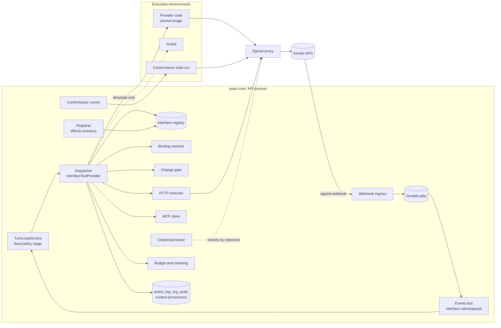
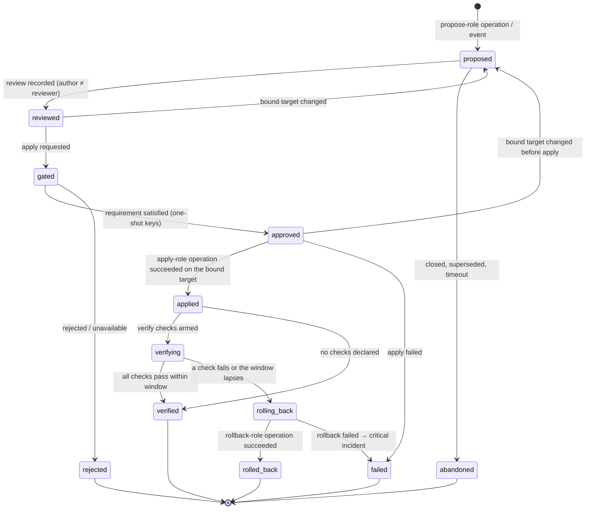
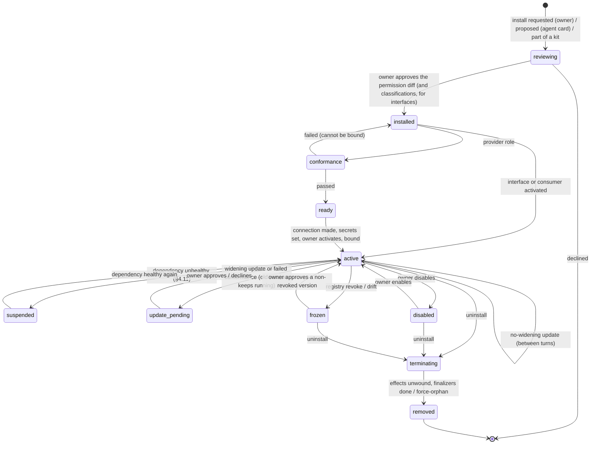

# Plugins: interfaces, providers and consumers on an enforcing core

Status: **Phase 1 shipped**, 3 November 2026 (see "Shipped as (Phase 1)"
under §10). Later phases are design.

Sources:

- **[R: …]** cites a section of the report *Agent harness plugin
  architectures* (`reports/Agent harness plugin architectures.md` in the
  project folder, outside the repository; notes in
  `research_notes/Agent harness plugin architectures/`).
- **[D: …]** cites a section of the report *DeepSeek Harness plugin
  architecture* (`reports/DeepSeek Harness plugin architecture.md`; notes
  in `research_notes/DeepSeek Harness plugin architecture/`).
- Code citations are paths on `main` as of the date above.

The one-line version: **plugins declare, core decides.** Plugins come in
three roles:

- an **interface** plugin declares a capability contract such as `scm@1`;
- a **provider** plugin implements that contract for one vendor;
- a **consumer** (agents, packs, playbooks, other plugins) calls the
  contract, never the vendor.

The core is vendor-agnostic and domain-agnostic. It knows nothing about
merges or deploys. It provides the mechanism:

- the interface registry, binding resolver, dispatcher and conformance
  runner;
- generic change records;
- the policy engine, budgets, credentials and audit.

No plugin ever contributes an "allow". An owner who installs a GitHub or
Stripe plugin can see, before anything runs, exactly what agents could do
with it and how each operation is classed. No later update can widen
that, or lower a class, without the owner seeing a diff.

**What changed after the dsh research and the owner's review.**

- **Interfaces are plugins** (§2.3, §3). The owner decided that
  capability contracts (`scm`, `ci`, `deploy`, `observability`, `issues`,
  `billing`, `analytics`, `support`) are not defined in core. They are
  interface plugins, as dsh's `forge` package defines the service that
  `forge-github` provides [D: "A plugin is four exports, and overriding
  means replacing a row"]. Agents, skills, packs and change records
  target `scm.merge`, not `github_merge_pr`, so GitHub and GitLab are a
  swap.
- **The core gained a generic mechanism for them** (§4.2–§4.4): a
  registry, a binding resolver with scoped defaults, a dispatcher and a
  conformance runner. The class rule is now the maximum of core floors,
  the interface's class, the provider's class and owner policy. A provider
  can only raise. Interface plugins are a higher trust tier (§5.1).
- **A core registrar with reversible effects** (§4.10). Every
  contribution records its inverse, so disable and uninstall unwind
  generically, and "what did this plugin add" is a query.
- **Dependency-driven activation** (§4.11). A broken connection or a
  missing provider hides tools and suspends the install, which resumes by
  itself.
- **An approval vocabulary aligned with dsh's closed outcome set**, with
  an asked/decided audit pair (§4.3).
- **Model-visible means logged** (§5.6), **data-sharing rules** (§5.7)
  and an explicit **budget stage** (§4.3).
- **Kits (formerly bundles) with a resolved-config view** (§6.9), and **hot reload
  between turns, per contribution** (§6.5).
- **No services between plugins**, and **policy is never a plugin**
  (§3.1, §4.3).
- **Packaging for company types and use cases** (kits, blueprint v2,
  the Foundry marketplace) is designed in `docs/foundry.md`.
- §11 holds the copy/adapt/avoid table. Open questions the research
  answered are marked resolved in §12.

Contents:

1. [Purpose, scope, non-goals](#1-purpose-scope-non-goals)
2. [Who owns what: core, plugin, agent](#2-who-owns-what-core-plugin-agent)
3. [Plugin anatomy](#3-plugin-anatomy)
4. [Runtime model](#4-runtime-model)
5. [Security model](#5-security-model)
6. [Lifecycle](#6-lifecycle)
7. [Distribution and trust](#7-distribution-and-trust)
8. [Data model and APIs](#8-data-model-and-apis)
9. [How existing features map](#9-how-existing-features-map)
10. [Phased plan](#10-phased-plan)
11. [Lessons from DeepSeek Harness](#11-lessons-from-deepseek-harness)
12. [Open questions for the owner](#12-open-questions-for-the-owner)

## 1. Purpose, scope, non-goals

**Purpose.** yaam-chat is becoming a company that runs itself
(`docs/company-vision.md`). A software or SaaS company needs its agents to
work in systems yaam does not own: a git host, CI, build machines, a deploy
platform, error tracking, billing, support and CRM. Each of those is a
vendor surface that changes on the vendor's schedule. Each also belongs to
a domain (source control, deployment, billing) whose shape yaam should not
hardcode either.

This document defines how such surfaces enter yaam: as plugins, packaged
so that the core's existing gates apply to them without exception
(`docs/permissions.md`, `docs/actions-and-trust.md`, `docs/boundary.md`).

**Scope.**

- The three plugin roles, the folder layout and the manifest,
  `plugin.json` (§3).
- How interfaces are registered, bound, dispatched and checked for
  conformance, and how tools, events, metrics and change records reach the
  turn loop and the org runtime (§4).
- The threat model, including malicious interfaces (§5).
- Install, configure, conformance, bind, grant, update, disable, suspend,
  uninstall, recall and kits (§6).
- Tiers, pinning and versioning (§7), tables and endpoints (§8), the
  mapping from today's features (§9), and a phased plan with acceptance
  criteria (§10).
- The core primitives that plugins need and the core does not have yet:
  - the **interface mechanism**: registry, binding resolver, dispatcher,
    conformance runner;
  - the **registrar** of reversible effects;
  - the generic **change record**;
  - the **execution-environment interface**, with an egress and secret
    policy;
  - **durable execution**;
  - **taint**.

**Non-goals.**

- **Rebuilding vendors.** yaam does not become a git host, CI system,
  deploy platform, error tracker or payment processor.
- **Domain knowledge in core.** The core never hardcodes "merge",
  "deploy" or "refund". Those words live in interface plugins.
- **In-process third-party code.** No plugin code is loaded into the API
  process: no `require()`, no dynamic import, no hooks running with the
  server's privileges. dsh runs vendor code in-process, and the research
  found nothing between plugins but a Proxy that any plugin can bypass
  [D: "Cordis is the only kernel, and even the agent loop is a YAML row"].
- **Plugin-supplied policy that relaxes.** No hook, guard, annotation,
  interface or manifest field can return `allow`, lower a class below the
  core floors, skip the reviewer or remember an approval [R: "Some
  contributions are excluded outright"].
- **Policy as a plugin.** In dsh the approval policy is a removable row
  and the pipeline's default is `allow`, so removing the policy plugin
  silently removes the policy [D: "The tool pipeline defaults to allow and
  fails closed only per call"]. In yaam the gate chain is a fixed core
  stage that denies by default (§4.3).
- **Install-time execution and config as code.** No install scripts, no
  `!!js`-style expressions in config, nothing runs at install (§6.1).
- **Breadth.** yaam will not compete on connector count
  (`docs/registry.md`, `docs/integrations.md` §3c).
- **Payments in the registry** (`docs/registry.md` §6).

## 2. Who owns what: core, plugin, agent

### 2.1 The split

| | **yaam core** (the company's kernel) | **Plugins** | **Agents** (the work) |
|---|---|---|---|
| What it is | First-party, reviewed code in this repository, free of domain knowledge | Declarative packages in three roles: **interface** (a contract), **provider** (a vendor implementation), **consumer** (skills, packs, metrics written against interfaces) | Durable agents with charters, memory and tools (`server/src/agents/`) |
| Owns | Identity, workspaces, permissions; the **interface mechanism** (registry, bindings, dispatcher, conformance runner); action classes, generic class floors, gates, two-key, reviewer, trust ledger; owner policies on operations; budgets and metering; audit and auditor; tasks and keys; WorkspaceFs; the events bus and follows; incidents and sensing pipes; approvals; durable execution; execution environments, egress and secrets; the generic change record; the registrar | Interface: operations, schemas, classes, change kinds, events, metric definitions, default skills, the conformance suite. Provider: the mapping of each operation to a vendor API, vendor webhooks, vendor extras, cleanup. Consumer: playbooks, role packs and metrics that `require` interfaces | Judgment and content: code, reviews, triage, ADRs, plans, replies, postmortems, rituals |
| May | Decide, refuse, raise, hold, freeze, recall, bind | Declare, implement, request | Propose (including a plugin or a binding), act inside its grants |
| May never | Run third-party code in-process; hardcode a domain | Contribute an `allow`; lower a class below a floor; see a raw secret; run at install; reach an undeclared host; call another plugin directly | Install, update, bind or grant a plugin; widen its own grants |
| Changes when | yaam ships a release | The domain's contract evolves (interface) or the vendor's API changes (provider) | Every turn |

### 2.2 The decision test

Ask four questions in order, and stop at the first yes:

1. **Must it hold whatever the domain, the agent or the plugin?** Then it
   is **core**.
   - "An operation whose change kind is irreversible needs two keys by
     default."
   - "No token leaves the broker."
   - "Every call is logged and metered."
2. **Is it the shape of a domain that several vendors share?** Then it is
   an **interface plugin**.
   - "A pull request has a head SHA and a base."
   - "Merge applies a `pull_request` change and is irreversible."
3. **Is it specific to one vendor and swappable?** Then it is a
   **provider plugin**.
   - GitHub's merge endpoint, its webhook signature scheme.
4. **Is it judgment or content?** Then it is **agent** work.
   - Whether a PR is good, what the postmortem says.

Any guarantee that would require trusting a provider belongs to the core
or to the interface. GitHub branch protection is useful defence in depth.
"Merge needs two keys" is enforced by the core's change gate (§4.8),
driven by the interface's declaration that `scm.merge` applies an
irreversible change kind.

### 2.3 Why interfaces are plugins

The first draft of this document defined `scm`, `ci`, `deploy` and the
rest in core. The owner rejected that: the core stays vendor-agnostic
**and** domain-agnostic, and provides only the mechanism for pluggable
interfaces. dsh does the same. Its `forge` package is itself a plugin that
defines the service, and `forge-github` provides it. dsh describes a
capability seam as three roles together, "a Service Definition, a Service
Provider and a Consumer", and "one role alone is not a seam" [D: "A plugin
is four exports, and overriding means replacing a row"].

The consequences:

- **New domains need no core release.** HR, legal or logistics can be
  added as interface plugins.
- **Contracts version on their own clock**, not the core's.
- **An interface is pure declaration**, so it can be reviewed like a
  schema.

The cost is that an interface plugin now carries security-relevant
declarations, the class of each operation. §5.1 is the answer: interfaces
are a higher trust tier, the core's generic floors bound what they can
declare, and the owner consents to every classification.

### 2.4 Where each gap of an autonomous software company lands

| Gap | Core (generic) | Interface plugins | Provider plugins | Agent |
|---|---|---|---|---|
| **Git** | Change records with the apply gate; short-lived scoped credentials; repo checkouts in execution environments | `scm@1`: repos, branches, PRs, reviews, merge, revert; the `pull_request` change kind | `github@yaam`, `gitlab@yaam` | Code, PR descriptions, reviews |
| **Build environments** | The execution-environment interface (§4.5): lifecycle, caps, egress proxy, secret injection, sync-back through WorkspaceFs. The local driver comes from `server/src/harness/harness-workdir.ts` and `server/src/runner/` | `ci@1`: runs, checks, logs | GitHub Actions (in `github@yaam`), Buildkite; environment drivers: Docker, Firecracker, E2B | Build steps, tests |
| **Deploy and observability** | Change records with verify and rollback; incidents (`org-incidents.service.ts`); sensing (`org-sensing.service.ts`); checks (`org-checks.ts`) | `deploy@1` (the `release` change kind), `observability@1` | Vercel, Fly; Sentry, Datadog | Triage, rollback calls, postmortems |
| **Customer and revenue** | The `money` class and two-key (`action-classes.ts`); capital envelopes (`org-capital.service.ts`); experiments | `billing@1` (`price_change`, `refund`), `support@1`, `analytics@1` | Stripe, Paddle; Intercom; PostHog | Replies, pricing proposals |
| **Issue sync** | Tasks and keys (`docs/tasks-keys.md`) with external references; follows | `issues@1` | Linear, Jira, GitHub Issues | Triage, breakdowns |
| **Governance** | All of it: boundary (`boundary.ts`), approvals and decision cards, the audit chain, the auditor, plugin and binding consent, owner policies on operations | Declared classes and change kinds, subject to floors and consent | Only *requested* stricter policies | Proposes rule changes through cards |
| **Codebase memory** | WorkspaceFs, mirrors and paths (`server/src/files/layout.ts`); knowledge and playbooks | Default skills and playbooks written against the interface | Mirrors of vendor state | ADRs, knowledge notes |
| **Long-running work** | Durable jobs (§4.9) | Declares which operations are long-running and how completion is observed | Maps completion to vendor events or polls | Plans and reacts |
| **Platform 24/7** | Restart safety, several instances, leader election (today: one process, `docs/architecture.md` §12) | None | None | Rituals, on-call |

## 3. Plugin anatomy

### 3.1 Three roles, one manifest

Every plugin uses the same `plugin.json`. A plugin declares the roles it
plays, and the validator checks that the fields present match them. One
package may play several roles: a vendor may ship an interface and its
first provider together, though the review treats each role separately.

| Role | Declares | Contains code? | Reviewed like |
|---|---|---|---|
| **interface** | `interfaces`: operations with JSON-Schema inputs and outputs, semantics, class and reversibility per operation, change kinds and how operations map onto the change lifecycle, events, metric definitions, default skills and playbooks, a conformance suite, optional `extends` | No. Purely declarative | A schema and a policy proposal |
| **provider** | `provides`: for each interface range, the implementation of each operation (HTTP template, MCP tool or out-of-process code), event mappings, plus vendor extras under its own prefix | Optionally, as a pinned out-of-process image | A vendor integration |
| **consumer** | `requires`: interface ranges; skills, role packs, playbooks, metrics and verify checks written against `iface.op` | No | Content |

Rules that apply to every role:

- **No direct plugin-to-plugin edges.** Plugins never call each other and
  never export services to each other. A provider or consumer that needs
  another capability `requires` an interface, and the core resolves it
  through bindings and gates. dsh's flat, ownerless service namespace,
  where "nothing verifies the scope is mounted", is the thing avoided
  [D: "A plugin is four exports, and overriding means replacing a row"].
- **Consumers call operations, never vendor tools.** Vendor extras are
  usable only by agents explicitly granted that provider's extras (§6.4).
- **Plugin code never calls the core in manifest v1.** Requirements are
  used declaratively: skills, verify checks, metrics and adapter
  delegation (§6.5), all executed by the core.

### 3.2 Folder convention

```
github/
├── plugin.json              the manifest (§3.3), the only file the core must read
├── README.md                shown on the review screen
├── CHANGELOG.md
├── icon.svg                 sanitised; rendered as an image, never inline
├── interfaces/<name>.json   interface definitions (interface role)
├── conformance/<name>/      conformance suites (interface role) and fixtures (provider role)
├── tools/<name>.json        HTTP templates for operations and extras
├── events/<id>.json         webhook mappings, if not inline
├── skills/<name>/SKILL.md   agentskills.io skills, loaded as data
├── packs/<role>.md          role packs in the packs/*.md format
└── panels/<id>.html         UI panels, rendered sealed
```

The loader enforces these rules:

- **Only referenced files load.** Anything else is listed as a warning.
- **No executables or scripts.** These refuse the archive:
  - an executable bit, a shell script or a binary;
  - `package.json` scripts or a `postinstall`;
  - a symlink, or a path that escapes the directory.

  Provider code is an OCI image referenced by digest, never a file in the
  archive.
- **Size caps.** 5 MB per archive, 256 KB per manifest, 256 KB per
  interface definition, 64 KB per skill (`scanSkillMd`'s limit), 512 KB
  per panel.
- **Strict where it matters.** Unknown keys are errors inside
  `interfaces`, `provides`, `requires`, `connections`, `tools`, `events`,
  `egress`, `secrets`, `policies`, `runtime`, `dataSharing`, `identity`
  and `finalizers`. Unknown top-level descriptive keys are warnings
  [R: "Claude Code is the most engineered distribution system…"].
- **No expressions.** No field is evaluated as code. Conditions use the
  declarative selector and match language below. dsh's `!!js` /
  `with (ctx) eval` config is the case avoided [D: "Profiles, bundles and
  whole-value patches compose the running harness"].
- **Text is scanned.** Skills, charters, operation semantics and tool
  descriptions go through `scanSkillMd` and `scanAppHtml`
  (`server/src/registry/app-scan.ts`), plus a steering lint (§5).

### 3.3 The manifest, `plugin.json`

`Class` is the core's
`'read' | 'internal_write' | 'external_reversible' | 'external_irreversible' | 'money'`
(`ACTION_CLASSES` in `server/src/actions/action-classes.ts`). `Range` is a
semver range. An interface reference is written `name@range`, for example
`scm@^1`.

**Identity and compatibility (every role)**

| Field | Type | Meaning |
|---|---|---|
| `manifestVersion` | `1` | The manifest schema version |
| `id` | `name@registry` | `name` is `[a-z0-9-]{2,40}`. `registry` is `yaam`, a verified publisher's namespace, `community` or `local` (§7) |
| `name`, `description`, `homepage`, `license` | `string` | Display |
| `version` | semver | The package version |
| `publisher` | `{ id; name; verifiedDomain? }` | The registry checks `verifiedDomain`; the manifest's claim alone counts for nothing |
| `roles` | `Array<'interface' \| 'provider' \| 'consumer'>` | Must match the fields present |
| `requires` | `{ yaamCore: Range; interfaces?: string[] }` | The core plugin API range, and the interfaces this package needs (`["scm@^1", "ci@^1"]`). The install is suspended while a required interface has no healthy bound provider (§4.11) |
| `toolPrefix` | `[a-z][a-z0-9]{1,15}` | Providers only: the namespace for vendor extras (`github` gives `github_list_discussions`). Core prefixes and registered interface names are refused |
| `settings` | JSON Schema | **Non-security** settings, validated when saved. A bad value fails loudly with its path, dsh's "misconfiguration fails loud" [D: "A plugin is four exports…"]. Bundles may override these and nothing else (§6.9) |

**Interface role: `interfaces`**

```ts
interfaces: Array<{
  name: string;                       // "scm"; [a-z][a-z0-9]{1,15}; claimed in the registry namespace
  version: string;                    // semver of the contract, e.g. "1.2.0"
  extends?: string;                   // "vcs@^1": inherits operations, events and change kinds; may only add
  semantics: string;                  // what the domain is, for reviewers and agents
  resources: { scheme: string; pattern: string; schema: JSONSchema };  // "scm", "scm://{host}/{owner}/{repo}"
  operations: Record<string, {
    required: boolean;                // providers must implement it to claim the version
    semantics: string;                // documented behaviour, shown to agents as the tool description
    input: JSONSchema; output: JSONSchema;
    class: Class;                     // the interface's classification (§4.3 combines it with floors)
    reversibility: 'none' | 'reversible' | 'costly' | 'irreversible';
    outbound: boolean;                // the input carries workspace content out (code, text, files)
    movesMoney?: boolean;
    classByInput?: Array<{ path: string; equals?: unknown; in?: unknown[]; gt?: number; class: Class }>;
    change?: { kind: string; role: 'propose' | 'update' | 'review' | 'apply' | 'rollback' };
    idempotent: boolean;
    longRunning?: { completion: { event: string; match: string }; timeout: string };
    untrustedOutput: boolean;         // free text from outside (issue bodies, logs)
    cost?: { unit: 'call' | 'minute'; usd: number };   // declared metering, if the provider has none
  }>;
  changeKinds?: Record<string, {
    semantics: string;
    reversibility: 'reversible' | 'costly' | 'irreversible';
    bind: Record<string, JSONSchema>;  // the identity of the target, pinned at review
    verify?: Array<{ event: string; match: string; within: string }>;  // may name events of interfaces in `uses`
    requirement?: 'trust' | 'cosign' | 'two_key';  // default; the core floor may raise it (§4.3)
  }>;
  events?: Record<string, { semantics: string; payload: JSONSchema; correlates?: string }>;
  metrics?: Record<string, MetricDef>;   // aggregations over events (below)
  uses?: string[];                    // optional interfaces whose events verify checks may use, e.g. ["ci@^1"]
  skills?: string[];                  // default skills written against the interface
  playbooks?: string[];
  conformance: string;                // path to the suite (§4.4)
}>
```

`MetricDef` is a fixed, declarative vocabulary that the core's generic
aggregator evaluates over the events bus. It has no code:

```ts
{ kind: 'count' | 'rate' | 'duration_between' | 'ratio'; of: string; and?: string;
  correlateBy?: string; window: string; unit: string; where?: { path: string; equals: unknown } }
```

**Provider role: `provides`**

```ts
provides: Array<{
  interface: string;                  // "scm@^1": the range implemented
  resources: string[];                // patterns served: ["scm://github.com/*"]
  operations: Record<string, OperationImpl>;
  events?: Record<string, string>;    // interface event → events[].id below
  class?: Record<string, Class>;      // optional: raise an operation's class for this vendor; never lower
  conformance: { mode: 'mock' | 'test_org'; fixtures?: string };   // §4.4
}>

type OperationImpl =
  | { http: HttpTemplate; inputMap?: Selectors; outputMap?: Selectors }
  | { mcp: { server: string; tool: string; definitionHash: string }; inputMap?: Selectors; outputMap?: Selectors }
  | { runtime: string; method: string }                 // out-of-process code (§4.1)
  | { delegate: string };                               // adapter: "scm@^1.open_pr" (§6.5)

type HttpTemplate = {
  method: 'GET'|'POST'|'PATCH'|'PUT'|'DELETE'; url: string;   // https; host must be in egress
  headers?: Record<string, string>;   // credentials only as {{secret:SLOT}} or {{connection:ID}}
  query?: Record<string, string>; body?: unknown;            // {{input.path}} substitutions
  response: { select?: string; maxBytes?: number } };
```

`HttpTemplate` packages two mechanisms that exist today: the agent-built
HTTP tool (`save_tool`, `docs/permissions.md` §2) and the
`{{secret:NAME}}` convention of the `http_json` metric source
(`docs/sensing.md` §1.1).

**Provider role: vendor extras**

```ts
tools?: { items: Array<{
  name: string; class: Class; grant: 'read' | 'write'; connection?: string;
  output: 'untrusted' | 'structured'; definitionHash: string;
  impl: OperationImpl }> }
```

Extras are classed by the max rule with core floors (§4.3).

**Connections and auth (provider role)**

```ts
connections?: Array<{
  id: string;
  auth:
    | { type: 'oauth2'; authorizationUrl: string; tokenUrl: string; pkce: true;
        resource?: string; clientRegistration: 'byo' | 'cimd' | 'preregistered' }
    | { type: 'github_app'; appSlug?: string }
    | { type: 'api_key'; slot: string };
  scopeTiers: Record<string, string[]>;   // requested incrementally
  audience: string[];                    // hosts the credential may be presented to
  grantLevels: Array<'read' | 'write'>;
}>
```

A connection belongs to the person who authorised it, as today
(`docs/integrations.md` §4). Scope tiers work like the Google tiers
(`ScopeTier` in `server/src/connections/connections.service.ts`).

**Events (provider role): webhooks**

```ts
events?: Array<{
  id: string; connection?: string;
  signature:
    | { scheme: 'hmac-sha256'; header: string; prefix?: string; secretSlot: string }
    | { scheme: 'hmac-sha256-timestamped'; header: string; format: 'stripe' | 'slack'; secretSlot: string; toleranceSeconds: number }
    | { scheme: 'ed25519'; header: string; timestampHeader: string; publicKeySlot: string };
  dedupeKey: { header: string } | { path: string };
  filter?: { path: string; in: string[] };
  map: { kind: string; ref: string; payload?: Selectors; actor?: string; occurredAt?: string };
  routes: Array<'follows' | 'triggers' | 'tasks' | 'sensing' | 'incidents' | 'changes'>;
  incident?: { when: MatchExpr; kind: string; severity: 'minor' | 'major' | 'critical' };
  reconcile?: { operation: string; every: string };
}>
```

`map.kind` must be an event of an interface the plugin provides (for
example `scm.pr.merged`), validated against that event's `payload`
schema, or a vendor event under `toolPrefix`.

**Every role: the remaining fields**

| Field | Type | Meaning |
|---|---|---|
| `metrics` | `Array<{ id; name; unit; operation: string; select: string; pollMinutes: number }>` | Polled metric sources over a read operation. They add a metric-source kind, `plugin`, to `SOURCE_KINDS` (`org-sensing.service.ts`). The CEO's `metric_source` card still activates each one (`docs/sensing.md` §1.6) |
| `verifies` | `Array<{ changeKind: string; check: { event; match; within } \| { metric; atLeast?; atMost?; within } }>` | Consumers and providers may add checks to an interface's change kind. A check can only make acceptance harder |
| `mirrors` | `Array<{ kind; source; path; template }>` | Markdown mirrors under `pluginPath` in `server/src/files/layout.ts` (`org/<function>/<plugin>/` or `org/plugins/<plugin>/`), written by `system` only when the text changed, as `org-mirror.service.ts` does |
| `panels` | `Array<{ id; title; entry; placement: 'task' \| 'change' \| 'agent' \| 'settings'; capabilities: Array<'plugin.read' \| 'plugin.propose' \| 'storage' \| 'chat.compose'> }>` | Sealed iframes, like mini apps (`docs/miniapp-capabilities.md` §5–6). `plugin.read` calls read operations through the host. No capability writes |
| `skills`, `rolePacks`, `playbooks` | `string[]` | Install as drafts with provenance `plugin: <id>`, as registry skills do (`docs/registry.md` §3). A pack's frontmatter may carry `requires` |
| `tunables` | `Record<string, TunableDef>` | Registered with `registerTunables` (`server/src/org/org-tunables.ts`) under `plugin.<name>.*`, area `plugins`. They never parameterise a gate |
| `policies` | `Array<{ match: { operation?: string; changeKind?: string; bind?: Record<string, string> }; require: 'two_key' \| 'cosign' \| 'owner_key' \| 'class:<Class>'; why: string }>` | Requested stricter treatment. Applied only if it raises (§4.3) |
| `egress` | `Array<{ host; category }>` | Every host that plugin code or a template may reach. Exact hosts, at most one leading `*.`, which does not cover the parent domain [R: "Mature platforms make the manifest an enforced allowlist"]. `fetchPublic` (`server/src/common/url-guard.ts`) still refuses private addresses |
| `secrets` | `Array<{ slot; description; kind; inject: 'proxy' \| 'env' }>` | Write-only slots. With `proxy`, the proxy substitutes the value and plugin code never sees it (§4.6) |
| `dataSharing` | `Array<{ category: 'code' \| 'issue_text' \| 'logs' \| 'customer_pii' \| 'payment' \| 'conversation' \| 'usage' \| 'telemetry'; to: string; when: 'operation' \| 'ambient'; purpose: string }>` | What data leaves, to whom and when (§5.7). Ambient sharing is off by default |
| `identity` | `Array<{ header; value: 'install_id' \| 'workspace_slug' \| 'yaam_version' \| 'static'; static? }>` | Every identifying value sent to the vendor. Nothing else identifying is sent (§5.7) |
| `budgets` | `{ callsPerMinute?; concurrent?; maxCostPerCallUsd?; computeMinutesPerDay? }` | Requested ceilings. The core's limits and envelopes still apply; the lower wins |
| `runtime` | `Array<{ id; image; digest; protocol: 'mcp-http' \| 'mcp-stdio' \| 'rpc-http'; cpu; memoryMb }>` | Out-of-process provider code, pinned by OCI digest, run in an execution environment (§4.5) |
| `environments` | `Array<{ id; driver: 'http'; api; … }>` | An execution-environment provider driven by the core's generic HTTP driver |
| `setup` | `Array<{ operation: string; input; creates: string }>` | Run after the owner activates, never at install. Each names the finalizer that undoes it |
| `finalizers` | `Array<{ id; operation; resource }>` | Domain-qualified ids for external resources only (§6.7) |
| `guards` | `Array<{ id; runtime; operations: string[]; timeoutMs }>` | Out-of-process checks that may return only `deny` or `ask` (§4.3) |

### 3.4 Example: the `scm` interface plugin

```json
{
  "manifestVersion": 1,
  "id": "scm@yaam",
  "name": "Source control (interface)",
  "version": "1.0.0",
  "publisher": { "id": "yaam", "name": "yaam", "verifiedDomain": "yaam.chat" },
  "roles": ["interface"],
  "requires": { "yaamCore": "^1.0" },
  "interfaces": [{
    "name": "scm",
    "version": "1.0.0",
    "semantics": "Hosted git repositories with branches and pull requests that are reviewed and merged.",
    "resources": { "scheme": "scm", "pattern": "scm://{host}/{owner}/{repo}",
                   "schema": { "type": "string", "pattern": "^scm://[a-z0-9.-]+/[^/]+/[^/]+$" } },
    "uses": ["ci@^1"],
    "operations": {
      "list_prs":      { "required": true,  "semantics": "Open or recent pull requests in a repository.",
                         "input":  { "type": "object", "required": ["repo"], "properties": { "repo": { "$ref": "#resource" }, "state": { "enum": ["open", "closed", "all"] } } },
                         "output": { "type": "object", "properties": { "items": { "type": "array", "items": { "$ref": "#/defs/prSummary" } } } },
                         "class": "read", "reversibility": "none", "outbound": false, "idempotent": true, "untrustedOutput": true },
      "read_pr":       { "required": true,  "semantics": "One pull request with its description, head SHA, base and review state.",
                         "input": { "…": "…" }, "output": { "…": "…" },
                         "class": "read", "reversibility": "none", "outbound": false, "idempotent": true, "untrustedOutput": true },
      "read_diff":     { "required": true,  "semantics": "The diff of a pull request.", "input": { "…": "…" }, "output": { "…": "…" },
                         "class": "read", "reversibility": "none", "outbound": false, "idempotent": true, "untrustedOutput": true },
      "create_branch": { "required": true,  "semantics": "A branch from a ref.", "input": { "…": "…" }, "output": { "…": "…" },
                         "class": "external_reversible", "reversibility": "reversible", "outbound": false, "idempotent": true, "untrustedOutput": false },
      "push":          { "required": true,  "semantics": "Push commits prepared in an execution environment to a non-default branch.", "input": { "…": "…" }, "output": { "…": "…" },
                         "class": "external_reversible", "reversibility": "reversible", "outbound": true, "idempotent": true, "untrustedOutput": false,
                         "classByInput": [ { "path": "$.branch", "equals": "{{resource.defaultBranch}}", "class": "external_irreversible" } ] },
      "open_pr":       { "required": true,  "semantics": "Open a pull request; creates a pull_request change record.", "input": { "…": "…" }, "output": { "…": "…" },
                         "class": "external_reversible", "reversibility": "reversible", "outbound": true, "idempotent": true, "untrustedOutput": false,
                         "change": { "kind": "pull_request", "role": "propose" } },
      "comment":       { "required": true,  "semantics": "Comment on a pull request.", "input": { "…": "…" }, "output": { "…": "…" },
                         "class": "external_reversible", "reversibility": "reversible", "outbound": true, "idempotent": false, "untrustedOutput": false },
      "review":        { "required": true,  "semantics": "Approve or request changes.", "input": { "…": "…" }, "output": { "…": "…" },
                         "class": "external_reversible", "reversibility": "reversible", "outbound": true, "idempotent": true, "untrustedOutput": false,
                         "change": { "kind": "pull_request", "role": "review" } },
      "merge":         { "required": true,  "semantics": "Merge an approved pull request at the reviewed head SHA.", "input": { "…": "…" }, "output": { "…": "…" },
                         "class": "external_irreversible", "reversibility": "irreversible", "outbound": false, "idempotent": true, "untrustedOutput": false,
                         "change": { "kind": "pull_request", "role": "apply" },
                         "longRunning": { "completion": { "event": "scm.push", "match": "$.sha == {{output.mergeSha}}" }, "timeout": "30m" } },
      "revert":        { "required": true,  "semantics": "Revert a merged pull request with a new commit on the base.", "input": { "…": "…" }, "output": { "…": "…" },
                         "class": "external_irreversible", "reversibility": "costly", "outbound": false, "idempotent": true, "untrustedOutput": false,
                         "change": { "kind": "pull_request", "role": "rollback" } }
    },
    "changeKinds": {
      "pull_request": {
        "semantics": "Code proposed on a branch and merged into a base.",
        "reversibility": "costly",
        "bind": { "repo": { "$ref": "#resource" }, "number": { "type": "integer" }, "headSha": { "type": "string" }, "base": { "type": "string" } },
        "verify": [ { "event": "ci.run.completed", "match": "$.sha == {{applied.mergeSha}} && $.conclusion == 'success'", "within": "45m" } ],
        "requirement": "two_key"
      }
    },
    "events": {
      "pr.opened":        { "semantics": "A pull request was opened.", "payload": { "…": "…" }, "correlates": "pr" },
      "pr.updated":       { "semantics": "New commits or a changed description.", "payload": { "…": "…" }, "correlates": "pr" },
      "pr.merged":        { "semantics": "A pull request was merged.", "payload": { "…": "…" }, "correlates": "pr" },
      "pr.closed":        { "semantics": "Closed without merging.", "payload": { "…": "…" }, "correlates": "pr" },
      "review.submitted": { "semantics": "A review was submitted.", "payload": { "…": "…" }, "correlates": "pr" },
      "push":             { "semantics": "Commits were pushed.", "payload": { "…": "…" } }
    },
    "metrics": {
      "lead_time_for_changes": { "kind": "duration_between", "of": "scm.pr.opened", "and": "scm.pr.merged", "correlateBy": "pr", "window": "7d", "unit": "hours" },
      "merge_frequency":       { "kind": "rate", "of": "scm.pr.merged", "window": "7d", "unit": "per day" }
    },
    "skills": ["skills/review-pr/SKILL.md", "skills/write-pr-description/SKILL.md"],
    "conformance": "conformance/scm/suite.json"
  }]
}
```

Notes on the example:

- **The interface classes every operation** and says that `merge` applies
  a `pull_request` change whose default requirement is two-key. The core
  does not know what a merge is. It enforces "apply-role operations of a
  `costly` or `irreversible` change kind are at least
  `external_irreversible` and two-key by default" (§4.3).
- **Its skills are vendor-neutral.** "Review a pull request" calls
  `scm.read_diff` and `scm.review`.
- **The suite** (§4.4) defines the cases every provider must pass.

### 3.5 Example: the GitHub provider

```json
{
  "manifestVersion": 1,
  "id": "github@yaam",
  "name": "GitHub",
  "description": "Provides scm and ci for GitHub repositories.",
  "version": "1.0.0",
  "publisher": { "id": "yaam", "name": "yaam", "verifiedDomain": "yaam.chat" },
  "license": "AGPL-3.0-or-later",
  "roles": ["provider"],
  "requires": { "yaamCore": "^1.0", "interfaces": ["scm@^1", "ci@^1"] },
  "toolPrefix": "github",

  "connections": [{
    "id": "github",
    "auth": { "type": "github_app" },
    "scopeTiers": {
      "read":  ["contents:read", "pull_requests:read", "checks:read", "metadata:read"],
      "write": ["contents:write", "pull_requests:write"]
    },
    "audience": ["api.github.com", "github.com"],
    "grantLevels": ["read", "write"]
  }],

  "egress": [
    { "host": "api.github.com", "category": "vendor_api" },
    { "host": "github.com", "category": "vendor_api" },
    { "host": "codeload.github.com", "category": "vendor_cdn" }
  ],
  "secrets": [ { "slot": "WEBHOOK_SECRET", "description": "The repository webhook secret", "kind": "webhook_signing", "inject": "proxy" } ],

  "provides": [
    { "interface": "scm@^1", "resources": ["scm://github.com/*"],
      "operations": {
        "list_prs": { "http": { "method": "GET", "url": "https://api.github.com/repos/{{input.repo.owner}}/{{input.repo.name}}/pulls?state={{input.state}}",
                                "headers": { "Authorization": "Bearer {{connection:github}}" }, "response": { "maxBytes": 200000 } },
                      "outputMap": { "items": "$[*].{number: number, title: title, headSha: head.sha, base: base.ref, url: html_url}" } },
        "read_pr":       { "http": { "…": "…" } },
        "read_diff":     { "http": { "…": "…" } },
        "create_branch": { "http": { "…": "…" } },
        "push":          { "runtime": "git-push", "method": "push" },
        "open_pr":       { "http": { "…": "…" } },
        "comment":       { "http": { "…": "…" } },
        "review":        { "http": { "…": "…" } },
        "merge":         { "http": { "method": "PUT", "url": "https://api.github.com/repos/{{input.repo.owner}}/{{input.repo.name}}/pulls/{{input.number}}/merge",
                                     "headers": { "Authorization": "Bearer {{connection:github}}" },
                                     "body": { "sha": "{{input.headSha}}", "merge_method": "{{settings.mergeMethod}}" } },
                           "outputMap": { "mergeSha": "$.sha" } },
        "revert":        { "http": { "…": "…" } }
      },
      "events": { "scm.pr.opened": "pull_request", "scm.pr.updated": "pull_request", "scm.pr.merged": "pull_request",
                  "scm.pr.closed": "pull_request", "scm.review.submitted": "pull_request_review", "scm.push": "push" },
      "conformance": { "mode": "mock", "fixtures": "conformance/scm-fixtures/" } },
    { "interface": "ci@^1", "resources": ["scm://github.com/*"],
      "operations": { "list_runs": { "http": { "…": "…" } }, "read_run": { "http": { "…": "…" } },
                      "read_logs": { "http": { "…": "…" } }, "rerun": { "http": { "…": "…" } }, "cancel": { "http": { "…": "…" } } },
      "events": { "ci.run.completed": "check_suite" },
      "conformance": { "mode": "mock", "fixtures": "conformance/ci-fixtures/" } }
  ],

  "runtime": [ { "id": "git-push", "image": "ghcr.io/yaam/git-push", "digest": "sha256:…", "protocol": "rpc-http", "cpu": 1, "memoryMb": 512 } ],

  "tools": { "items": [
    { "name": "create_hook", "class": "external_reversible", "grant": "write", "connection": "github", "output": "structured", "definitionHash": "sha256:9e02…", "impl": { "http": { "…": "…" } } },
    { "name": "delete_hook", "class": "external_reversible", "grant": "write", "connection": "github", "output": "structured", "definitionHash": "sha256:3b77…", "impl": { "http": { "…": "…" } } },
    { "name": "list_discussions", "class": "read", "grant": "read", "connection": "github", "output": "untrusted", "definitionHash": "sha256:5c21…", "impl": { "http": { "…": "…" } } }
  ] },

  "events": [
    { "id": "pull_request", "connection": "github",
      "signature": { "scheme": "hmac-sha256", "header": "X-Hub-Signature-256", "prefix": "sha256=", "secretSlot": "WEBHOOK_SECRET" },
      "dedupeKey": { "header": "X-GitHub-Delivery" },
      "filter": { "path": "$.action", "in": ["opened", "synchronize", "edited", "closed"] },
      "map": { "kind": "scm.pr.{{$.pull_request.merged ? 'merged' : $.action}}", "ref": "scm://github.com/{{$.repository.full_name}}#{{$.number}}",
               "actor": "{{$.sender.login}}", "occurredAt": "{{$.pull_request.updated_at}}" },
      "routes": ["changes", "follows", "triggers"],
      "reconcile": { "operation": "scm.list_prs", "every": "1h" } },
    { "id": "pull_request_review", "connection": "github", "signature": { "…": "…" }, "dedupeKey": { "header": "X-GitHub-Delivery" },
      "map": { "kind": "scm.review.submitted", "ref": "scm://github.com/{{$.repository.full_name}}#{{$.pull_request.number}}" },
      "routes": ["changes", "follows"] },
    { "id": "push", "connection": "github", "signature": { "…": "…" }, "dedupeKey": { "header": "X-GitHub-Delivery" },
      "map": { "kind": "scm.push", "ref": "scm://github.com/{{$.repository.full_name}}@{{$.after}}" }, "routes": ["changes"] },
    { "id": "check_suite", "connection": "github", "signature": { "…": "…" }, "dedupeKey": { "header": "X-GitHub-Delivery" },
      "filter": { "path": "$.action", "in": ["completed"] },
      "map": { "kind": "ci.run.completed", "ref": "scm://github.com/{{$.repository.full_name}}@{{$.check_suite.head_sha}}" },
      "routes": ["changes", "follows", "sensing"] }
  ],

  "settings": { "type": "object", "properties": {
    "mergeMethod":   { "enum": ["squash", "merge", "rebase"], "default": "squash" },
    "mirrorOpenPrs": { "type": "boolean", "default": true } } },

  "policies": [ { "match": { "changeKind": "scm.pull_request", "bind": { "base": "release/*" } }, "require": "two_key",
                  "why": "Release branches ship to customers too." } ],

  "dataSharing": [
    { "category": "code", "to": "api.github.com", "when": "operation", "purpose": "scm.push and scm.open_pr send the agent's commits" },
    { "category": "issue_text", "to": "api.github.com", "when": "operation", "purpose": "comments and reviews the agent writes" }
  ],
  "identity": [ { "header": "User-Agent", "value": "yaam_version" } ],

  "mirrors": [ { "kind": "scm.pull_request", "source": { "event": "pull_request" }, "path": "prs/{{repo}}/{{number}}.md",
                 "template": "# {{title}}\n\nState: {{state}} · {{url}}\n" } ],
  "budgets": { "callsPerMinute": 60, "concurrent": 4 },
  "setup": [ { "operation": "github.create_hook", "input": { "events": ["pull_request", "pull_request_review", "check_suite", "push"] }, "creates": "github.yaam/webhook" } ],
  "finalizers": [ { "id": "github.yaam/webhook", "operation": "github.delete_hook", "resource": "webhook" } ]
}
```

Notes on the example:

- **The provider declares no class for interface operations.**
  `scm.merge` is `external_irreversible` and two-key because the
  interface says so and the core floor agrees. The provider only adds a
  stricter policy for release branches.
- **Agents never see `github_merge_pr`.** They see `scm_merge` (§4.3).
  The only `github_*` tools are the extras, which need an explicit grant.
- **Most operations are HTTP templates the core executes.** Only `push`
  runs provider code (a pinned image), because a git push needs a git
  client. It reaches GitHub through the egress proxy with a repo-scoped,
  one-hour token (§4.6).
- **A `gitlab@yaam` provider of the same interfaces** serves the same
  skills, packs and change records unchanged.

### 3.6 Example: a consumer (an agent pack)

A role pack in a consumer plugin, written only against interfaces:

```json
{
  "manifestVersion": 1,
  "id": "release-manager@yaam",
  "name": "Release manager pack",
  "version": "1.0.0",
  "publisher": { "id": "yaam", "name": "yaam", "verifiedDomain": "yaam.chat" },
  "roles": ["consumer"],
  "requires": { "yaamCore": "^1.0", "interfaces": ["scm@^1", "ci@^1", "deploy@^1"] },
  "rolePacks": ["packs/release-manager.md"],
  "playbooks": ["playbooks/weekly-release.md"],
  "verifies": [ { "changeKind": "deploy.release", "check": { "event": "ci.run.completed", "match": "$.conclusion == 'success'", "within": "30m" } } ],
  "metrics": [],
  "egress": []
}
```

`packs/release-manager.md` frontmatter:

```yaml
name: Release manager
requires: [scm@^1, ci@^1, deploy@^1]
tools: [scm.list_prs, scm.read_pr, scm.merge, ci.read_run, ci.read_logs, deploy.deploy, deploy.rollback]
loops:
  - name: merged-to-release
    trigger: { event: scm.pr.merged }
    enabled: false
```

The pack has no egress and no code; it earns the **no-egress** badge
(§7.1). Hiring it proposes grants on whichever providers are bound for
`scm`, `ci` and `deploy` in that workspace. If `deploy` has no bound
provider, the pack installs but its deploy tools are suspended (§4.11).

### 3.7 Example: Sentry (short)

```json
{
  "manifestVersion": 1, "id": "sentry@yaam", "version": "1.0.0", "roles": ["provider"],
  "publisher": { "id": "yaam", "name": "yaam", "verifiedDomain": "yaam.chat" },
  "requires": { "yaamCore": "^1.0", "interfaces": ["observability@^1"] },
  "toolPrefix": "sentry",
  "connections": [{ "id": "sentry", "auth": { "type": "api_key", "slot": "AUTH_TOKEN" },
                    "scopeTiers": { "read": ["event:read", "project:read"], "write": ["event:write"] },
                    "audience": ["sentry.io"], "grantLevels": ["read", "write"] }],
  "egress": [ { "host": "sentry.io", "category": "vendor_api" } ],
  "secrets": [ { "slot": "AUTH_TOKEN", "kind": "api_key", "inject": "proxy", "description": "Internal-integration token" },
               { "slot": "CLIENT_SECRET", "kind": "webhook_signing", "inject": "proxy", "description": "Webhook signing secret" } ],
  "provides": [{ "interface": "observability@^1", "resources": ["obs://sentry.io/*"],
    "operations": { "list_alerts": { "http": { "…": "…" } }, "read_issue": { "http": { "…": "…" } },
                    "query_metric": { "http": { "…": "…" } }, "ack": { "http": { "…": "…" } }, "resolve": { "http": { "…": "…" } } },
    "events": { "observability.alert.triggered": "issue_alert" }, "conformance": { "mode": "test_org" } }],
  "events": [{ "id": "issue_alert",
    "signature": { "scheme": "hmac-sha256", "header": "Sentry-Hook-Signature", "secretSlot": "CLIENT_SECRET" },
    "dedupeKey": { "header": "Request-ID" },
    "map": { "kind": "observability.alert.{{$.action}}", "ref": "obs://sentry.io/{{$.data.issue.id}}" },
    "routes": ["incidents", "follows", "triggers"],
    "incident": { "when": { "path": "$.action", "equals": "triggered" }, "kind": "plugin_alert", "severity": "major" } }],
  "verifies": [ { "changeKind": "deploy.release", "check": { "metric": "sentry.error_rate", "atMost": 0.02, "within": "30m" } } ],
  "metrics": [ { "id": "error_rate", "name": "Error rate", "unit": "ratio", "operation": "observability.query_metric", "select": "value", "pollMinutes": 5 } ],
  "identity": [ { "header": "User-Agent", "value": "yaam_version" } ]
}
```

## 4. Runtime model

### 4.1 Where plugin contributions execute

None of these is the API process:

| Contribution | Executes in | Network |
|---|---|---|
| Interface definition, metric definition, mapping, skill, pack | Data, interpreted by the core | n/a |
| HTTP template (operation or extra) | The core's HTTP executor (core code) | The egress proxy, declared hosts only |
| Remote MCP tool (vendor-hosted) | The vendor; the core's `McpHttpClient` (`server/src/mcp/mcp-client.ts`) calls it | An audience-bound token from the broker |
| Provider code (`runtime`) | An execution environment (§4.5), started on first use and stopped when idle | Only through the egress proxy |
| Guard | The same as provider code, with a timeout | The same |
| Conformance run | An execution environment, against fixtures or a vendor test org (§4.4) | The egress proxy |
| UI panel | A sealed iframe in the browser | None; the bridge only |

Pi's useful rule applies: instructions are data, code is privilege [R: "Pi
and dsh run plugins in process"].



### 4.2 The interface registry and the binding resolver

**The registry** stores every installed interface version: its
operations, schemas, classes, change kinds, events, metrics and suite. An
interface name is claimed by one registry namespace. A second plugin
claiming `scm` is refused unless it is a new version from the same owner,
or an adapter (§6.5) that provides rather than defines `scm`. Several
majors may be installed side by side (`scm@1`, `scm@2`). Each version
carries `deprecatedAt` and `sunsetAt`, and the core warns consumers in the
deprecation window.

**Providers.** A provider install registers one row per interface range
it provides, with its conformance status (§4.4). Only a provider that has
passed conformance can be bound.

**Bindings.** A workspace may have several providers of one interface:
GitHub for most repositories and GitLab for one client, or Stripe for
subscriptions and Paddle for one product line. `interface_bindings` holds,
for each interface major version, **exactly one provider per scope**.
Scopes, from most to least specific:

1. a **resource pattern** (`scm://gitlab.com/client-x/*`);
2. a **project** (`org_projects`);
3. a **unit** (`org_units`), applied to calls by agents in that unit;
4. the **workspace default**.

To resolve a call, the core takes the most specific binding that matches
the call's resource and the acting agent's unit and project. If there is
none, it uses the workspace default. If there is still none, the call is
refused with the candidate providers named, and the owner is asked to
bind. The core never guesses, and the agent never chooses the provider.

The resolved provider must also serve the resource's pattern (a GitHub
provider cannot be asked about `scm://gitlab.com/…`).

Bindings are set by the owner and audited (`interface_binding_set`).
Agents may propose one through a card. Changing a binding is a governance
change (boundary verdict `propose`, not delegable), because it moves where
code and money go.

### 4.3 The dispatcher and the fixed policy stage

**Registration.** Two core providers register through
`TurnLoopService.addToolProvider` (`ToolProviderHook`,
`server/src/chats/turn-loop.service.ts`):

- **`InterfaceToolProvider`, the dispatcher**, offers one tool per
  interface operation that the agent may use. The model-facing name is
  `<iface>_<op>` (`scm_merge`), because model tool names cannot contain
  dots. The canonical id `scm.merge` is used everywhere else: policies,
  audit, packs. The tool description is the operation's `semantics`, and
  the input schema is the interface's. An operation is offered only when
  all of these hold:
  - a healthy provider is bound in some scope the agent can reach;
  - the agent holds a grant on that provider's connection at the
    operation's level;
  - nothing in the install is suspended (§4.11).
- **`PluginToolProvider`** offers vendor extras (`github_list_discussions`)
  only to agents explicitly granted that provider's extras.

Both implement the hook in the same way:

- `runsFreely()` is always `false`; plugin and interface operations never
  join `FREE_INTERNAL_TOOLS`;
- `queuesInLoops` is true for any non-read operation;
- `onToolResult` taints the turn on untrusted output (§5.4) and feeds the
  tool-error streak;
- `execute` resolves the binding, then hands the call to the provider's
  implementation through the broker, passing the turn's abort signal and
  progress sink (`ToolExecCtx`).

Interface tools never take the `mcp_` branch of `checkPolicy`, where a
server's `readOnlyHint` makes a tool read-only (`McpService.readOnlyTools`,
`server/src/mcp/mcp.module.ts`). The MCP spec says such hints are not to
be trusted [R: "Mitigations are architectural, not detective"].

**The effective class** of a call is the **maximum**, in the order
`read < internal_write < external_reversible < external_irreversible < money`,
of:

1. **The core's generic floors**, which need no domain knowledge:
   - an operation with `change.role` of `apply` or `rollback` on a change
     kind whose reversibility is `costly` or `irreversible` is at least
     `external_irreversible`, and its change kind is two-key by default;
   - an operation with `outbound: true`, or any HTTP implementation whose
     method is not `GET` or `HEAD`, is at least `external_reversible`
     (never `read`);
   - `movesMoney: true`, or a name matching `MONEY_RE`
     (`action-classes.ts`), is `money`;
   - an operation the registry cannot classify (an interface missing the
     field, an extra with no class) is `external_reversible` and asks;
     anything undeclared is gated.
2. **The interface's declared class**, and any matching `classByInput`
   row.
3. **The provider's class**, which can only raise
   (`provides[].class`; extras' `class`).
4. **Owner policy**: per workspace, rules that target operations by name
   and resource, stored in core (`interface_policies`). Examples: "`scm.merge`
   on `scm://github.com/acme/prod-*` = two-key"; "`billing.refund` above
   $200 = owner key". The owner may also raise an individual operation's
   class.
5. **Requested policies** from plugins (`policies`), applied only if they
   raise.

`classOf` in `action-classes.ts` gains one lookup: a map from canonical
operation id to `{ interface, provider, floors }`, built from installed
versions and combined with `max`. Every interface operation is therefore
classified, and the boot warning for unclassified names
(`unclassified`) is unchanged.

**The policy stage is core and fixed.** It is a step of `TurnLoopService`
that cannot be unmounted, pre-empted or outranked by a later layer, and it
denies by default. This is the opposite of dsh, where "with no
pre-execute listener mounted, every registered tool is allowed" and any
listener can `prepend` and short-circuit [D: "The tool pipeline defaults
to allow and fails closed only per call"]. Plugin guards run after it and
may only return `deny` or `ask`. A guard that times out (at most 2,000
ms), errors or answers anything else counts as `deny`.

**The chain for an interface call** keeps dsh's well-designed stage order
(log the call, decide, ask, guard, execute, post-process, log the result)
and inverts ownership at the decision. New steps are marked:

1. **New: log the call** (`action_log` row in `started`, with the canonical
   operation id, interface version, provider and binding scope).
2. Sandbox recorder (red team, evals).
3. `restrictTo`; same-call loop breaker.
4. **New: resolve the binding** (§4.2). An unresolved binding refuses the
   call.
5. **New: change gate** for `apply` and `rollback` operations (§4.8).
6. Action contract: `classify` (the max rule above), idempotency key,
   trust level, `decide()` (`server/src/actions/trust-policy.ts`).
7. **New: owner policies, requested policies and taint** raise the
   decision.
8. **New: budget and metering.** Every plugin call is metered. The cost is
   the provider's measured cost (environment compute from `exec_envs`,
   vendor-reported usage) when available, and otherwise the operation's
   declared `cost`. It is reserved against the org envelope before the
   call (`OrgCapitalService`) and settled after, and it counts against the
   install's `budgets` and the core rate limits (`ActionsService.rateCheck`,
   channel = the provider). dsh has no budget stage [D: "The tool pipeline
   defaults to allow and fails closed only per call"].
9. **New: guards**, if any.
10. Routed approval for another member's connection.
11. `checkPolicy` (Ask/Auto), then `contractPolicy` (two-key never
    remembered).
12. Independent reviewer, for auto or remembered non-read calls, on a
    model that never sees the agent's prompt. This differs from dsh's
    `auto-review`, which uses the acting agent's own model.
13. Ask, if needed (the approval vocabulary below).
14. Execute through the provider; validate the output against the
    interface's output schema (a non-conforming output is a tool error).
15. **New: log the result** and its provenance (§5.6); settle the cost;
    `actions.finish`.

**The approval vocabulary.** dsh's `ApprovalOutcome` is a closed union,
`allowed-once | rejected | cancelled | unavailable`, where "a missing,
non-owning, throwing, or non-conforming answerer becomes `unavailable`",
and `unavailable` means deny. Each request has a fresh id that pairs an
`approval/asked` event with an `approval/decided` event [D: "The tool
pipeline defaults to allow and fails closed only per call"]. yaam maps
onto it as follows:

| dsh outcome | yaam today | For plugin calls |
|---|---|---|
| `allowed-once` | `allow-once` inline; a card or held action approved with `POST …/actions/:id/keys` | The default grant for interface operations. A key is **one-shot**: it covers the exact call (canonical input hash) and nothing after it |
| (none) | `allow-always` (exact input) and `allow-tool`, remembered per chat | Allowed only for `read` and `external_reversible` operations in untainted turns. Never for two-key classes or change-record apply and rollback. This is stricter than today's rule for non-plugin tools |
| `rejected` | `deny` inline; a card rejected; a reviewer or co-signer deny | Unchanged |
| `cancelled` | The chat's Stop; an aborted turn | Recorded as `cancelled`, not `deny`, so the trust ledger does not count it as a rejection |
| `unavailable` → deny | Partly: a co-signer that cannot answer fails closed; the 10-minute inline timeout auto-denies but is logged as `deny` | Every missing answerer is `unavailable` and denies: no co-signer, reviewer off where required, a guard that times out, an unattended turn with no card path, a card that reaches its deadline with a deny default |

Two gaps get closed for plugin calls. First, an `approval_asked` /
`approval_decided` pair with a request id is written to `action_log` (and,
in an organization, `org_audit`). Second, the outcome is stored as one of
the four values, plus `allowed-once`'s key holder. Today a single row
records the final decision only. Held and staged calls (`stage`/`hold`)
are asks whose answerer is the owner's key: `approve` is `allowed-once`,
`reject` is `rejected`, and a deadline is `unavailable`.

### 4.4 The conformance runner

Every interface version ships a **suite**: a declarative list of cases.

```json
{ "interface": "scm@1.0.0",
  "fixtures": { "repo": "scm://{testHost}/{testOwner}/conformance" },
  "cases": [
    { "id": "open-then-read", "steps": [
      { "op": "create_branch", "input": { "repo": "{{fixtures.repo}}", "name": "conf-{{run}}", "from": "main" } },
      { "op": "open_pr", "input": { "repo": "{{fixtures.repo}}", "head": "conf-{{run}}", "base": "main", "title": "conformance" }, "save": { "pr": "$.number" } },
      { "op": "read_pr", "input": { "repo": "{{fixtures.repo}}", "number": "{{pr}}" },
        "expect": { "schema": true, "match": { "$.base": "main", "$.state": "open" } } },
      { "expectEvent": { "kind": "scm.pr.opened", "within": "60s" }, "skipIn": ["mock"] } ] },
    { "id": "merge-requires-head-sha", "steps": [
      { "op": "merge", "input": { "…": "a stale headSha" }, "expect": { "error": "conflict" } } ] }
  ] }
```

The **conformance runner** (core) runs the suite for a provider:

- **When.** On provider install, on provider update, on a new version of
  an interface it provides, and on demand.
- **Where.** In an execution environment, through the same dispatcher and
  executor that production calls use, with the egress proxy and broker.
  It never uses the workspace's real resources.
- **Against what.** Either of two modes:
  - `mock`: the provider's recorded fixtures (request/response pairs)
    served by a core stub, which checks the provider's mappings and
    schemas;
  - `test_org`: a vendor sandbox or test organisation the owner connects
    with a separate test connection, which also checks the vendor's
    behaviour.

  Irreversible operations run only in `mock` mode, or against a resource
  the owner marked as a conformance resource.
- **Result.** A `conformance_runs` row with per-case results. A provider
  can be bound to an interface version only after a pass. A failure on
  update keeps the old version bound (§6.5).

The registry also runs `mock` conformance at publish, and shows the
result on the listing.

### 4.5 The execution-environment interface

Today two places run untrusted processes:

- **The runner** (`server/src/runner/runner.service.ts`): `sandbox-exec`
  or `bwrap` locally, or Cloudflare Sandboxes.
- **The harness** (`server/src/harness/harness.service.ts`,
  `harness-workdir.ts`): a temp dir with `work/ home/ tmp/`, an
  environment built from scratch, an OS jail, and sync-back through
  WorkspaceFs with `expectedVersion`.

Plugins add provider code, guards, conformance runs and build machines.
The core defines one interface and moves the runner and the harness onto
it. (This is a core interface, not a plugin interface: it is the
platform's own mechanism.)

```ts
interface ExecEnvDriver {
  id: string;                           // 'local-sandbox' | 'cf-sandbox' | 'docker' | 'firecracker' | 'http:<plugin>'
  capabilities(): { network: 'proxy-only' | 'none' | 'unenforced'; persistent: boolean; maxCpu: number; maxMemoryMb: number; imageDigests: boolean };
  create(spec: EnvSpec, signal: AbortSignal): Promise<EnvHandle>;
}
interface EnvSpec {
  image?: { ref: string; digest: string };
  cpu: number; memoryMb: number; diskMb: number; timeoutMs: number;
  egress: { proxy: string; allow: string[] };
  env: Record<string, string>;                      // from scratch; never inherited
  secretEnv?: Array<{ slot: string; as: string }>;  // only slots declared inject: 'env'
  mounts?: { workdir: { from: string; sync: 'back' | 'none' } };
  labels: { workspaceId: string; agentId?: string; installId?: string; jobId?: string };
}
interface EnvHandle {
  exec(cmd: string[], opts: { stdin?: string; signal: AbortSignal; onLine?(l: string): void }): Promise<{ code: number }>;
  connect?(port: number): Promise<URL>;  // provider code endpoint, reachable only from the core
  syncBack(): Promise<SyncReport>;       // through WorkspaceFs as the agent
  destroy(): Promise<void>;
}
```

Every driver must meet this policy, checked by a driver conformance test:

- **No direct egress.** All traffic goes through the egress proxy. A
  driver that cannot enforce that (the local Seatbelt jail, which shares
  the host network, `docs/coding-harnesses.md` §3) is marked
  `unenforced` and may run first-party harnesses only, never third-party
  provider code.
- **An environment built from scratch.**
- **Workspace writes only through WorkspaceFs,** with `expectedVersion`.
- **Labels and budgets.** Every environment carries its workspace, agent,
  install and job, and compute is reserved against the org envelope
  before start.
- **Abort.** The turn's or job's abort signal destroys the environment.

| Driver | Who ships it | Notes |
|---|---|---|
| `local-sandbox` | Core, extracted from the harness and runner | Egress unenforced on macOS; enforceable on Linux with `bwrap --unshare-net` and a veth to the proxy |
| `cf-sandbox` | Core (`cloudflare/runner-worker`) | Hosted |
| `docker`, `firecracker` | First-party plugins with a core driver | An internal network whose only route is the proxy |
| `http:<plugin>` | Any plugin that declares `environments` | E2B, Fly Machines, Modal, through the core's generic HTTP driver |

### 4.6 Credentials: the broker and the egress proxy

Credentials never leave the core [R: "Credentials stay in the core"].

- **At rest.** Tokens, GitHub App keys and slot values are sealed with
  `secretbox` (`server/src/common/secretbox.ts`). The API returns
  `hasValue` only.
- **Per call.** The broker mints the narrowest credential:
  - a GitHub App installation token for one repository and the
    operation's level, valid for one hour;
  - an OAuth token with the RFC 8707 audience;
  - or a slot value.
- **By reference.** Templates and provider code write `{{secret:SLOT}}`
  or `{{connection:ID}}`. The egress proxy runs in reverse-proxy mode
  (`http://egress/<host>/<path>`). It substitutes the value, checks the
  host against the install's list and the credential's `audience`, and
  opens TLS itself. This generalises the sensing rule for credential-like
  headers (`docs/sensing.md` §1.1).
- **The `env` exception.** Used for CLIs such as `git`. It is a red line
  on the review screen, uses the shortest-lived credential, goes into the
  environment only, and every output line is redacted, as in the harness
  rule (`docs/coding-harnesses.md` §3).
- **No passthrough.** A token for one audience is refused for any other
  host [R: "Mitigations are architectural, not detective"].

### 4.7 Events: signed webhook ingress to the bus

```mermaid
sequenceDiagram
  participant V as Vendor
  participant I as Ingress (public route)
  participant D as webhook_deliveries
  participant J as Durable jobs
  participant B as Events bus
  V->>I: POST /api/plugins/hooks/:installId/:eventId
  I->>I: install active? event declared? body ≤ 256 KB?
  I->>I: verify signature (declared scheme, slot secret, timestamp window)
  alt bad signature, unknown or disabled install
    I-->>V: 401 (audit row, no body kept)
  else ok
    I->>D: insert (installId, deliveryId), unique
    alt duplicate
      I-->>V: 200
    else new
      I->>J: enqueue plugin_event job
      I-->>V: 202 within 1 s
      J->>J: map → interface event; validate payload schema
      J->>B: publish scm.pr.merged {ref, payload, provider}
      B->>B: changes · follows · triggers · tasks · sensing · incidents · metrics
    end
  end
```

- **Verify first.** The ingress route is public at the auth layer (listed
  with the loop webhooks and metric ingest in
  `server/src/common/auth-strategy.interface.ts`). It checks the signature
  timing-safe over the raw body that `bootstrap.ts` keeps. Timestamped
  schemes reject a skew over `toleranceSeconds`, at most 300
  [R: "Versions, events, secrets and trust"]. The limit is 30 deliveries
  per minute per install.
- **Dedupe** on `(installId, deliveryId)`.
- **Answer fast**, then map in a durable job.
- **Interface-namespaced types.** The bus carries
  `{ type: 'scm.pr.merged', ref, payload, interfaceVersion, provider, installId, occurredAt }`.
  Consumers subscribe by type, so a loop on `scm.pr.merged` fires for any
  bound `scm` provider. A vendor event (`github.discussion.created`)
  reaches only subscribers that named the provider.
- **Routes:**
  - change records whose `bind` matches the ref (§4.8);
  - `FollowsService.recordActivity` on linked tasks and changes;
  - a `plugin_event` trigger kind on `TriggerBus`
    (`server/src/chats/trigger-bus.ts`, `docs/triggers.md`);
  - task **proposals** in triage, never assigned tasks
    (`docs/security.md` §b);
  - metric samples;
  - `OrgIncidentsService.report` with kind `plugin_alert`;
  - the metric aggregator, which evaluates interface `metrics`
    definitions such as `scm.lead_time_for_changes`.
- **Untrusted by construction.** Event text reaches a model only wrapped
  as `<plugin-event source="scm via github@yaam">…</plugin-event>`. It is
  logged with provenance (§5.6) and taints the turn it wakes (§5.4).
- **Reconcile.** A declared read operation runs on a cadence and
  synthesises missed events, because webhook delivery is not guaranteed.

### 4.8 The generic change record

The core owns a generic lifecycle and knows no change kinds. Interface
plugins declare kinds (`scm.pull_request`, `deploy.release`,
`billing.price_change`) and which operations play which role. The core
then enforces the lifecycle for every kind in the same way. One more kind,
`core.manual`, is the core's own: a change a human attests to.



**A record holds:**

- `id`, `workspaceId`, `kind` (`scm.pull_request`), the interface version,
  the provider and binding scope, `ref`, `title`, `state`;
- `bind`: the target identity declared by the kind, pinned at review;
- the proposer and the linked task (such as `ENG-12`);
- `reviews[]`;
- the gate: requirement, outcome, `approvalId`, keys;
- `applyActionId`, `verify[]` with results, `rollbackActionId`;
- deadlines.

Every transition is an `org_audit` row on the hash chain.

**The change gate** (§4.3, step 5) is generic:

1. An operation whose `change.role` is `apply` or `rollback` must name a
   `changeId`, and its input must resolve to the record's `bind`.
   Otherwise it is refused. If the bound target changed (a new head SHA),
   the record returns to `proposed`.
2. The record must be `approved`.
3. The call then continues through the ordinary chain, with the record id
   as the idempotency key, so a retried apply replays instead of applying
   twice.

**Who may review.** A review counts only if the reviewer is not the
proposer. An agent reviewer on another model family is preferred
(`OrgTasksService.familyOf`). A review on the vendor's side arrives as the
interface's review event and counts, attributed to the vendor login.

**The requirement** is the maximum of:

- the trust decision for the apply operation's effective class;
- the kind's declared `requirement`;
- the generic floor (two-key for `costly` and `irreversible` kinds);
- owner policies on the kind or operation;
- requested policies.

`two_key` uses the existing owner's key: inline when present, otherwise a
`two_key` card (`OrgApprovalsService`) with default deny.

**Verify and roll back.** Checks come from three places:

- the kind's own checks, which may name events of the interface's `uses`
  interfaces;
- plugins' `verifies` entries;
- the core's generic checks (`http_status`, `metric_at_least`,
  `metric_increased`, `docs/sensing.md` §3).

A check whose interface has no bound provider is reported as
"unverifiable", and the record waits for an attested check. On failure,
the core runs the rollback-role operation unattended, because the
approval covered apply and rollback together and the card says so. It
then opens a `revert` incident (`docs/incidents.md` §2), which feeds
`OrgTrustBridge`.

### 4.9 Durable execution

Today everything runs in one process on in-process tickers, and chat
locks are an in-memory set (`docs/architecture.md` §1, §12). The core
gains a job system; plugins never get their own.

- **A Postgres queue.** `jobs`, claimed with
  `SELECT … FOR UPDATE SKIP LOCKED`, with heartbeated leases, backoff and
  an idempotency key. PGlite in tests.
- **Checkpoints** after each step, so a restart resumes and does not
  repeat outward calls. Those calls use `keyFor` idempotency.
- **Waits** for a bus event, a time or a poll, at no process cost.
- **Several instances.** Ticker work moves onto scheduled jobs. Chat
  locks and the workspace bus move to Postgres `LISTEN/NOTIFY`.
- **Long-running operations** return at once. A job owns their
  completion, which arrives on the heartbeat
  (`HeartbeatService.addReasonProvider`) and through follows.

### 4.10 The registrar: every contribution is a reversible effect

dsh's best discipline is that every registration is an effect that records
its own disposer, so `getEffects()` lists a plugin's live side effects and
unloading reverts them [D: "Cordis is the only kernel…"; "What yaam-chat
should copy, adapt and avoid"]. yaam's core provides the same guarantee to
out-of-process plugins. Every contribution goes through one core
**registrar**, which writes a `plugin_effects` row recording:

- the effect: what was registered, with its id;
- the inverse: how the core removes it.

| Contribution | Effect | Inverse |
|---|---|---|
| Interface version | Registry row | Remove when no provider or consumer needs it; otherwise deprecate |
| Provider operation | Provider row, offered tools | Unoffer; unbind (the owner is asked to rebind) |
| Extra tool | Tool spec | Unoffer |
| Webhook route | Ingress route | 410 |
| Metric source | `org_metric_sources` row | Stop polling; status `removed`; samples kept |
| Interface metric | Aggregator definition | Stop evaluating; history kept |
| Mirror | Mirror job | Stop; files marked "source removed" |
| Panel | Placement | Unmount |
| Tunable | `registerTunables` key | Unregister; stored value kept for re-install |
| Skill, playbook, pack | Draft or approved row | Archive, never delete (history) |
| Trigger subscription, cadence | Loop trigger, schedule | Disable the loop |
| Binding | `interface_bindings` row | Remove; dependants suspend |
| Setup operation (external) | `plugin_effects` row, `external: true`, with its finalizer | The finalizer operation (§6.7) |

Disable and uninstall then become one generic operation: unwind the
effects in reverse order, each unwind audited. The list is also the
**inventory view**, "what this plugin added to this workspace", in the
install detail and the API. Finalizers are kept only for **external**
resources that need a vendor call to undo.

### 4.11 Dependency-driven activation

dsh starts plugins from the dependency graph, not file order. A consumer
whose provider is missing stays pending, and dependents unload before
their provider and come back when it returns [D: "Activation follows
dependencies, but one stray throw kills the process"]. yaam adopts the
behaviour at the level of contributions.

Each contribution has dependencies:

- a provider operation needs its connection healthy, its secret slots
  filled and its conformance passed;
- a consumer's tools need a healthy bound provider for each required
  interface;
- a webhook needs its signing secret.

When a dependency fails, the contributions that need it are
**suspended**. Their tools are hidden from agents rather than left to
error mid-turn, their webhooks answer 503 (the vendor retries), and their
jobs wait. The install shows `suspended: <reason>`, for example
"suspended: GitHub connection expired" or "suspended: no `deploy`
provider bound". One inbox notice goes to the owner.

When the dependency returns, the contributions resume automatically: the
connection health event (`ConnectionsService.onHealth`, the pattern in
`docs/incidents.md` §2), a new binding or a filled slot re-runs
activation. Suspension is not an incident, unless it lasts longer than a
tunable, `plugins.suspendIncidentHours`.

Failures stay isolated. A provider's runtime crash suspends that
provider's operations only. dsh's failure mode, where one stray throw
exits the whole process, cannot occur, because plugin code is out of
process.

### 4.12 Skills, packs, playbooks, mirrors, panels, tunables

- **Skills and playbooks** install as drafts with provenance, and the
  owner approves each. Text written against interfaces is preferred, and
  the Market labels vendor-specific skills.
- **Role packs** declare `requires` and the `iface.op` tools they want.
  Hiring one proposes grants on the bound providers.
- **Mirrors, panels and tunables** are registered through the registrar
  (§4.10).

## 5. Security model

The threat model is [R: "The attack chain is credentials, auto-update,
ambient privilege, and now the model"], plus the threats that come from
interfaces being plugins.

| # | Threat | Where it enters | Control (core) |
|---|---|---|---|
| T1 | **Tool poisoning and shadowing** | Operation semantics, extra descriptions | Text comes only from pinned manifests and is shown in full at review. A steering lint refuses text that names other tools or plugins, says "always", or carries invisible Unicode or base64. Interface names and extra prefixes are namespaced, so nothing can shadow a core or another plugin's name |
| T2 | **Rug pull (metadata)** | MCP-backed operations | `definitionHash` is pinned. The core re-lists on a schedule and on `list_changed`, and a change suspends the operation and opens a re-review [R: "Mitigations are architectural, not detective"] |
| T3 | **Rug pull (package)** | Registry updates | Archive sha256 and image digests are pinned. Updates go through the permission diff (§6.5) |
| T4 | **Injection via output or events** (the lethal trifecta) | `untrustedOutput` operations, events | Taint (§5.4); the egress allowlist; narrowly scoped tokens |
| T5 | **Confused deputy** | Connections | Per-agent grants; per-call credentials from the broker; routed approval |
| T6 | **Token passthrough and theft** | Provider code | Secrets by reference; audience checks; `env` slots short-lived and redacted |
| T7 | **Malicious package or publisher takeover** | Registry | Signing tiers, pinning, staged rollout, revoke (§6.8) |
| T8 | **Pre-consent execution** | Install, config | Nothing runs at install; no expressions; `setup` only after activation [R: "The harness CVEs: configuration that ran before consent"] |
| T9 | **Malicious or buggy interface**: classifies `merge` as `read`, declares an irreversible kind `reversible`, omits `outbound` | Interface plugins | Interface trust tier (§5.1); generic floors (HTTP method, `outbound`, money, change role); owner consent to every classification; lowering a class in an update counts as widening; conformance cannot be skipped |
| T10 | **Malicious or buggy provider**: maps `read_pr` to a write | Provider plugins | The provider can only raise classes. The HTTP-method floor applies per implementation. Conformance runs against fixtures, and output is validated against the schema at run time |
| T11 | **Binding hijack**: an agent steers calls to another provider | Bindings | Bindings are owner-only and audited (verdict `propose`); agents never choose a provider |
| T12 | **Under-declared extras** | Vendor extras | The max rule with floors; extras need an explicit grant |
| T13 | **Malicious skill text** | `SKILL.md` | Data and drafts; every call it causes still passes the chain |
| T14 | **Hostile panel** | Panel HTML | A sealed iframe; read and propose capabilities only |
| T15 | **Webhook forgery and replay** | Ingress | Signature, timestamp window, dedupe, rate limit |
| T16 | **Silent data sharing** | Provider code, ambient exports | Declared egress and `dataSharing`; ambient sharing off by default; no backfill; declared identity only (§5.7) |
| T17 | **Runaway cost** | Operations, environments | The budget stage (§4.3), envelope reservation, leases |

### 5.1 Interface trust

An interface plugin decides what the operations in a domain mean and how
risky they are, so it is the most security-relevant plugin a workspace
installs.

- **Higher tier.** Interface plugins install from **first-party** or
  **verified** publishers by default. A **community** or **local**
  interface requires an explicit owner opt-in, a workspace setting
  `plugins.allowCommunityInterfaces` that is off by default and has
  boundary verdict `never` for agents.
- **Consent to classification.** The review screen for an interface lists
  every operation with its class, reversibility, `outbound`,
  `movesMoney`, the change kind it creates and the role it plays, and
  each change kind's default requirement. Any class raised by a core
  floor is marked with the floor's reason. The owner approves the
  classification itself, not just the install.
- **Lowering is widening.** In an update, lowering an operation's class,
  a kind's reversibility or a requirement, or clearing `outbound` or
  `movesMoney`, is a widening of power and needs re-consent (§6.5).
- **Floors hold whatever the interface says** (§4.3): apply and rollback
  of costly or irreversible kinds, outbound data, money, and anything
  unclassified.
- **Residual risk.** An interface could declare a kind `reversible` when
  it is not, and so escape the two-key floor. That is why interfaces are
  first-party or verified by default and the owner sees the declaration.
  For the first-party interfaces this plan ships (§10), yaam is the
  author.

### 5.2 Effective classes

The mechanism is in §4.3. The review screen states it in two sentences:
"Each operation shows the class yaam will treat it as, from the
interface, the provider, yaam's own floors and your policies, whichever
is strictest. A plugin can ask for more caution, never for less."

### 5.3 Pinned definitions and re-review

At approval the core stores each operation's and extra's canonical
definition and its hash, using `canonicalJson` and `sha256` from
`action-classes.ts`. MCP-backed operations re-list at most every 15
minutes and on `list_changed`. A changed hash suspends the operation,
writes `plugin_tool_drift` and opens a re-review with a text diff. Today
`McpService.discover` overwrites the `mcp_servers.tools` cache without
comparing, so pinning existing servers is Phase 1 work.

### 5.4 Taint

**The rule.** A turn becomes tainted when it receives output from an
operation marked `untrustedOutput`, untrusted extra output, a
`plugin_event` wake, or connection content (as today). In a tainted turn,
any `external_reversible`, `external_irreversible` or `money` call that
would run without a fresh human decision is raised one step:

- `run` and `run_notify` become `ask` when a person is present, and
  `stage` or `hold` when unattended;
- `cosign` adds the reviewer;
- remembered grants do not apply (§4.3).

Reads and internal writes are unaffected. The strictness is the tunable
`plugins.taintRaise` (boundary verdict `propose`). The code floor is that
a tainted turn never runs `money` without a human key. This is a coarse
form of CaMeL provenance [R: "Taint, events, audit and revocation"]. The
provenance log (§5.6) is what tells the core which turn content came from
where.

### 5.5 Two-key defaults

The core's generic floor makes apply and rollback of `costly` and
`irreversible` change kinds two-key by default, and makes every `money`
operation two-key below level 3. With the first-party interfaces this
covers merges, production releases, price changes and refunds, without the
core naming any of them. Owner policies may add more, for example a repo
pattern or an amount. Only the owner can lower a requirement, through the
`changes.*` and `actions.*` tunables (boundary verdict `propose`, not
delegable), and never below the money floor.

### 5.6 Model-visible means logged, and audit

dsh's invariant is that every model input must be reconstructable from
the durable log [R: "Pi and dsh run plugins in process"; D: "What yaam-chat
should copy, adapt and avoid"]. yaam makes it a core rule for plugins:
**every piece of plugin-sourced text that enters a model's context is
logged with provenance before it is sent.** That covers:

- operation semantics and extra descriptions (tool definitions);
- operation results;
- mapped event text;
- skill and playbook text;
- context cards;
- panel proposals.

Each entry is a `context_provenance` row:

- `turnId`;
- the source: plugin id, version, contribution id, interface operation or
  event;
- `contentHash` and byte length;
- `untrusted`.

Prompt assembly refuses plugin text that has no provenance row. The same
rows drive taint (§5.4) and let the auditor reconstruct what a model saw.

The rest of the audit:

- **Every plugin call** is an `action_log` row, reads included. The row
  carries the canonical operation, interface version, provider,
  `pluginVersion`, `packageDigest`, `definitionHash`, `credentialRef`,
  the binding scope, `changeId`, `tainted`, the approval pair and the
  metered cost.
- **Every install, consent, binding, grant, conformance run, update,
  drift, suspension, effect unwind, revoke and change transition** is an
  `org_audit` row.
- **The auditor** (`org-auditor.service.ts`) samples plugin calls,
  bindings and change records.

### 5.7 Data-sharing rules

dsh shows what to avoid. Two default-on plugins upload up to 8 MiB of
session log and the plugin inventory per model request. Re-enabling the
upload "resumes the unaccepted suffix, including events recorded while
disabled". The identity headers are hardcoded in the adapter [D:
"DeepSeek's uploads are two default-on plugins riding the model
request"]. yaam's rules:

1. **Only declared egress.** No plugin contribution can send data
   anywhere outside its declared `egress` hosts. The proxy enforces this
   for provider code, and the core builds every template request itself.
2. **Plugins get only what they need.** Provider code receives the
   operation's input and nothing else: never the conversation, the system
   prompt or other tools' results. It cannot leak what it never gets.
3. **Categories on the review screen.** Every `dataSharing` entry is
   shown, by category, destination and purpose.
4. **Ambient sharing is off by default.** Telemetry, usage, inventory and
   exports are sent without an agent action. Each is a core-run export
   contribution, off until the owner turns it on per category.
5. **No backfill.** Turning an ambient share on sends only data created
   after that moment. The core keeps the watermark at the moment of
   enabling, never at the last delivery.
6. **Declared identity only.** The executor sends only the `identity`
   values declared. The proxy drops undeclared identifying headers from
   provider code (a static list: user ids, session ids, machine ids) and
   records each drop.

### 5.8 Kill switch and recall

- **Per install:** disable (§6.6).
- **Per workspace:** "Freeze all plugins"; the org kill switch
  (`boundary.ts`) covers plugins.
- **Per operation:** owner policy `deny` on a canonical operation (for
  example `scm.merge`, everywhere).
- **Per class:** incident freezes (`organizations.frozenClasses`).
- **Global:** registry revoke (§6.8).

## 6. Lifecycle



### 6.1 Install

Only the workspace owner installs. The routes are owner-only, as
`PUT /api/harness/*` is today. Installs are **workspace-owned**, never
account-global.

1. **Fetch and verify.** The archive's sha256 is checked, its signature
   against the tier, and the manifest is validated strictly. Nothing is
   executed and no image is pulled.
2. **Review: the permission diff against nothing.** This extends
   `RegistryReviewModal` and shows real artifacts, not paraphrases
   (`docs/permissions.md` §4):
   - publisher, tier, signature, digest, roles, `requires`;
   - **for interfaces**: every operation's class, reversibility,
     `outbound` and `movesMoney`, change kinds with their roles and
     default requirements, events, metric definitions, the suite, and any
     core-floor raises;
   - **for providers**: the interfaces and ranges provided, connections
     and scopes, egress hosts, secret slots (`env` slots in red),
     `dataSharing` by category, `identity`, extras with their effective
     classes, events and routes, setup operations and their finalizers,
     runtime images;
   - **for consumers**: required interfaces, skills (the full text),
     packs, playbooks, verify checks, metrics;
   - requested policies ("applies" or "already stricter"), panels,
     tunables, budgets and the scan report.
3. **Confirm.** `confirm: true` re-validates and writes the install. No
   agent holds any grant yet.

**Agents may propose, never install.** The tool
`plugin_propose { id, why }` (free; it only writes a proposal) opens a
`plugin_install` card. The boundary gains a row for the `plugin` family,
verdict `propose`, not delegable. Installing a community interface is
`never` for agents.

### 6.2 Configure

The owner (or the member who owns the connection) connects, fills slots,
and sets `settings`. Settings are validated at save and fail loudly with
the field path. Then the owner activates. `setup` operations run as gated,
owner-origin calls, and each external effect is registered with its
finalizer (§4.10). Metric sources register as `pending_approval`.

### 6.3 Conformance and binding

A provider runs conformance (§4.4) for each interface range it provides,
before it can be bound. Then the owner binds it:

- as the workspace default for the interface;
- or for a unit, a project or a resource pattern (§4.2).

Each binding change is shown with what it reroutes ("12 repositories will
use GitLab instead of GitHub"), audited and reversible.

### 6.4 Grant to agents

Grants work as in the three-gate model (`docs/permissions.md` §1): per
agent, per provider connection, `read` or `write`, off by default.

- The agent's Skills & tools tab shows the **interface operations** the
  grant makes available through the current bindings.
- A separate **"vendor extras"** toggle per provider grants its extras.
- Hiring a pack proposes the grants it needs on the bound providers.

### 6.5 Update, hot reload and interface evolution

The **permission diff** compares the approved version with the candidate
[R: "Install, grant and update follow the three gates and the permission
diff"]:

| Dimension | Widening (needs the owner) | Not widening (automatic) |
|---|---|---|
| Interface operations | An operation added; **a class lowered; reversibility, `outbound`, `movesMoney` or a requirement relaxed**; semantics changed | Removed (major only); a class raised |
| Change kinds | Added; a verify check removed; a role moved | A verify check added |
| Provider | An interface range added; a scope, connection, host, slot or extra added; `proxy` → `env`; `dataSharing` category or `identity` value added; image digest changed | Removals |
| Definitions | Any `definitionHash` change | n/a |
| Policies | A requested policy removed or weakened | Added or strengthened |
| Budgets | Raised | Lowered |
| Skills, playbooks, packs | Text changed (re-drafted; the approved text keeps running) | n/a |

- **Hot reload between turns, per contribution.** The registrar diffs the
  old and new versions **by contribution id**, as dsh's HMR diffs config
  rows by id [D: "Activation follows dependencies, but one stray throw
  kills the process"]. Only changed contributions are unregistered and
  re-registered. A turn snapshots the versions it resolved at its start,
  and changes apply from the next turn, never mid-turn. The old version's
  runtime stays until its in-flight turns and jobs end.
- **Widening updates wait** as a `plugin_update` card, and the old version
  keeps running (Forge's rule).
- **Providers re-run conformance on update.** A failure leaves the old
  version bound and opens the update card with the failing cases.
- **Interface evolution.**
  - **Minor versions** only add optional operations and events. Providers
    and consumers keep working.
  - **Majors** install side by side (`scm@1` and `scm@2`). A consumer's
    `requires` range selects the major, and each major has its own
    bindings.
  - **Adapter plugins** bridge majors: a plugin that `provides: scm@^2`
    by delegating each operation to `scm@^1`
    (`OperationImpl: { delegate: "scm@^1.open_pr" }`, with input and
    output maps). The dispatcher resolves the delegated call through the
    `scm@1` binding again, inside the core, with the class taken as the
    maximum of both. LSP and Kubernetes API evolution work the same way.
  - **Deprecation windows.** An interface major is supported for at least
    12 months after its successor ships. Consumers on a deprecated major
    get a warning in the review and the Market, and keep working through
    the resolver until sunset.
- **Staged rollout.** Automatic updates reach installs in waves.

### 6.6 Disable and suspend

- **Disable** (the owner's act) unwinds the install's internal effects
  through the registrar, aborts in-flight calls, stops runtimes and makes
  webhooks answer 410. External effects stay, and bindings are kept but
  marked unhealthy, so dependants suspend.
- **Enable** re-registers the effects.
- **Suspend** (automatic, §4.11) hides tools and resumes by itself.
  Nothing is unregistered.

### 6.7 Uninstall: effects, then finalizers

1. The install moves to `terminating`. No new effects can be registered.
2. The registrar unwinds internal effects in reverse order (§4.10).
3. A job runs each external effect's finalizer operation, owner-origin.
4. When all are done, the core:
   - revokes connections at the vendor where possible;
   - deletes secrets;
   - removes bindings, so dependants suspend and the owner is asked to
     rebind;
   - marks the install `removed`.
5. A finalizer that cannot finish may be force-orphaned by the owner, with
   an audit row naming the resources left behind.

Uninstalling an interface that providers or consumers still need is
refused, with the dependants listed; the owner removes them first or
installs a replacement. Change records and the effects inventory are kept
as history. This is the Kubernetes finalizer model [R: "Updates that widen
permissions wait for an admin"], limited to external resources.

### 6.8 Recall from the registry

The registry gains **revoke** on a plugin version. Instances learn of it
through the federation feed (`REGISTRY_URL`, every 10 minutes and at
boot). A revoked version is frozen:

- its effects are unwound and in-flight calls aborted;
- a `plugin_revoked` incident (major) opens.

A revoked interface version suspends every provider and consumer bound
through it. Nothing installs without the owner's consent [R: "Versions,
events, secrets and trust"].

### 6.9 Kits and the resolved-config view

*Terminology: this section first called the composition package a
**bundle**. It is now the **kit** (`docs/foundry.md` §1.3), which adds
people, rhythm, metrics and policies to the same mechanism; a kit with
only plugins, bindings and settings is the old bundle. The rules below
are unchanged.*

dsh composes a running harness from layers: bundles, then the profile
patch, then home patches, then overlays. A patch replaces a row's whole
`config`, with no deep merge, and `--dump-config` shows which layer set
each row [D: "Profiles, bundles and whole-value patches compose the
running harness"]. yaam adapts the idea, and keeps security out of the
layers.

**A kit** is a registry kind, `kit`: an installable set of plugins
with default configuration, under one review. For example, the Ship
Software kit (`docs/foundry.md` §2.6):

- the interfaces `scm`, `ci`, `deploy`, `observability` and `issues`;
- the providers `github@yaam`, `linear@yaam`, `sentry@yaam` and
  `vercel@yaam`;
- default bindings (each provider as the workspace default for its
  interfaces);
- default settings;
- packs to propose (Engineering head, Release manager).

**Rules.**

- **One review, every consent.** Installing a kit shows one screen with
  each member's own permission diff and classifications. The owner
  approves each member; nothing is approved implicitly because it came in
  a kit.
- **Kits override only non-security `settings`**, with whole-value
  replacement per key: no deep merge, and no removal.
- **Security fields are never overridable** by a kit or any layer:
  - classes and requirements;
  - egress, secrets and `dataSharing`;
  - connections, scopes and grants;
  - policies;
  - `identity`.

  Those come only from manifests, owner consent and owner policy.
- **Bindings proposed by a kit** are applied only when the owner
  confirms them in the review. They are not silent defaults.
- **Layers, in order:** the plugin's defaults, then each kit in install
  order, then workspace overrides by the owner. The **resolved-config
  view** (`GET …/plugins/config/resolved`) shows each effective value and
  the layer that set it, like `dsh --dump-config`. A later bundle that
  would change a value an earlier one set is shown as a conflict in its
  review.

## 7. Distribution and trust

### 7.1 Registry and tiers

Plugins (all roles) and kits become registry kinds beside `agent`,
`skill`, `app` and `company` (`docs/registry.md` §1). The Connectors
directory (`server/src/market/connectors.catalog.ts`) becomes the
Market's plugin department. Tiers bind to scope, Grafana's rule
[R: "Versions, events, secrets and trust"]:

| Tier | Namespace | Who signs | Interfaces | Providers and consumers | Where |
|---|---|---|---|---|---|
| **First party** | `@yaam` | yaam's release key | Yes | Everything, including `env` slots and host-privileged drivers | Everywhere |
| **Verified** | `@<publisher>` | The publisher's key, bound to a verified domain | Yes | HTTP, remote MCP, provider code | Everywhere |
| **Community** | `@community` | The registry, after scan and human review | Only with the owner's opt-in (§5.1) | HTTP and remote MCP only; no provider code, no `env` slots | Everywhere, badged |
| **Local** | `@local` | Unsigned | Only with the owner's opt-in | Community floors | Only the workspace that loaded it |

- A **no-egress** badge marks plugins with no egress: interfaces, most
  consumers, packs.
- The registry shows each provider's conformance result per interface
  version.
- The local scan and local conformance decide, never a remote's report.
- Discovery is the reviewed registry only, never an open topic search.
  On 3 November 2026 the `dsh-plugin` GitHub topic returned 26,163
  repositories, including a self-described jailbreak [D: "Profiles,
  bundles and whole-value patches compose the running harness"].

### 7.2 Pinning

- Archives by sha256; images by OCI digest.
- MCP-backed operations by definition hash.
- Builder sources by commit SHA, never a branch.

### 7.3 Versioning

- **Packages** use semver. The permission diff, not the number, decides
  consent.
- **Interfaces** use semver for the contract (§6.5).
- **The core plugin API** (`yaamCore`) covers the manifest schema, the
  `ExecEnvDriver` contract, the event envelope, the change lifecycle and
  the bridge capabilities. Minor versions only add, and a major is
  supported for at least 12 months after its successor ships (Shopify's
  window). `GET /api/plugins/api` returns the range.
- **No inherited exemptions.** dsh's rule that "neither a plugin upgrade
  nor a DSH upgrade inherits permission" applies to compatibility
  overrides [D: "Profiles, bundles and whole-value patches compose the
  running harness"].

### 7.4 Local development

`POST …/plugins/dev { path }` (owner-only, developer mode) loads a folder
as `name@local`.

- The same review and conformance apply. Diffs are approved
  automatically, because the builder is the owner.
- The plugin reloads per contribution between turns.
- `yaam plugin validate` runs the validator, scan and `mock` conformance
  in CI.
- A local interface needs the community-interface opt-in.

## 8. Data model and APIs

### 8.1 Tables

All tables get `accountId` from `ensureAccountColumns`; workspace-scoped
tables carry `workspaceId`.

| Table | Main columns | Notes |
|---|---|---|
| `plugins` | `id` (`name@registry`), `name`, `publisherId`, `tier`, `roles`, `registryItemId` | One row per package identity |
| `plugin_versions` | `id`, `pluginId`, `version`, `manifest`, `manifestHash`, `archiveSha256`, `imageDigests`, `definitions` (canonical definitions and hashes), `signature`, `coreRange`, `scanReport`, `revokedAt`, `revokeReason` | Immutable |
| `plugin_installs` | `id`, `workspaceId`, `pluginId`, `versionId`, `pendingVersionId`, `status` (`installed`·`ready`·`active`·`suspended`·`update_pending`·`disabled`·`frozen`·`terminating`·`removed`), `suspendedReason`, `approvedDiff`, `settings`, `kitInstallId`, `installedBy`, `activatedAt` | Unique on (`workspaceId`, `pluginId`) |
| `interfaces` | `name`, `ownerNamespace`, `latestVersion` | A name is claimed by one namespace |
| `interface_versions` | `id`, `name`, `version`, `major`, `definition` (operations, kinds, events, metrics), `definitionHash`, `pluginVersionId`, `suite`, `deprecatedAt`, `sunsetAt` | Immutable |
| `interface_providers` | `id`, `workspaceId`, `installId`, `interface`, `range`, `resolvedVersion`, `resources`, `conformanceRunId`, `status` (`unverified`·`conformant`·`failed`·`suspended`) | One per provided range |
| `interface_bindings` | `id`, `workspaceId`, `interface`, `major`, `scopeKind` (`workspace`·`unit`·`project`·`resource`), `scopeRef`, `providerId`, `setBy`, `createdAt` | Unique on (`workspaceId`, `interface`, `major`, `scopeKind`, `scopeRef`): exactly one provider per scope |
| `interface_policies` | `id`, `workspaceId`, `operation` (canonical, or `iface.*`), `resourcePattern`, `match` (declarative), `require` (`two_key`·`cosign`·`owner_key`·`deny`·`class:<Class>`), `why`, `setBy` | Owner policies on operations; stored in core |
| `conformance_runs` | `id`, `providerId`, `interfaceVersionId`, `mode`, `startedAt`, `finishedAt`, `result`, `cases` (JSON), `envId` | |
| `plugin_effects` | `id`, `installId`, `seq`, `kind`, `ref`, `inverse` (JSON), `external`, `finalizer`, `state` (`live`·`unwinding`·`unwound`·`orphaned`), `createdAt`, `unwoundAt` | The registrar and the inventory |
| `plugin_secrets` | `id`, `installId`, `slot`, `value` (sealed), `setBy`, `updatedAt` | Write-only |
| `plugin_connections` | Shaped like `connections`, plus `installId` and `purpose` (`live`·`conformance`) | May merge into `connections` later |
| `plugin_grants` | `id`, `installId`, `connectionId`, `agentId`, `level`, `extras` (bool), `memberAccountId` | Mirrors `connection_grants` |
| `plugin_shares` | `id`, `installId`, `category`, `enabled`, `enabledAt`, `watermark` | Ambient sharing switches; watermark set at enabling (§5.7) |
| `kits` and related tables | Defined in `docs/foundry.md` §9.2; install rows link `kitInstallId` | |
| `plugin_settings_layers` | `id`, `installId`, `layer` (`default`·`kit:<installId>`·`workspace`), `key`, `value`, `setAt` | Feeds the resolved-config view |
| `webhook_deliveries` | `id`, `installId`, `eventId`, `deliveryId`, `receivedAt`, `bodySha256`, `body` (14 days), `status`, `jobId` | Unique on (`installId`, `deliveryId`) |
| `change_records` | `id`, `workspaceId`, `kind`, `interfaceVersionId`, `providerId`, `bindingScope`, `ref`, `bind`, `title`, `state`, `proposer`, `taskId`, `reviews`, `requirement`, `approvalId`, `keys`, `applyActionId`, `verify`, `rollbackActionId`, `deadlineAt` | Kind is a string; the core knows no kinds |
| `context_provenance` | `id`, `turnId`, `sourceKind`, `pluginId`, `pluginVersion`, `contributionId`, `contentHash`, `bytes`, `untrusted`, `createdAt` | §5.6 |
| `jobs` | `id`, `workspaceId`, `kind`, `payload`, `checkpoint`, `status`, `runAt`, `waitFor`, `leaseOwner`, `leaseUntil`, `attempts`, `maxAttempts`, `idempotencyKey`, `lastError` | Durable execution |
| `exec_envs` | `id`, `driver`, `labels`, `imageDigest`, `status`, `startedAt`, `stoppedAt`, `computeMs`, `costUsd` | Metering |

Additions to existing tables:

- `action_log` gains `operation`, `interfaceVersion`, `providerId`,
  `bindingScope`, `pluginVersion`, `packageDigest`, `definitionHash`,
  `credentialRef`, `changeId`, `tainted`, `approvalRequestId`,
  `approvalAskedAt`, `approvalDecidedAt`,
  `approvalOutcome` (`allowed-once`·`rejected`·`cancelled`·`unavailable`)
  and `costUsd`.
- `org_tasks` and `agent_tasks` gain `externalRefs`.
- `org_metric_sources.kind` accepts `plugin`.
- `org_approvals.kind` accepts `plugin_install`, `plugin_update` and
  `interface_binding`.

### 8.2 Endpoints

Owner-only unless noted. `:ws` is the workspace id.

| Method and path | What |
|---|---|
| `GET /api/plugins/api` | The supported core plugin API range (public) |
| `GET /api/plugins/catalog?q=&role=` | Plugins, local and remote (kits: `docs/foundry.md` §9.3) |
| `GET /api/workspaces/:ws/plugins` | Installs, status and suspension reasons (members may read) |
| `POST /api/workspaces/:ws/plugins/install { source, confirm? }` | Two-step: the diff against nothing, then install |
| `POST /api/workspaces/:ws/kits/plan` · `…/kits/install { source, choices, confirm }` | Kit review with per-member consent (`docs/foundry.md` §9.3) |
| `POST /api/workspaces/:ws/plugins/dev { path }` | Developer mode |
| `GET /api/workspaces/:ws/plugins/:id` | Detail, including the **effects inventory** |
| `PATCH /api/workspaces/:ws/plugins/:id/settings` | Non-security settings (validated) |
| `GET /api/workspaces/:ws/plugins/config/resolved` | The resolved-config view, with the layer per value |
| `PATCH /api/workspaces/:ws/plugins/:id/secrets` | Write-only |
| `GET …/plugins/:id/connections/:key/start?tier=&purpose=` and `…/callback` | Live or conformance connection |
| `POST /api/workspaces/:ws/plugins/:id/activate` | Runs setup; registers effects |
| `POST /api/workspaces/:ws/plugins/:id/conformance` | Run conformance now |
| `GET /api/workspaces/:ws/interfaces` | Installed interfaces, versions, providers, bindings (members may read) |
| `PUT /api/workspaces/:ws/interfaces/:name/bindings { major, scopeKind, scopeRef, providerId \| null }` | Bind or unbind |
| `GET /api/workspaces/:ws/interfaces/:name/resolve?resource=&agentId=` | Which provider would serve a call, and why |
| `PUT /api/workspaces/:ws/interface-policies/:id` · `DELETE …` | Owner policies on operations |
| `PUT /api/workspaces/:ws/plugins/:id/grants/:agentId { connectionId, level \| null, extras }` | Grants |
| `PATCH /api/workspaces/:ws/plugins/:id/shares { category: boolean }` | Ambient data sharing |
| `GET …/plugins/:id/updates` · `POST …/updates/:versionId { approve }` | Updates |
| `POST …/plugins/:id/disable` · `…/enable` · `DELETE …/plugins/:id` · `POST …/effects/:eid/orphan` | Disable, enable, uninstall, force-orphan |
| `POST /api/workspaces/:ws/plugins/freeze` | Freeze all |
| `POST /api/plugins/hooks/:installId/:eventId` | Webhook ingress (public; signed) |
| `POST /api/registry/plugins/:versionId/revoke` | Registry operator |
| `GET /api/workspaces/:ws/changes` · `GET …/changes/:id` · `POST …/changes { kind: 'core.manual' }` · `POST …/changes/:id/keys` | Change records |
| `GET /api/workspaces/:ws/jobs` | Durable jobs |

The core adds these agent tools: `plugin_propose` and
`binding_propose` (free; proposals only), `change_status` and
`change_list` (read), and `change_request_apply` (internal; moves a
record to `gated`).

### 8.3 Migration notes

Follow `server/src/database/migrator.ts`: idempotent functions that check
`information_schema` first, string ids in array order,
`CREATE TABLE IF NOT EXISTS`, and the same tables in `schema.ts`. The last
migration today is `0052-task-keys`. Proposed:

- `0053-change-records-jobs` (Phase 1): `change_records`, `jobs`,
  `context_provenance`, and the `action_log` columns.
- `0054-plugins-interfaces` (Phase 1): the plugin, interface, binding,
  policy, conformance, effects, secrets, connections, grants, shares,
  settings-layer, delivery and environment tables.
- `0055-mcp-to-plugins` (Phase 2): each `mcp_servers` row becomes an
  `@local` provider-of-extras install in each workspace of its account.
  Its tools are pinned at their current hashes and classed
  `external_reversible`, and every agent that could see the server is
  granted, so nothing breaks.
- `0056-task-external-refs` (Phase 3).

Each migration ships with a PGlite suite that runs it twice
(`tests/helpers.ts`).

## 9. How existing features map

| Feature today | Code | Becomes | Why |
|---|---|---|---|
| Google and Microsoft connections | `server/src/connections/` | **Stay core** until Phase 8. Then interface plugins `mail@1`, `calendar@1` and `files@1`, with providers `google@yaam` and `microsoft@yaam` | Deeply wired: staging, sensing queries, triggers, cards, the calendar classifier |
| Connection grants | `connection_grants` | The model for `plugin_grants` | Same three gates |
| Context cards | `server/src/connections/cards/` | Later, a declarative contribution, logged with provenance | Content about a service |
| MCP servers | `server/src/mcp/`, `mcp_servers` | `@local` providers of extras with pins and grants. The MCP client stays core as a transport for operations and extras | Closes rug-pull and confused-deputy gaps |
| Connectors directory | `connectors.catalog.ts` | The plugin catalog's first-party and verified listing | Already tiered |
| Registry | `server/src/registry/` | Gains plugin kinds, kits, revoke, signatures, conformance results | Its review gate is the install gate |
| Market packs | `packs/`, `server/src/market/` | Stay content. Packs may declare `requires` interfaces, and plugins may ship packs | Packs are agents |
| Custom HTTP tools | `save_tool` | Stay agent-built; they share the HTTP executor | Same mechanism |
| `code_agent` and harnesses | `server/src/harness/` | The tool, the temp-dir materialise and sync-back, the OS jail and the stream parsers stay core and become the `local-sandbox` driver. Each harness becomes a first-party plugin with a declarative harness descriptor: binary, version arguments, task passing, env-var map, which core parser, turn counting, config-isolation flags | The CLI details are vendor-specific; the jail is not |
| Runner, browser, computer | `runner/`, `browser/`, `computer/` | Stay core | The platform's own capabilities |
| Mini apps | `appbridge/` | Stay core; panels reuse the sandbox | Same isolation |
| Metric sources | `org-sensing.service.ts` | Gain the `plugin` kind; interface metrics feed the same samples | Activation unchanged |
| Incidents, follows, triggers, tasks | `org/`, `follows/`, `trigger-bus.ts` | Stay core; fed by the bus | They are the pipes |
| Action classes | `action-classes.ts` | Gain the operation-class lookup and the generic floors | No domain names added |

**DeepSeek.** `docs/coding-harnesses.md` §1 now notes that DeepSeek
Harness (`dsh`) exists (open-sourced 13 August 2026). Today's `deepseek`
harness remains Claude Code on DeepSeek's Anthropic-compatible endpoint
and becomes the `deepseek@yaam` harness plugin in Phase 2.

What dsh sends by default, from the research [D: "DeepSeek's uploads are
two default-on plugins riding the model request"]:

| What | Field or channel | Default | How to turn it off |
|---|---|---|---|
| The unaccepted suffix of the session log, up to 8 MiB per request | `dsh_session_log` in the model request body | **On** | Disable the `session-log-deepseek` row (`enabled: false`) |
| Names and versions of the active plugin packages | `dsh_plugin_packages` | **On** | Disable `plugin-package-inventory-deepseek` |
| The full canonical prefix, on explicit feedback only, to `dsh-otel-collector.deepseeksvc.com` | OpenTelemetry | Feedback only | `DSH_TELEMETRY_MODE=DISABLED` |
| `x-deepseek-harness-user-id` (a stable anonymous UUID per home), `x-deepseek-harness-session-id`, `user-agent` | Hardcoded headers in the adapter | Always | Only by swapping the adapter |

Re-enabling the session-log upload re-sends history recorded while it was
off. The owner does not treat the upload as a blocker. Whether to offer
`dsh` is Q13.

## 10. Phased plan

Each phase ships with its tests (`tests/backend-plugins-*.test.ts`,
`web-tests/plugins*.test.ts`) and updates this document's status.

### Phase 1: the interface mechanism, proven with `scm` and `ci`

Build:

- manifest v1 (all roles) and its strict validator;
- the interface registry, the binding resolver, the dispatcher
  (`InterfaceToolProvider`), the generic floors and `interface_policies`;
- the conformance runner (`mock` mode);
- the registrar and effects inventory; dependency-driven suspension;
- the generic change record and gate (`core.manual` plus kinds declared by
  interfaces);
- the approval outcome set and the asked/decided pair;
- context provenance; the budget stage;
- `jobs`; the `ExecEnvDriver` interface with the `local-sandbox` driver;
  the egress proxy v0;
- the install review screen; `@local` loading; pins retrofitted to
  existing `mcp_servers`;
- first-party interface plugins **`scm@yaam` and `ci@yaam`**, and a
  first-party **mock provider** (`scm-mock@yaam`) served from fixtures, as
  proof.

Acceptance:

- With `scm@yaam` and `scm-mock@yaam` installed and bound, an agent sees
  `scm_open_pr` and `scm_merge`, and no vendor tool.
- `scm_merge` without an approved `scm.pull_request` record is refused.
  With one, it is two-key by the generic floor, though the core's source
  contains no mention of "merge".
- A test interface that declares `merge` as `read` with `change.role:
  apply` on an `irreversible` kind is still classed
  `external_irreversible` and two-key. Its review screen shows the floor's
  reason.
- An update that lowers an operation's class opens a `plugin_update` card;
  one that only raises applies between turns.
- A provider that fails a conformance case cannot be bound; an update
  that fails keeps the old version bound.
- Two providers of `scm` with a workspace default and a resource-pattern
  binding route calls as `GET …/resolve` predicts. With two providers and
  no default, the call is refused with candidates named.
- Disabling a plugin unwinds every effect in its inventory in reverse
  order, and each unwind is audited. Uninstall leaves no registered
  contribution behind (a test over all registries).
- Unbinding `scm` hides `scm_*` tools from agents on the next turn, and
  the install shows `suspended: no scm provider bound`. Rebinding restores
  them.
- Every plugin text that reached a model in the test turn has a
  `context_provenance` row; prompt assembly refuses unlogged plugin text.
- An unattended two-key call with no answerer ends `unavailable` and is
  denied. A stopped turn records `cancelled`.
- Every plugin call has a metered cost settled against the envelope.
- No secret value appears in any log, result or row (a canary test).
- A `core.manual` record walks the whole lifecycle, and a job waiting on
  its verify window survives a restart.

#### Shipped as (Phase 1)

Built on 3 November 2026. Code: `server/src/plugins/` (the mechanism),
`plugins/first-party/` (the plugins), `src/components/PluginsPane.tsx`
(Settings › Plugins). Tests: `tests/backend-plugins-core.test.ts`,
`tests/backend-plugins.test.ts`, `web-tests/plugins.test.tsx`.

**Built.**

- **Manifest v1 and the loader** (`manifest.ts`, `loader.ts`,
  `template.ts`, `json-schema.ts`, `semver.ts`): the strict validator for
  all three roles, as §3.2–§3.3 describe, including the steering lint, no
  `!!` tags or code-shaped keys, plain-reference templates and the
  declarative `$.path == value` match language. The loader enforces the
  archive rules on first-party folders and on inline `@local` packages
  (developer mode, `POST …/plugins/install { source: { manifest, files } }`).
- **The interface registry, resolver and dispatcher** (`plugins.service.ts`,
  `dispatcher.ts`): name claims per package, interface versions, providers
  with mock conformance, bindings with the resolution order of §4.2, per
  agent grants, owner policies (`interface_policies`), and
  `InterfaceDispatcher`, which offers `<iface>_<op>` only through a healthy
  binding and a grant.
- **The fixed policy stage** (`dispatcher.ts` with
  `TurnLoopService`'s `PolicyStageHook`): binding, grant, change gate,
  class (the max rule over floors, interface, provider and
  `classByInput`), owner and requested policies, and the budget stage. It
  runs before the trust decision. `classOf` gained the operation lookup.
  The executor refuses any call the loop did not admit, and a turn loop
  without the action contract refuses plugin calls.
- **The approval vocabulary**: `action_log` records
  `approvalRequestId`, `approvalAskedAt`, `approvalDecidedAt` and
  `approvalOutcome`. The plugin audit chain records each pair. Inline asks
  map to `allowed-once`, `rejected`, `cancelled` (the chat's Stop) or
  `unavailable` (the 10-minute timeout). Held calls past
  `plugins.heldDeadlineHours`, and change gates past
  `plugins.gateDeadlineHours`, end `unavailable`.
- **The generic change record** (`changes.service.ts`): kinds are declared
  by interfaces (`scm.pull_request`) or `core.manual`. It covers the review
  by someone other than the proposer, the gate with its deadline, the
  owner's one-shot key, and apply on the pinned bind (a provider
  `conflict` returns the record to `proposed`). Verify checks come from
  the kind and from `verifies`; they settle by event (`ingestEvent`) or
  attestation, and a check whose interface is unbound is `unverifiable`.
  An unattended rollback runs through the kind's rollback-role operation.
  The sweep is restart-safe. Every transition emits `change.transitioned`
  and writes an audit row.
- **The registrar and suspension**: every contribution is a
  `plugin_effects` row with its inverse. Disable unwinds in reverse and
  audits each step. Enable restores exactly. Uninstall leaves no provider,
  binding, grant or offered tool. An interface with no bound provider
  shows `suspended: no <name> provider bound`, its tools are hidden, and
  it resumes on rebinding.
- **Updates** with the permission diff of §6.5: widening updates wait
  (pending on the install). Providers re-run conformance on the candidate,
  and a failure keeps the old version bound.
- **Metering**: each call reserves its declared `cost` on its row and
  settles or releases it afterwards. The install's `budgets` apply, and a
  monthly envelope `plugins.monthlyUsd` (a tunable) refuses calls once
  spent.
- **Provenance**: offered definitions and returned results get
  `context_provenance` rows before the model sees them. Text that cannot
  be logged is withheld.
- **First-party plugins**: the interfaces `scm@yaam` and `ci@yaam`, and
  `scm-mock@yaam`, which provides both from deterministic fixtures. The
  doc names the mock after `scm`; it also provides `ci`, so the
  `pull_request` kind's CI check can be armed and verified.
- **Data model**: migrations `0053-change-records` and
  `0054-plugins-interfaces`. **API**: the §8.2 routes for installs, review,
  conformance, disable, enable, uninstall, updates, grants, interfaces,
  bindings, resolve, policies and change records, plus
  `PATCH …/plugin-settings`, which holds the community-interface opt-in.
- **SPA**: Settings › Plugins lists installs and why one is suspended. It
  shows the review screen (declared beside effective class, with the
  floor's reason), interfaces with their providers' conformance, the
  owner's default binding, the inventory, conformance runs, per-agent
  access and pending updates.

**Refined where the code forced it.**

- **The fixture stub** is a fifth `OperationImpl` kind, `{ fixture }`. It
  is first-party and local only. HTTP templates, MCP-backed operations,
  provider code and delegation validate, but they refuse to run until the
  egress proxy, pinned re-listing and execution environments ship (Phase
  2 and 3). The mock therefore runs in process as data, behind the same
  `callProvider` seam as later runtimes.
- **New manifest fields**: `change.verdict` (which input value of a
  review-role operation means "approve") and `provides[].conformance.params`
  (values for a suite's `{testHost}` placeholders).
- **The `jobs` table is deferred.** Verify windows and gate deadlines live
  on `change_records.deadlineAt` and `action_log.approvalAskedAt`. A
  restart-safe sweep runs every minute and at boot.
- **Status set.** Installs use `installed` (a provider not yet conformant),
  `active`, `suspended`, `disabled`, `terminating` and `removed`. `ready`
  merges into `active`, because Phase 1 has no connections or setup to
  wait for. Effects parked by a disable are in state `disabled`.
- **The audit chain.** Workspaces without an organization have no
  `org_audit` chain, so plugin audit rows go to a hash-chained
  `plugin_audit` per workspace. They are mirrored to `org_audit` through
  the action contract's audit hook when an organization exists.
- **Not built yet.** Pending updates show in Settings › Plugins rather
  than as `plugin_update` cards. `GET /api/plugins/api` is behind auth.

**Deferred**, with the phase that brings it:

- the `ExecEnvDriver`, the egress proxy and secrets (Phase 3 with the
  first vendor provider);
- MCP pins and the `mcp_servers` repackaging (Phase 2);
- taint and data-sharing switches (Phase 2);
- webhook ingress and the events bus (Phase 3);
- `plugin_propose` and `binding_propose` cards;
- skills, packs and playbooks as drafts;
- kits;
- the secrets canary test.

**Defaults taken for §12.** The owner said "execute", so open questions
took the doc's proposed default.

- Q1: requested policies always apply (only stricter).
- Q3: a semantics change re-reviews, as the §6.5 table says.
- Q8: Postgres-native, with deadlines on rows until `jobs` exists.
- Q10: owner policies only raise in Phase 1; nothing lowers the
  interface's two-key.
- Q11: semver ranges (`yaamCore ^1.0`; this server implements `1.0.0`).
- Q12: one interface name per claiming package; a second claim is
  refused.
- Q14: change kinds come only from interfaces.
- Q15: `mock` conformance is enough to bind a first-party provider.
- Q16: resource bindings beat unit bindings.


### Phase 2: repackage what exists; trust and updates

Build:

- the four harness plugins (`claude-code@yaam`, `codex@yaam`, `pi@yaam`,
  `deepseek@yaam`);
- `issues@yaam` with a `linear@yaam` provider over Linear's
  vendor-hosted MCP server (brokered OAuth, RFC 8707 audience), with
  `test_org` conformance;
- registry kinds, signing tiers, the interface trust tier, revoke and the
  federation feed;
- the update flow with per-contribution hot reload and staged rollout;
- taint; the data-sharing rules and ambient-share switches; kits and
  the resolved-config view (`docs/foundry.md` §11, F1);
- the `0055-mcp-to-plugins` migration.

Acceptance:

- The existing `code_agent` tests pass unchanged, and Settings › Coding
  agents reads from installs.
- Disabling `codex@yaam` removes Codex from the `harness` enum on the next
  turn and stops a running Codex run.
- An issue-triage skill written against `issues.*` works on Linear
  without vendor names in its text.
- Revoking a version freezes it on a federated instance within 10
  minutes.
- In a turn that read an issue body, an outward call that would run
  automatically asks or holds instead. The red-team canary never leaves
  the workspace.
- An ambient share turned on sends nothing recorded before it was turned
  on.
- A kit that tries to set a security field is refused at publish.
- The resolved-config view names the layer of every value.

### Phase 3: the GitHub provider; ticket → PR → CI → merge

Build:

- `github@yaam` providing `scm@^1` and `ci@^1` (§3.5): GitHub App auth,
  per-repo installation tokens, the `git-push` runtime, `mock` and
  `test_org` conformance;
- webhook ingress with signatures, dedupe, reconcile and the bus;
- durable CI waits and verification; `externalRefs` on tasks;
- multi-instance safety for plugin ticker work;
- the `release-manager@yaam` consumer pack.

The loop:

1. Task `ENG-12` is assigned.
2. The agent runs `code_agent` in an environment with the repo checked
   out.
3. `scm_push`, then `scm_open_pr`: the record is `proposed` and linked to
   `ENG-12`.
4. A reviewer on another model family calls `scm_review`: `reviewed`.
5. `ci.run.completed` arrives.
6. The agent calls `change_request_apply`: `gated`.
7. The owner's key: `approved`.
8. `scm_merge`: `applied`.
9. CI on the merge commit within 45 minutes: `verified`. Otherwise
   `scm_revert` runs and a `revert` incident opens: `rolled_back`.
10. The task is accepted by check.

Acceptance:

- The same loop passes against `scm-mock@yaam` and against `github@yaam`
  with no change to skills, packs or the change kind.
- `scm_merge` on a stale head SHA is refused, and the record returns to
  `proposed`.
- The author's own review does not count.
- A forged, stale or replayed webhook changes nothing.
- A restart during the CI wait completes verification exactly once, with
  no double merge.
- A failing check triggers `scm_revert` unattended and lowers the trust
  ledger.
- Uninstalling unwinds every effect and deletes the webhook through its
  finalizer.
- Installation tokens are repo-scoped, expire within an hour and appear
  in no log.

### Later phases

| Phase | Scope | Acceptance highlights |
|---|---|---|
| 4: Deploy and observability | `deploy@yaam`, `observability@yaam`; `vercel@yaam` or `fly@yaam`, `sentry@yaam`; DORA metrics in a consumer plugin over `scm`, `ci` and `deploy` events | A production `deploy.release` is two-key by the floor. An error spike rolls back unattended |
| 5: Revenue | `billing@yaam`, `support@yaam`, `analytics@yaam`; `stripe@yaam`, `paddle@yaam`, `intercom@yaam`, `posthog@yaam` | `money` operations are never run without a human key in a tainted turn. A price experiment reverts on its rule |
| 6: Issue sync | Two-way `issues` mapping with task keys; `jira@yaam`, GitHub Issues in `github@yaam` | A change on either side converges without loops |
| 7: Environments | `docker@yaam`, `firecracker@yaam`, `e2b@verified` drivers | The driver suite passes, including "no route except the proxy" |
| 7b: Kits and blueprints | Moved to `docs/foundry.md` §11: the Ship Software kit on mocks lands with Phase 2, real providers with Phases 3–5 | A new workspace gets interfaces, providers, bindings and packs under one review |
| 8: Google and Microsoft | `mail`, `calendar` and `files` interfaces; the native connections become providers | Behaviour and tests unchanged |
| Only on demand | Community provider code; community interfaces by default | Needs an enforced-egress driver everywhere, and a review process for interface classifications |

## 11. Lessons from DeepSeek Harness

dsh is a composition engine without a governance kernel; yaam-chat is a
governance kernel that has not yet chosen its composition engine [D:
"Conclusion"]. The rule applied here: anything that makes composition
reversible, observable or fail-loud transfers, and anything that makes
governance optional does not [D: "What yaam-chat should copy, adapt and
avoid"].

| Verdict | dsh / Cordis mechanism | yaam form (section) |
|---|---|---|
| **Copy** | Service definition / provider / consumer seam (`forge` defines; `forge-github` provides) | Interface, provider and consumer plugins; the core supplies the mechanism (§2.3, §3.1, §4.2) |
| **Copy** | Registrations are effects with disposers; `getEffects()` lists them | The registrar and effects inventory; generic unwind (§4.10) |
| **Copy** | Closed `ApprovalOutcome`; a missing or throwing answerer means `unavailable` means deny; an asked/decided pair | The approval vocabulary and audit pair (§4.3) |
| **Copy** | "Model-visible ⟺ logged" | Context provenance for every plugin text (§5.6) |
| **Copy** | `Config` schema as validator, "misconfiguration fails loud", "no hardcoded tunables" | `settings` JSON Schema validated at save; tunables in the registry (§3.3) |
| **Copy** | Required entries abort startup | Governance services (policy stage, budget, approval, audit, registrar) are required; the server refuses to start without them |
| **Copy** | `engines.dsh`; exemptions not inherited; `--dump-config` with layer provenance | `requires.yaamCore`; no inherited exemptions; the resolved-config view (§6.9, §7.3) |
| **Copy** | Stage order: log, decide, ask, guard, execute, post-process, log | The chain in §4.3, with ownership of the decision inverted |
| **Adapt** | `ctx.isolate` per subtree | One install and one set of bindings per workspace; scoped bindings per unit, project or resource (§4.2) |
| **Adapt** | Dependency-driven activation and re-activation | Suspend and resume per contribution, with tools hidden rather than erroring (§4.11) |
| **Adapt** | Whole-value patch layering | Kits override non-security settings only (§6.9) |
| **Adapt** | HMR diffing rows by id; `internal/update` reconfigure | Per-contribution reload between turns, never mid-turn (§6.5) |
| **Adapt** | Monotonic guards | Out-of-process guards that fail closed; deny or ask only (§4.3) |
| **Adapt** | Outbound contributors as named, individually disableable units with a watermark | Ambient shares: declared, off by default, watermark set at enabling, no backfill (§5.7) |
| **Avoid** | Policy as a removable plugin; pre-execute default `allow`; `prepend` short-circuit | A fixed core policy stage that denies by default (§1, §4.3) |
| **Avoid** | In-process vendor code; a `vm` "sandbox"; agent-authored dynamic plugins; a model-facing plugin manager | Out-of-process providers; agents only propose (§4.1, §6.1) |
| **Avoid** | `!!js` / `with (ctx) eval` in config | No expressions; declarative match language (§3.2) |
| **Avoid** | A flat service namespace with no ownership; unverified credential owners | Namespaced interface names claimed per registry namespace; brokered secrets per slot (§4.2, §4.6) |
| **Avoid** | Topic discovery; no signing | The reviewed registry with tiers, conformance and revoke (§7) |
| **Avoid** | Default-on uploads; retroactive upload; hardcoded identity headers | Data-sharing rules (§5.7) |
| **Avoid** | Reviewer on the acting agent's own model (`auto-review`) | The isolated reviewer stays (§4.3) |
| **Avoid** | No budget stage | Metering on every plugin call (§4.3) |

## 12. Open questions for the owner

**Resolved by the research and the owner's review:**

- ~~Composition~~: kits (formerly bundles) of plugins with non-security overrides and a
  resolved-config view (§6.9).
- ~~Service injection between plugins~~: none; plugins provide and consume
  interfaces through the core (§3.1).
- ~~Disposal of side effects~~: the core registrar with reversible
  effects; finalizers only for external resources (§4.10).
- ~~Hot reload~~: between turns, per contribution (§6.5).
- ~~Correcting `docs/coding-harnesses.md` §1~~: done in this change.
- ~~Where `scm`, `ci` and the rest live~~: interface plugins, not core
  (§2.3).

**Still open:**

1. **Declining a stricter request.** Can the owner untick a plugin's
   requested stricter policy (never below the floors), or must requested
   policies always apply?
2. **Default taint strictness.** Raise one step (proposed), require the
   owner's key for every outward call, or route through the reviewer
   only?
3. **Text-only changes to first-party definitions.** Should they apply
   automatically with an inbox notice instead of a re-review?
4. **The egress proxy's shape.** In-process or a sidecar; and are
   reverse-proxy placeholders enough, or do unmodified clients also need a
   TLS-intercepting forward proxy?
5. **The Phase 2 connector.** Linear as the first `issues` provider
   (proposed), or something else?
6. **Connection ownership** for org-level vendor installs such as a GitHub
   App: the workspace's, or a person's?
7. **GitHub auth on self-hosted deployments.** A GitHub App per
   deployment, or also fine-grained PATs?
8. **Durable execution.** Postgres-native jobs (proposed), or pg-boss,
   Temporal or Inngest?
9. **Signing.** Sigstore keyless or a yaam-run key per publisher; and who
   reviews the community tier?
10. **Experimental repositories.** Can repositories marked "experimental"
    let level-3 agents merge alone, by an owner policy below the
    interface's two-key default?
11. **Core API versioning.** Semver ranges (proposed) or dated versions?
12. **Interface authorship.** May verified third parties publish
    interfaces for domains yaam also covers (a second `scm`-like
    contract)? Or is one interface per domain name, first-party, the rule,
    with others extending it (`extends`)?
13. **`dsh` as a harness.** The owner does not treat the upload as a
    blocker. If `dsh` is offered as a fifth harness plugin, ship it with a
    top-precedence `--patch` overlay that sets both upload rows
    (`session-log-deepseek`, `plugin-package-inventory-deepseek`) to
    `disabled: true`, together with `DSH_TELEMETRY_MODE=DISABLED`. The
    review screen should show the hardcoded identity headers
    (`x-deepseek-harness-user-id`, `x-deepseek-harness-session-id`,
    `user-agent`) as `identity` lines, since they leave unless the adapter
    is swapped. `code_agent`'s throwaway `HOME` should make the user UUID
    fresh per run [D: "DeepSeek's uploads are two default-on plugins
    riding the model request"]. Offer it, and in which phase?
14. **Vendor-specific change kinds.** May a provider declare a change kind
    of its own for an extra (for example a Stripe Radar rule change), or
    must every change kind come from an interface?
15. **Conformance against real vendors.** Is `mock` conformance enough to
    bind a first-party provider, or should `test_org` be required for
    providers whose interfaces have irreversible operations?
16. **Unit-scoped bindings.** Should a unit's binding override a resource
    binding (for example the client-X team always uses GitLab), or is
    resource-first, as proposed, right?
