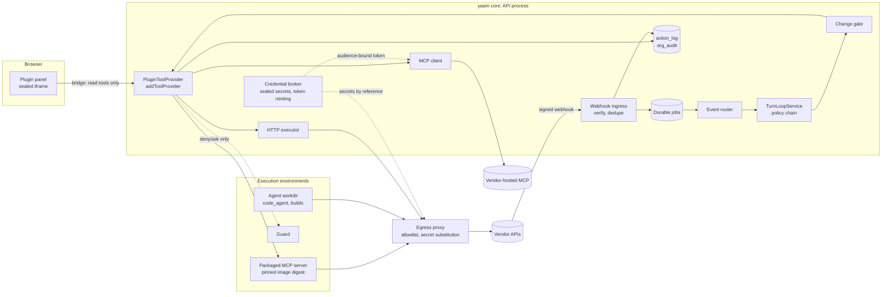
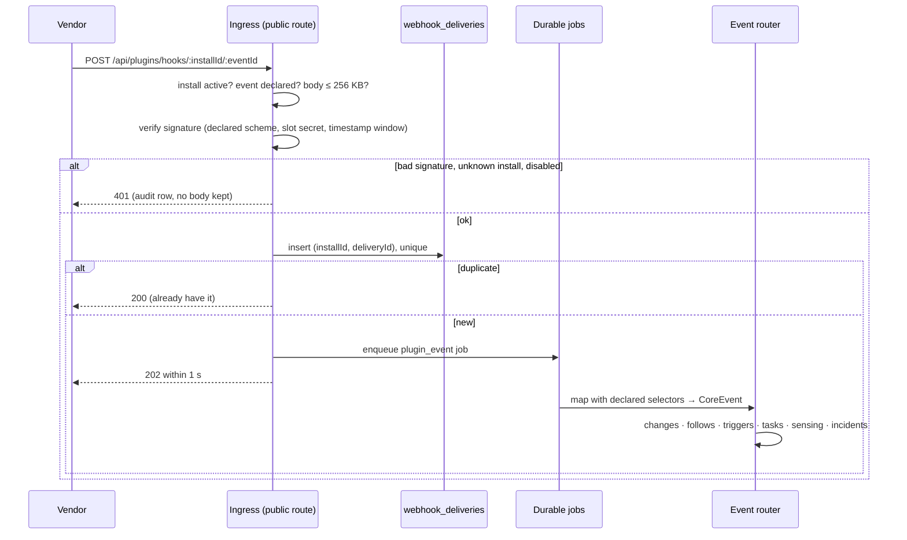
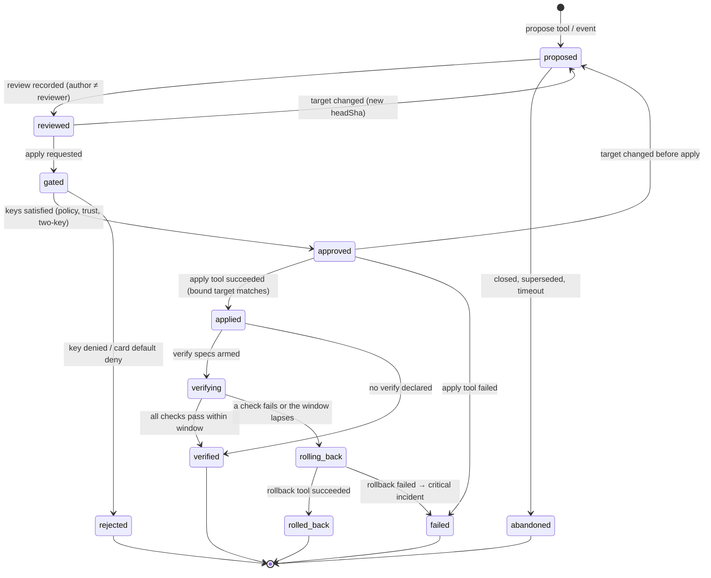
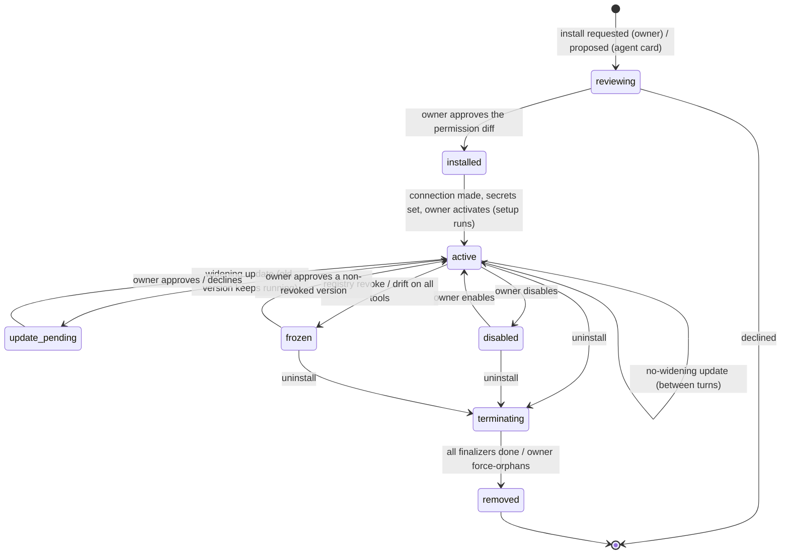

# Plugins: declarative capability packs on an enforcing core

Status: **design**, 3 November 2026. Nothing here is built yet. The
research behind it is the report *Agent harness plugin architectures*
(`reports/Agent harness plugin architectures.md` in the project folder,
outside the repository) and its four notes in
`research_notes/Agent harness plugin architectures/`. Citations of the form
**[R: …]** name a section of that report. Code citations are paths on
`main` as of the date above. A focused study of DeepSeek Harness's plugin
architecture is in progress and will feed §11; the composition and
lifecycle choices it may inform are listed as open questions (§12), not
settled.

The one-line version: **plugins declare, core decides.** A plugin is a
vendor package that adds verbs (tools), senses (events, metrics), records
(change kinds, mirrors) and know-how (skills, role packs). It never adds an
"allow". The core assigns every risk class, holds every credential, makes
every approval decision, runs every gate and writes every audit row. An
owner who installs a GitHub or Stripe plugin can see, before anything runs,
exactly what agents could do with it, and no later update can widen that
without the owner seeing a diff. The report found no agent harness
ecosystem that offers this property [R: "Conclusion"].

Contents:

1. [Purpose, scope, non-goals](#1-purpose-scope-non-goals)
2. [Who owns what: core, plugin, agent](#2-who-owns-what-core-plugin-agent)
3. [Plugin anatomy](#3-plugin-anatomy)
4. [Runtime model](#4-runtime-model)
5. [Security model](#5-security-model)
6. [Lifecycle](#6-lifecycle)
7. [Distribution and trust](#7-distribution-and-trust)
8. [Data model and APIs](#8-data-model-and-apis)
9. [How existing features map](#9-how-existing-features-map)
10. [Phased plan](#10-phased-plan)
11. [Lessons from DeepSeek Harness (pending)](#11-lessons-from-deepseek-harness-pending)
12. [Open questions for the owner](#12-open-questions-for-the-owner)

## 1. Purpose, scope, non-goals

**Purpose.** yaam-chat is becoming a company that runs itself
(`docs/company-vision.md`). A software or SaaS company needs its agents to
work in systems yaam does not own: a git host, CI, build machines, a deploy
platform, error tracking, billing, support and CRM. Each of those is a
vendor-specific surface that changes on the vendor's schedule. This
document defines how such surfaces enter yaam: as **plugins**, packaged so
that the core's existing gates (`docs/permissions.md`,
`docs/actions-and-trust.md`, `docs/boundary.md`) apply to them without
exception.

**Scope.**

- The plugin unit, its folder layout and its manifest, `plugin.json` (§3).
- Where plugin code runs and how its tools, events, metrics and change
  kinds reach the turn loop and the org runtime (§4).
- The threat model and the control for each threat (§5).
- Install, configure, grant, update, disable, uninstall and recall (§6).
- Registry tiers, pinning and versioning (§7).
- Tables and endpoints (§8), the mapping from today's features (§9), and
  a phased plan with acceptance criteria (§10).
- Four core primitives that plugins need and the core does not have yet:
  - the **change record**;
  - the **execution-environment interface**, with an egress and secret
    policy;
  - **durable execution**;
  - **taint**.

**Non-goals.**

- **Rebuilding vendors.** yaam does not become a git host, a CI system, a
  deploy platform, an error tracker or a payment processor. It drives
  them through their APIs and records what it did.
- **In-process third-party code.** No plugin code is ever loaded into the
  API process: no `require()`, no dynamic import and no hooks running with
  the server's privileges. Pi and dsh load plugins in process, and the
  report's reading of their docs is that this is not a security boundary
  [R: "Pi and dsh run plugins in process"].
- **Plugin-supplied policy that relaxes.** No hook, guard, annotation or
  manifest field can return `allow`, lower a class, skip the reviewer or
  remember an approval [R: "Some contributions are excluded outright"].
- **Install-time execution.** No install scripts, post-install hooks or
  setup code. Nothing runs at install (§6.1).
- **Breadth.** yaam will not compete on connector count
  (`docs/registry.md` opening, `docs/integrations.md` §3c). The goal is a
  short list of well-built plugins for the systems a company actually
  runs on.
- **Payments in the registry.** Plugins are free to publish and install,
  as registry items are today (`docs/registry.md` §6).

## 2. Who owns what: core, plugin, agent

### 2.1 The split

| | **yaam core** (the company's kernel) | **Plugins** (vendor capability packs) | **Agents** (the work) |
|---|---|---|---|
| What it is | First-party, reviewed code in this repository | A declarative package: manifest, tool definitions, event mappings, skills and panels, optionally with a pinned out-of-process server | Durable agents with charters, memory and tools (`server/src/agents/`) |
| Owns | Identity, workspaces, accounts, permissions; action classes, gates, two-key, reviewer, trust ledger; budgets and capital; audit and auditor; tasks and keys; WorkspaceFs; events and follows; incidents and sensing pipes; approvals and decision cards; durable execution; the execution-environment interface with egress and secret policy; the change record | The vendor's API surface as curated verbs; the vendor's webhooks and how they map to core events; vendor metric queries; how vendor objects map to change records; mirrors; panels; vendor-specific skills and role packs; cleanup of vendor resources it created | Judgment and content: code, reviews, triage, ADRs, plans, replies, postmortems, rituals |
| May | Decide, refuse, raise, hold, freeze, recall | Declare and request | Propose (including a plugin), act inside its grants |
| May never | Run third-party code in-process | Contribute an `allow`, lower a class, see a raw secret, run at install, reach an undeclared host | Install, update or grant a plugin; widen its own grants |
| Changes when | yaam ships a release | The vendor's API changes | Every turn |

### 2.2 The decision test

Ask three questions in order, and stop at the first yes:

1. **Must it hold regardless of what any agent or plugin does?** Then it
   is **core**. Examples: "a merge to the default branch needs two keys",
   "no token leaves the broker", "every outward call is logged".
2. **Is it specific to one vendor and swappable for another?** Then it is
   a **plugin**. Examples: GitHub's webhook signature scheme, Linear's
   issue states, Stripe's refund API.
3. **Is it judgment or content?** Then it is **agent** work. Examples:
   whether a PR is good, what the postmortem says, how to price a plan.

It follows that any guarantee which would require trusting a plugin
belongs in core. GitHub branch protection is useful defence in depth, but
"merge needs two keys" is enforced by the core's change gate (§4.6), not
by trusting the plugin or the vendor's settings.

### 2.3 Where each gap of an autonomous software company lands

The analysis done with the owner found nine gaps between today's yaam and
an autonomous software company. They split as follows.

| Gap | Core | Plugin | Agent |
|---|---|---|---|
| **Git** (repos, branches, PRs) | The change record (§4.6) with merge gating; short-lived repo-scoped credentials from the broker; repo checkouts inside execution environments, never in WorkspaceFs | GitHub, GitLab: PR, review, branch, check and webhook verbs; the `pull_request → change` mapping | Writes the code, the PR description, the review |
| **Build environments** | The execution-environment interface (§4.3): lifecycle, resource caps, egress proxy, secret injection, sync-back through WorkspaceFs. Its local sandbox driver is extracted from `server/src/harness/harness-workdir.ts` and `server/src/runner/` | Docker, Firecracker, E2B, Fly Machines and Cloudflare Sandboxes as environment drivers | Writes build steps and tests |
| **Deploy and observability** | `deploy → change` with verify and rollback hooks; incidents (`server/src/org/org-incidents.service.ts`); sensing (`server/src/org/org-sensing.service.ts`); executable checks (`server/src/org/org-checks.ts`) | Vercel, Fly, Render; Sentry, Datadog, Grafana: deploy verbs, alert webhooks, error-rate metric queries | Triage, rollback recommendation, postmortem |
| **Customer and revenue** | The `money` class and two-key (`server/src/actions/action-classes.ts`); capital envelopes and value events (`org-capital.service.ts`); `price_change → change` with an experiment's revert rule | Stripe, Paddle; Intercom, Zendesk; HubSpot; PostHog: verbs, webhooks, revenue and funnel metrics | Support replies, pricing proposals, account reviews |
| **Issue sync** | Tasks and keys (`docs/tasks-keys.md`) as the system of record inside yaam, with an external-reference field; follows (`server/src/follows/`) | Linear, Jira, GitHub Issues: two-way mapping of states, comments and assignees | Triage, estimates, breakdowns |
| **Governance** | All of it: boundary (`server/src/org/boundary.ts`), approvals and decision cards (`org-approvals.service.ts`, `decision-cards.ts`), the audit chain, the auditor, plugin install and update consent | Only *requested* policies, which can raise and never lower (§3.2 `policies`) | Proposes changes to rules through cards |
| **Codebase memory** | WorkspaceFs, mirrors and path conventions (`server/src/files/layout.ts`); knowledge and playbooks | Mirrors of vendor state into declared paths (open PRs, CODEOWNERS, release notes) | ADRs, knowledge notes, LESSONS.md |
| **Long-running work** | Durable execution (§4.7): a Postgres-backed job queue, leases, checkpoints, restart-safe waits for events and polls | Declares which operations are long-running and how completion is observed (an event or a poll) | Plans the work and reacts to completion |
| **Platform 24/7** | Restart safety, more than one API instance, leader election for tickers (today: a single process, `docs/architecture.md` §12) | None | Rituals and on-call rotations, run on the core's heartbeat |

## 3. Plugin anatomy

### 3.1 Folder convention

A plugin is a directory. It is distributed as a content-addressed archive
(§7.2):

```
github/
├── plugin.json              the manifest (§3.2), the only file the core must read
├── README.md                shown on the review screen
├── CHANGELOG.md
├── icon.svg                 sanitised; rendered as an image, never inline
├── tools/<name>.json        declarative HTTP tool definitions (§3.2 tools, source "http")
├── events/<id>.json         webhook event mappings, if not inline
├── skills/<name>/SKILL.md   agentskills.io skills, loaded as data
├── packs/<role>.md          role packs in the same format as packs/*.md
└── panels/<id>.html         UI panels, rendered sealed (§3.2 panels)
```

The loader enforces these rules:

- **Only referenced files load.** Anything the manifest does not name is
  ignored and listed as a warning on the review screen.
- **No executables, no scripts.** The archive is refused if it contains
  any of these:
  - a file with an executable bit, a shell script or a binary;
  - a `package.json` with `scripts` or a `postinstall`;
  - a symlink, or a path that escapes the directory.

  Packaged server code is never inside the archive. It is an OCI image
  referenced by digest (§3.2 `runtime`).
- **Size caps.** 5 MB per archive, 256 KB per manifest, 64 KB per skill
  (the existing `scanSkillMd` limit), 512 KB per panel.
- **Strict where it matters, lenient where it is metadata.** Unknown keys
  are errors inside `connections`, `tools`, `events`, `egress`, `secrets`,
  `policies`, `runtime`, `environments` and `finalizers`. Unknown
  top-level descriptive keys are only warnings. Claude Code uses the same
  rule [R: "Claude Code is the most engineered distribution system…"].
- **Text is scanned.** Every skill, pack charter, tool description and
  panel goes through the registry's existing scans: `scanSkillMd`, and
  `scanAppHtml` in `server/src/registry/app-scan.ts`. Tool descriptions
  also get a steering lint (§5).

### 3.2 The manifest, `plugin.json`

Types use TypeScript notation. `Class` is the core's
`'read' | 'internal_write' | 'external_reversible' | 'external_irreversible' | 'money'`
(`ACTION_CLASSES` in `server/src/actions/action-classes.ts`).

**Identity and compatibility**

| Field | Type | Meaning |
|---|---|---|
| `manifestVersion` | `1` | The manifest schema version. |
| `id` | `string`, `name@registry` | `name` is `[a-z0-9-]{2,40}`. `registry` is the namespace that vouches for the plugin: `yaam` (first party), a verified publisher's namespace, `community` or `local` (§7). Claude Code uses the same `plugin@marketplace` form [R: "Four harnesses, one shape…"]. |
| `name`, `description`, `homepage`, `license` | `string` | Display. |
| `version` | `string`, semver | The plugin's version. |
| `publisher` | `{ id: string; name: string; verifiedDomain?: string }` | Who publishes. The registry checks `verifiedDomain` (§7.1); the manifest's claim alone counts for nothing. |
| `requires` | `{ yaamCore: string }` | A semver range over the **core plugin API** version, for example `"^1.2"`. Install refuses a range the core does not meet. |
| `toolPrefix` | `string`, `[a-z][a-z0-9]{1,15}` | The namespace for this plugin's tool names: `github` gives `github_merge_pr`. Prefixes are reserved per registry namespace. Core prefixes are refused: `fs_`, `org_`, `mcp_`, `skill_`, `tool_`, `computer_`, `browser_`, `run_`, `gmail_`, `gcal_` and the others in `TOOL_CLASSES`. |

**Connections and auth**

```ts
connections?: Array<{
  id: string;                          // "github"
  auth:
    | { type: 'oauth2'; authorizationUrl: string; tokenUrl: string; pkce: true;
        resource?: string;              // RFC 8707 audience
        clientRegistration: 'byo' | 'cimd' | 'preregistered' }
    | { type: 'github_app'; appSlug?: string }   // installation tokens, 1 h, repo-scoped
    | { type: 'api_key'; slot: string };          // a secret slot (below)
  scopeTiers: Record<'read' | 'write' | string, string[]>;  // requested incrementally
  audience: string[];                  // hosts this connection's credential may be presented to
  grantLevels: Array<'read' | 'write'>;// what a per-agent grant can be
}>
```

A connection belongs to the person who authorises it, as today
(`docs/integrations.md` §4, "Connections are user-level; agent access is a
grant"). Scopes are requested per tier and incrementally, like the Google
tiers (`ScopeTier`) in `server/src/connections/connections.service.ts`.
Which agents may use a connection is a separate grant: per agent, per
connection, read and write apart, off by default (§6.3).

**Tools**

```ts
tools: {
  source: 'mcp' | 'http';
  // source 'mcp': where the server is
  server?: { remote: string }                        // a vendor-hosted Streamable HTTP URL
         | { runtime: string };                      // a `runtime` entry id (packaged server)
  items: Array<{
    name: string;                        // without prefix: "merge_pr" → github_merge_pr
    upstreamName?: string;               // the MCP tool name, if different
    class: Class;                        // declared; the core may only raise it (§4.2)
    classByInput?: Array<{ path: string; equals?: unknown; in?: unknown[]; class: Class }>;
    connection?: string;                 // which connection's credential it uses
    grant: 'read' | 'write';             // which grant level it needs
    definitionHash: string;              // sha256 of canonicalJson({name, description, inputSchema, outputSchema})
    output: 'untrusted' | 'structured';  // 'structured' = validated against outputSchema; still tainting unless every field is an enum or number
    staging?: { twin: string };          // a draft twin (as STAGING in action-classes.ts)
    idempotency?: { header?: string; inputPath?: string };  // how the core passes its idempotency key
    longRunning?: { completion: { event: string; match: string } | { poll: string; every: string; done: string }; timeout: string };
    http?: HttpToolSpec;                 // source 'http' only (below)
  }>;
}
```

`HttpToolSpec` is a request template that the **core** executes, so no
plugin code runs:

```ts
{ method: 'GET'|'POST'|'PATCH'|'PUT'|'DELETE'; url: string;  // https; the host must be in egress
  headers?: Record<string, string>;     // credentials only as {{secret:SLOT}} or {{connection:ID}}
  query?: Record<string, string>; body?: unknown;              // {{input.path}} substitutions, JSON-encoded
  response: { select?: string; maxBytes?: number } }           // the sensing selector grammar
```

Two existing mechanisms are promoted here to a packaged form: the
agent-built custom HTTP tool (`save_tool`, `docs/permissions.md` §2 "HTTP
tools") and the `{{secret:NAME}}` convention of the `http_json` metric
source (`docs/sensing.md` §1.1).

**Events (webhooks)**

```ts
events?: Array<{
  id: string;                                    // "pull_request"
  connection?: string;
  signature:
    | { scheme: 'hmac-sha256'; header: string; prefix?: string; secretSlot: string }        // GitHub X-Hub-Signature-256
    | { scheme: 'hmac-sha256-timestamped'; header: string; format: 'stripe' | 'slack'; secretSlot: string; toleranceSeconds: number }
    | { scheme: 'ed25519'; header: string; timestampHeader: string; publicKeySlot: string };
  dedupeKey: { header: string } | { path: string };   // X-GitHub-Delivery, Stripe event id
  filter?: { path: string; in: string[] };            // e.g. action ∈ [opened, closed, synchronize]
  map: { kind: string; ref: string; title?: string; url?: string; actor?: string; occurredAt?: string };  // selectors
  routes: Array<'follows' | 'triggers' | 'tasks' | 'sensing' | 'incidents' | 'changes'>;
  incident?: { when: string; kind: string; severity: 'minor' | 'major' | 'critical' };
  reconcile?: { tool: string; every: string };        // a read tool that lists recent objects
}>
```

**Metric sources**

```ts
metrics?: Array<{ id: string; name: string; unit: string; tool: string;  // a read tool
                  select: string; pollMinutes: number }>
```

These add a metric-source kind, `plugin`, to the existing `http_json`,
`webhook`, `connection` and `manual_attested` (`SOURCE_KINDS` in
`org-sensing.service.ts`). The CEO's `metric_source` card still activates
each source, and agents still never write samples (`docs/sensing.md`
§1.6).

**Change-record mappings**

```ts
changes?: Array<{
  kind: string;                                  // "pull_request", "deploy", "price_change"
  propose: { tool?: string; event?: string };    // what creates a record in `proposed`
  bind: Record<string, string>;                  // identity of the target: repo, number, headSha
  review?: { event?: string; tool?: string };    // what records a review
  apply: { tool: string };                       // the only tool that may apply it (§4.6)
  verify?: Array<{ event: string; match: string; within: string }
               | { check: 'http_status' | 'metric_at_least' | 'metric_increased'; args: object; within: string }>;
  rollback?: { tool: string };                   // pre-approved with the apply
  defaultClass: Class;                           // the apply tool's floor for this kind
}>
```

**Artifact mirrors**

```ts
mirrors?: Array<{ kind: string; source: { event: string } | { tool: string; every: string };
                  path: string;                  // a template under the plugin's mirror root
                  template: string }>            // markdown with {{field}} substitutions
```

A new `pluginPath` builder in `server/src/files/layout.ts` resolves the
paths, so a plugin cannot name an arbitrary path:

- The mirror root is `org/<function>/<plugin>/` when the plugin names a
  function from `ORG_FUNCTIONS`, and `org/plugins/<plugin>/` otherwise.
- The `system` author writes mirrors, only when the text changed, and each
  file says it is a mirror. This is the rule in
  `server/src/org/org-mirror.service.ts`.

**UI panels**

```ts
panels?: Array<{ id: string; title: string; entry: string;   // panels/<id>.html
                 placement: 'task' | 'change' | 'agent' | 'settings';
                 capabilities: Array<'plugin.read' | 'plugin.propose' | 'storage' | 'chat.compose'> }>
```

Panels render exactly like mini apps (`docs/miniapp-capabilities.md`
§5–6):

- a `sandbox="allow-scripts"` iframe with the CSP from `src/lib/sandbox.ts`
  and no network;
- data only through a capability-checked bridge.

`plugin.read` lets the panel call the plugin's **read** tools through the
host. `plugin.propose` lets it fill in a proposal that the user confirms
every time. No capability executes a write.

**Skills, role packs, tunables, policies**

| Field | Type | Meaning |
|---|---|---|
| `skills` | `string[]` | Paths to `SKILL.md` files. They install as **drafts** with `proposedBy: "plugin: <id>"`, as registry skills do (`docs/registry.md` §3). |
| `rolePacks` | `string[]` | Paths to pack files in the `packs/` format (`MarketItem` in `server/src/market/market.catalog.ts`). They appear in the Market, and hiring one goes through the existing hire review. |
| `tunables` | `Record<string, { default: number; min: number; max: number; description: string }>` | Registered with `registerTunables` (`server/src/org/org-tunables.ts`) under `plugin.<name>.*`, in area `plugins`; the core clamps them. A plugin tunable can only parameterise the plugin's own behaviour (for example `plugin.github.mirrorOpenPrs`), never a gate. |
| `policies` | `Array<{ match: { tool?: string; change?: string; bind?: Record<string, string> }; require: 'two_key' \| 'cosign' \| 'owner_key' \| 'class:<Class>'; why: string }>` | Requested **stricter** treatment, for example "a merge to the default branch is two-key". The core applies an entry only if it raises the result (§4.2). |

**Egress, secrets, budgets, runtime, cleanup**

| Field | Type | Meaning |
|---|---|---|
| `egress` | `Array<{ host: string; category: 'vendor_api' \| 'vendor_auth' \| 'vendor_cdn' \| 'package_registry' }>` | Every host that plugin code or a plugin HTTP tool may reach. Hosts are exact, with at most one leading `*.` wildcard, which does not cover the parent domain (Forge's rule [R: "Mature platforms make the manifest an enforced allowlist"]). `fetchPublic` (`server/src/common/url-guard.ts`) refuses private, loopback and metadata addresses whatever is declared. |
| `secrets` | `Array<{ slot: string; description: string; kind: 'api_key' \| 'webhook_signing' \| 'signing_key'; inject: 'proxy' \| 'env' }>` | Named, write-only slots filled per install. With `proxy`, the default, the egress proxy substitutes `{{secret:SLOT}}` and plugin code never receives the value. `env` is allowed only for CLIs that cannot use a proxy, and is a separate line on the review screen (§4.4). |
| `budgets` | `{ callsPerMinute?: number; concurrent?: number; maxCostPerCallUsd?: number; computeMinutesPerDay?: number }` | Ceilings the plugin asks for. The core's own rate limits (`ActionsService.rateCheck`) and the org's envelopes still apply, and the lower limit wins. |
| `runtime` | `Array<{ id: string; image: string; digest: string; protocol: 'mcp-http' \| 'mcp-stdio'; cpu: number; memoryMb: number; env?: string[] }>` | A packaged MCP server, pinned by OCI digest and run in an execution environment (§4.3). Absent for remote-MCP and HTTP-only plugins. |
| `environments` | `Array<{ id: string; driver: 'http'; api: string; … }>` | An execution-environment provider such as E2B or Fly Machines, driven by the core's generic HTTP driver (§4.3). |
| `setup` | `Array<{ tool: string; input: object; creates: string }>` | Operations that run **after** the owner activates the install, never at install; for example, creating a webhook. Each names the finalizer that undoes it. |
| `finalizers` | `Array<{ id: string; tool: string; resource: string }>` | Domain-qualified ids (`github.yaam/delete-webhook`), each with the tool that removes one created resource (§6.6). |
| `guards` | `Array<{ id: string; runtime: string; tools: string[]; timeoutMs: number }>` | Optional out-of-process checks that may return only `deny` or `ask` (§4.2). |

Composition between plugins is deliberately absent from manifest v1:
there is no `dependsOn`, no service a plugin exports to another, and no
patch one plugin applies to another. Whether to add any of these is an
open question (§12, Q14–Q15).

### 3.3 Example: GitHub

```json
{
  "manifestVersion": 1,
  "id": "github@yaam",
  "name": "GitHub",
  "description": "Repositories, pull requests, reviews and checks. Pull requests are change records: merging one goes through yaam's change gate.",
  "version": "1.0.0",
  "publisher": { "id": "yaam", "name": "yaam", "verifiedDomain": "yaam.chat" },
  "license": "AGPL-3.0-or-later",
  "requires": { "yaamCore": "^1.0" },
  "toolPrefix": "github",

  "connections": [{
    "id": "github",
    "auth": { "type": "github_app" },
    "scopeTiers": {
      "read":  ["contents:read", "pull_requests:read", "checks:read", "issues:read", "metadata:read"],
      "write": ["contents:write", "pull_requests:write", "issues:write"]
    },
    "audience": ["api.github.com", "github.com"],
    "grantLevels": ["read", "write"]
  }],

  "egress": [
    { "host": "api.github.com", "category": "vendor_api" },
    { "host": "github.com", "category": "vendor_api" },
    { "host": "codeload.github.com", "category": "vendor_cdn" }
  ],

  "secrets": [
    { "slot": "WEBHOOK_SECRET", "description": "The secret set on the repository webhook", "kind": "webhook_signing", "inject": "proxy" }
  ],

  "tools": {
    "source": "http",
    "items": [
      { "name": "list_prs",      "class": "read", "grant": "read", "connection": "github", "output": "untrusted",
        "definitionHash": "sha256:4b1e…", "http": { "method": "GET", "url": "https://api.github.com/repos/{{input.repo}}/pulls?state={{input.state}}",
        "headers": { "Authorization": "Bearer {{connection:github}}" }, "response": { "maxBytes": 200000 } } },
      { "name": "read_pr",       "class": "read", "grant": "read", "connection": "github", "output": "untrusted", "definitionHash": "sha256:91c0…", "http": { "…": "…" } },
      { "name": "read_checks",   "class": "read", "grant": "read", "connection": "github", "output": "structured", "definitionHash": "sha256:0d7a…", "http": { "…": "…" } },
      { "name": "create_branch", "class": "external_reversible", "grant": "write", "connection": "github", "output": "structured", "definitionHash": "sha256:a2f3…", "http": { "…": "…" } },
      { "name": "open_pr",       "class": "external_reversible", "grant": "write", "connection": "github", "output": "structured",
        "idempotency": { "inputPath": "$.clientRef" }, "definitionHash": "sha256:77b2…", "http": { "…": "…" } },
      { "name": "comment_pr",    "class": "external_reversible", "grant": "write", "connection": "github", "output": "structured", "definitionHash": "sha256:c3e9…", "http": { "…": "…" } },
      { "name": "review_pr",     "class": "external_reversible", "grant": "write", "connection": "github", "output": "structured", "definitionHash": "sha256:5f10…", "http": { "…": "…" } },
      { "name": "merge_pr",      "class": "external_irreversible", "grant": "write", "connection": "github", "output": "structured",
        "longRunning": { "completion": { "event": "push", "match": "$.after == {{bind.mergeSha}}" }, "timeout": "30m" },
        "definitionHash": "sha256:e8d4…", "http": { "…": "…" } },
      { "name": "revert_pr",     "class": "external_irreversible", "grant": "write", "connection": "github", "output": "structured", "definitionHash": "sha256:1a6c…", "http": { "…": "…" } },
      { "name": "create_hook",   "class": "external_reversible", "grant": "write", "connection": "github", "output": "structured", "definitionHash": "sha256:9e02…", "http": { "…": "…" } },
      { "name": "delete_hook",   "class": "external_reversible", "grant": "write", "connection": "github", "output": "structured", "definitionHash": "sha256:3b77…", "http": { "…": "…" } }
    ]
  },

  "events": [
    { "id": "pull_request", "connection": "github",
      "signature": { "scheme": "hmac-sha256", "header": "X-Hub-Signature-256", "prefix": "sha256=", "secretSlot": "WEBHOOK_SECRET" },
      "dedupeKey": { "header": "X-GitHub-Delivery" },
      "filter": { "path": "$.action", "in": ["opened", "synchronize", "closed", "reopened", "ready_for_review"] },
      "map": { "kind": "pr.{{$.action}}", "ref": "{{$.repository.full_name}}#{{$.number}}", "title": "{{$.pull_request.title}}",
               "url": "{{$.pull_request.html_url}}", "actor": "{{$.sender.login}}", "occurredAt": "{{$.pull_request.updated_at}}" },
      "routes": ["changes", "follows", "triggers"],
      "reconcile": { "tool": "list_prs", "every": "1h" } },
    { "id": "check_suite", "connection": "github",
      "signature": { "scheme": "hmac-sha256", "header": "X-Hub-Signature-256", "prefix": "sha256=", "secretSlot": "WEBHOOK_SECRET" },
      "dedupeKey": { "header": "X-GitHub-Delivery" },
      "filter": { "path": "$.action", "in": ["completed"] },
      "map": { "kind": "checks.{{$.check_suite.conclusion}}", "ref": "{{$.repository.full_name}}@{{$.check_suite.head_sha}}" },
      "routes": ["changes", "follows", "sensing"],
      "incident": { "when": "$.check_suite.conclusion == 'failure' && $.check_suite.head_branch == $.repository.default_branch",
                    "kind": "plugin_alert", "severity": "major" } },
    { "id": "pull_request_review", "connection": "github",
      "signature": { "scheme": "hmac-sha256", "header": "X-Hub-Signature-256", "prefix": "sha256=", "secretSlot": "WEBHOOK_SECRET" },
      "dedupeKey": { "header": "X-GitHub-Delivery" },
      "map": { "kind": "pr.review.{{$.review.state}}", "ref": "{{$.repository.full_name}}#{{$.pull_request.number}}", "actor": "{{$.sender.login}}" },
      "routes": ["changes", "follows"] }
  ],

  "metrics": [
    { "id": "open_prs", "name": "Open pull requests", "unit": "PRs", "tool": "list_prs", "select": "length", "pollMinutes": 60 }
  ],

  "changes": [{
    "kind": "pull_request",
    "propose": { "tool": "open_pr" },
    "bind": { "repo": "$.repo", "number": "$.number", "headSha": "$.head.sha", "base": "$.base.ref" },
    "review": { "event": "pull_request_review", "tool": "review_pr" },
    "apply": { "tool": "merge_pr" },
    "verify": [ { "event": "check_suite", "match": "$.head_sha == {{bind.mergeSha}} && $.conclusion == 'success'", "within": "45m" } ],
    "rollback": { "tool": "revert_pr" },
    "defaultClass": "external_irreversible"
  }],

  "policies": [
    { "match": { "change": "pull_request", "bind": { "base": "{{repo.default_branch}}" } }, "require": "two_key",
      "why": "Merging to the default branch ships code; it should never be one agent's call." }
  ],

  "mirrors": [
    { "kind": "pull_request", "source": { "event": "pull_request" }, "path": "prs/{{repo}}/{{number}}.md",
      "template": "# {{title}}\n\nState: {{state}} · Author: {{actor}} · {{url}}\n" }
  ],

  "panels": [
    { "id": "pr", "title": "Pull request", "entry": "panels/pr.html", "placement": "change", "capabilities": ["plugin.read"] }
  ],

  "skills": ["skills/review-pr/SKILL.md", "skills/write-pr-description/SKILL.md"],
  "rolePacks": ["packs/release-manager.md"],

  "tunables": {
    "plugin.github.mirrorOpenPrs": { "default": 1, "min": 0, "max": 1, "description": "Mirror open pull requests into /org/engineering/github/prs/." }
  },

  "budgets": { "callsPerMinute": 60, "concurrent": 4 },

  "setup": [ { "tool": "create_hook", "input": { "events": ["pull_request", "pull_request_review", "check_suite", "push"] }, "creates": "github.yaam/webhook" } ],
  "finalizers": [ { "id": "github.yaam/webhook", "tool": "delete_hook", "resource": "webhook" } ]
}
```

Notes on the example:

- `merge_pr` is declared `external_irreversible`. With the requested
  policy it is two-key on the default branch whatever the agent's trust
  level, and it can be called only through an approved change record
  (§4.6).
- The plugin is HTTP-only and contains no code. The core executes every
  request, so the egress list is the literal set of hosts the core will
  call on the plugin's behalf.
- `revert_pr` is the rollback. The merge's approval covers it, so the core
  may run it unattended when verification fails.

### 3.4 Example: Sentry

```json
{
  "manifestVersion": 1,
  "id": "sentry@yaam",
  "name": "Sentry",
  "version": "1.0.0",
  "publisher": { "id": "yaam", "name": "yaam", "verifiedDomain": "yaam.chat" },
  "requires": { "yaamCore": "^1.0" },
  "toolPrefix": "sentry",
  "connections": [{ "id": "sentry", "auth": { "type": "api_key", "slot": "AUTH_TOKEN" },
                    "scopeTiers": { "read": ["event:read", "project:read"], "write": ["event:write"] },
                    "audience": ["sentry.io"], "grantLevels": ["read", "write"] }],
  "egress": [ { "host": "sentry.io", "category": "vendor_api" } ],
  "secrets": [ { "slot": "AUTH_TOKEN", "description": "An internal-integration token", "kind": "api_key", "inject": "proxy" },
               { "slot": "CLIENT_SECRET", "description": "Webhook signing secret", "kind": "webhook_signing", "inject": "proxy" } ],
  "tools": { "source": "http", "items": [
    { "name": "list_issues",   "class": "read", "grant": "read", "connection": "sentry", "output": "untrusted", "definitionHash": "sha256:…", "http": { "…": "…" } },
    { "name": "read_issue",    "class": "read", "grant": "read", "connection": "sentry", "output": "untrusted", "definitionHash": "sha256:…", "http": { "…": "…" } },
    { "name": "resolve_issue", "class": "external_reversible", "grant": "write", "connection": "sentry", "output": "structured", "definitionHash": "sha256:…", "http": { "…": "…" } }
  ] },
  "events": [{ "id": "issue_alert",
    "signature": { "scheme": "hmac-sha256", "header": "Sentry-Hook-Signature", "secretSlot": "CLIENT_SECRET" },
    "dedupeKey": { "header": "Request-ID" },
    "map": { "kind": "sentry.{{$.action}}", "ref": "{{$.data.issue.id}}", "title": "{{$.data.issue.title}}", "url": "{{$.data.issue.web_url}}" },
    "routes": ["incidents", "follows", "triggers"],
    "incident": { "when": "$.action == 'triggered'", "kind": "plugin_alert", "severity": "major" } }],
  "metrics": [ { "id": "unresolved", "name": "Unresolved issues", "unit": "issues", "tool": "list_issues", "select": "length", "pollMinutes": 30 } ],
  "skills": ["skills/triage-error/SKILL.md"]
}
```

Sentry contributes no change kind; it only senses. Its alerts become
incidents and triggers, and its error count can serve as a deploy's verify
check (`metric_at_least` on a plugin metric source).

## 4. Runtime model

### 4.1 Where plugin code runs

A plugin's contributions execute in five places, none of them the API
process:

| Contribution | Executes in | Network |
|---|---|---|
| Declarative HTTP tool | The core's HTTP executor (core code), from the pinned template | Through the egress proxy, to declared hosts only |
| Remote MCP server (vendor-hosted) | The vendor's infrastructure, called by the core's `McpHttpClient` (`server/src/mcp/mcp-client.ts`) | The core presents an audience-bound token minted by the broker |
| Packaged MCP server (`runtime`) | An execution environment (§4.3), started on first use and stopped when idle | Only through the egress proxy; no direct route out |
| Guard | The same as a packaged server, called with a timeout | The same |
| UI panel | A sealed iframe in the browser | None (CSP `default-src 'none'`); data only through the bridge |

Skills, role packs, mappings, mirrors and tunables are **data** that the
core interprets. Pi's useful rule applies: instructions are data, code is
privilege [R: "Pi and dsh run plugins in process"].



### 4.2 Tools: registration and classing

**Registration.** One core provider, `PluginToolProvider`, registers
through `TurnLoopService.addToolProvider` (the `ToolProviderHook`
interface in `server/src/chats/turn-loop.service.ts`). It implements the
hook as follows:

- `specsFor(session)` returns the tools of every **active** install in
  `session.workspaceId` for which this agent holds a grant, at the grant's
  level. Definitions come from the **pinned** manifest of the install's
  approved version.
  - Sessions without an agent get none, because grants are per agent.
  - A tool whose live definition no longer matches its pin is not offered
    (§5.2).
- `owns(name)` is true when the name starts with an active install's
  `toolPrefix_`.
- `isReadOnly(name)` is true when the effective class is `read`.
- `execute(session, name, input, ctx)` routes to the HTTP executor, the
  MCP client or the packaged server. The broker attaches credentials, and
  the turn's abort signal and progress sink (`ToolExecCtx`) pass through.
- `runsFreely()` always returns `false`. Plugin tools never join
  `FREE_INTERNAL_TOOLS` (`server/src/actions/action-classes.ts`), and no
  plugin can opt a call into the free path the way `code_agent`'s
  `freeAgents` setting does.
- `queuesInLoops(name)` is true for any non-read tool, so a loop turn
  without the action contract queues the call in the inbox.
- `onToolResult` marks the turn tainted when the tool's output is
  untrusted (§5.3), and feeds the tool-error streak
  (`docs/incidents.md` §2).

Plugin tools never use the `mcp_` prefix, so they never take the MCP
branch of the classifier. On that branch a tool counts as `read` when its
server sets `readOnlyHint` (`McpService.readOnlyTools` in
`server/src/mcp/mcp.module.ts`), and the MCP spec says such hints are not
to be trusted [R: "Mitigations are architectural, not detective"].

**Classing: the core only raises.** The class order is
`read < internal_write < external_reversible < external_irreversible < money`.
The effective class of a plugin call is the **maximum** of:

1. the class declared in the pinned manifest, and any matching
   `classByInput` row;
2. the core's floor for the name and input:
   - `MONEY_RE`: any money-like name is `money`;
   - the change kind's `defaultClass` for an `apply` or `rollback` tool;
   - `external_reversible` for any HTTP tool whose method is not `GET` or
     `HEAD`;
3. the tier floor: a `read` declaration on an MCP tool from a `community`
   or `local` plugin is raised to `external_reversible`. The core can see
   that an HTTP tool is a `GET`, but cannot see what an opaque server does;
4. any requested policy that names a class (`class:<Class>`);
5. an owner override, set per install on the review screen, which can only
   raise.

`classOf` in `action-classes.ts` gains one lookup: a map of
`toolName → { declared, floor }` built from the pinned versions of active
installs, consulted before `MONEY_RE` and combined with `max`. The boot
warning for unclassified names (`unclassified`) is unchanged, because
plugin tools are always classified.

**Requested policies.** Matching `policies` entries apply after the trust
decision (`decide()` in `server/src/actions/trust-policy.ts`) and before
`contractPolicy`. Each applies only if it raises the result:

- `two_key` turns `run`, `run_notify` and `cosign` into `stage` or `hold`
  for the owner's key;
- `cosign` turns `run` and `run_notify` into `cosign`;
- `owner_key` holds the call for the owner.

A request that would lower the result is ignored, and the review screen
lists it as "already stricter".

**Guards.** A guard sees `{ tool, input, agentId, workspaceId }`, never
the conversation. It answers `deny` or `ask` with a reason, or nothing, and
runs with a `timeoutMs` of at most 2,000.

- A timeout, an error, a malformed answer or an `allow` counts as `deny`
  for that call. The guard fails closed, dsh's rule "absent or
  unanswerable: deny" [R: "Pi and dsh run plugins in process"].
- Under deny > ask > allow precedence, a guard can only make the core
  stricter.

**The policy chain for a plugin call** is today's chain
(`docs/architecture.md` §4, "Policy chain") with three steps added,
marked **new**:

1. Sandbox recorder (red team, evals).
2. `restrictTo`.
3. Same-call loop breaker.
4. **New: change gate** for `apply` and `rollback` tools (§4.6).
5. Action contract: `classify` (now combined with `max`), idempotency key,
   trust level, `decide()`.
6. **New: requested policies and taint** (§5.3) raise the decision.
7. **New: guards**, if any.
8. Routed approval for another member's connection.
9. `checkPolicy` (Ask/Auto).
10. `contractPolicy` (two-key is never remembered).
11. Independent reviewer, for auto or remembered non-read calls.
12. Ask, then `rateCheck` (with the plugin's `toolPrefix` as the
    channel), execute, `actions.finish`.

### 4.3 The execution-environment interface

Today two places run untrusted processes:

- **The runner** (`server/src/runner/runner.service.ts`): `sandbox-exec`
  or `bwrap` locally, or Cloudflare Sandboxes.
- **The harness** (`server/src/harness/harness.service.ts`,
  `harness-workdir.ts`): a temp dir with `work/ home/ tmp/`, an
  environment built from scratch, an OS jail, and sync-back through
  WorkspaceFs with `expectedVersion`.

Plugins add a third need: long-lived packaged MCP servers, and build or
test machines with real resources. The core defines one interface and
moves the runner and the harness onto it.

```ts
interface ExecEnvDriver {
  id: string;                                   // 'local-sandbox' | 'cf-sandbox' | 'docker' | 'firecracker' | 'http:<plugin>'
  capabilities(): { network: 'proxy-only' | 'none' | 'unenforced'; persistent: boolean; maxCpu: number; maxMemoryMb: number; imageDigests: boolean };
  create(spec: EnvSpec, signal: AbortSignal): Promise<EnvHandle>;
}
interface EnvSpec {
  image?: { ref: string; digest: string };      // required for packaged servers
  cpu: number; memoryMb: number; diskMb: number; timeoutMs: number;
  egress: { proxy: string; allow: string[] };   // the proxy URL and the install's declared hosts
  env: Record<string, string>;                  // from scratch: never inherited from the server
  secretEnv?: Array<{ slot: string; as: string }>; // only slots declared inject: 'env' (§4.4)
  mounts?: { workdir: { from: string /* a WorkspaceFs folder */; sync: 'back' | 'none' } };
  labels: { workspaceId: string; agentId?: string; installId?: string; jobId?: string };
}
interface EnvHandle {
  exec(cmd: string[], opts: { stdin?: string; signal: AbortSignal; onLine?(l: string): void }): Promise<{ code: number }>;
  connect?(port: number): Promise<URL>;         // an MCP server's endpoint, reachable only from the core
  syncBack(): Promise<SyncReport>;              // through WorkspaceFs as the agent, as harness-workdir.ts does
  destroy(): Promise<void>;
}
```

Every driver must meet this policy, checked by a conformance test:

- **No direct egress.** All traffic leaves through the egress proxy, which
  enforces the install's host list. A driver that cannot enforce this is
  marked `network: 'unenforced'` and may run first-party harnesses only,
  never a third-party packaged server. The local Seatbelt jail is such a
  driver, because it shares the host network
  (`docs/coding-harnesses.md` §3).
- **An environment built from scratch.** Nothing comes from the server's
  environment, as in the harness today.
- **Workspace writes only through WorkspaceFs.** A workdir is a copy.
  Sync-back goes through `WorkspaceFs.write` and `delete` with
  `expectedVersion` and the agent's permissions, so conflicts are reported
  and never clobbered.
- **Labels and budgets.** Every environment carries its workspace, agent,
  install and job. Compute minutes are reserved against the org envelope
  (`OrgCapitalService`) before start, as model calls are.
- **Abort.** The turn's or job's abort signal destroys the environment.

Drivers:

| Driver | Who ships it | Notes |
|---|---|---|
| `local-sandbox` | Core, extracted from `harness-workdir.ts` and the runner's local backend | Dev and single-host installs. Egress is unenforced on macOS; on Linux, `bwrap --unshare-net` plus a veth to the proxy can enforce it |
| `cf-sandbox` | Core (today's `cloudflare/runner-worker`) | Hosted. No network today; proxy-only once extended |
| `docker`, `firecracker` | First-party plugins with a core driver, because they need host privilege | An internal network whose only route is the proxy |
| `http:<plugin>` | Any plugin that declares `environments` | E2B, Fly Machines, Modal. The core's generic driver calls the vendor's REST API with a brokered key. The review screen lists the vendor's egress controls, and the core's proxy is set as the sandbox's HTTP proxy where the vendor allows it |

### 4.4 Credentials: the broker and the egress proxy

Credentials never leave the core [R: "Credentials stay in the core"].

- **At rest.** Connection tokens, GitHub App private keys and secret-slot
  values are sealed with `secretbox` (`server/src/common/secretbox.ts`),
  like `connections.accessToken` and `harness.config` today. The API never
  returns them; responses say `hasValue`.
- **Per call.** The broker mints or selects the narrowest credential for
  the call:
  - a GitHub App installation token, restricted to the one repository and
    the permissions the tool's grant level needs, valid for one hour;
  - an OAuth access token with the target's RFC 8707 audience;
  - or a slot value.
- **By reference.** Plugin HTTP templates and packaged servers write
  `{{secret:SLOT}}` or `{{connection:ID}}` where a credential goes. The
  egress proxy runs in **reverse-proxy mode**: the caller addresses
  `http://egress/<host>/<path>`. The proxy then:
  1. substitutes the value;
  2. checks the host against the install's list and the credential's
     `audience`;
  3. opens the TLS connection itself.

  The plugin process never holds the value, so a compromised plugin cannot
  replay it elsewhere. This generalises the sensing rule that
  credential-like headers must be `{{secret:NAME}}` (`docs/sensing.md`
  §1.1).
- **The `env` exception.** Some CLIs (`git`, `gh`, a vendor's deploy CLI)
  need a token in the environment, so a slot may declare `inject: 'env'`.
  It then follows the harness rule (`docs/coding-harnesses.md` §3,
  "Secrets"):
  - it is a separate red line on the review screen;
  - its value is the shortest-lived credential the broker can mint;
  - it enters the child's environment only, never argv;
  - every output line is redacted.
- **No passthrough.** The proxy refuses a token minted for one audience
  for any other host. This is the MCP spec's "MUST NOT pass through" rule
  [R: "Mitigations are architectural, not detective"].

### 4.5 Events: signed webhook ingress to core pipes



- **Verify before anything.** The route is public at the auth layer,
  added to the public list in `server/src/common/auth-strategy.interface.ts`
  next to loop webhooks and metric ingest. It checks its own signature with
  a timing-safe compare over the raw body, which `bootstrap.ts` already
  keeps.
  - Timestamped schemes reject a skew over `toleranceSeconds`, at most 300
    (Slack's window [R: "Versions, events, secrets and trust"]).
  - The default limit is 30 deliveries per minute per install.
- **Dedupe.** `webhook_deliveries` is unique on `(installId, deliveryId)`.
  A redelivery answers 200 and does nothing (Shopify's model).
- **Answer fast, work later.** The handler only verifies, records and
  enqueues. The mapping runs as a durable job, so a slow router never
  causes a vendor retry storm.
- **Map to one core shape.** Every event becomes
  `CoreEvent { installId, kind, ref, title, url, actor, occurredAt, payloadHash }`.
  The raw body is kept 14 days for replay and is never put whole into a
  model's context; mapped fields are bounded strings.
- **Route.** Each entry in `routes` sends the event to one core pipe:
  - `changes`: advances a change record whose `bind` matches `ref` (§4.6).
  - `follows`: `FollowsService.recordActivity` on the task or change linked
    to `ref`, so followers hear (`server/src/follows/follows.service.ts`).
  - `triggers`: a new trigger kind, `plugin_event`, on `TriggerBus`
    (`server/src/chats/trigger-bus.ts`), so a loop can run "on
    `github:pr.opened`" as it runs "on new mail" (`docs/triggers.md`).
  - `tasks`: a **proposal** in the unit's triage column, never an assigned
    task. An untrusted surface may propose, never act (`docs/security.md`
    §b).
  - `sensing`: a sample for a `plugin` metric source bound to this event.
  - `incidents`: `OrgIncidentsService.report` with kind `plugin_alert`,
    the declared severity and `ref = installId:ref`. As today, one incident
    is open per kind and ref (`docs/incidents.md` §1).
- **Untrusted by construction.** Event text reaches a model only wrapped
  as `<plugin-event source="github@yaam">…</plugin-event>`, the same
  framing as `<trigger>` and `<connection-content>`
  (`docs/architecture.md` §9). It taints the turn it wakes (§5.3).
- **Reconcile.** Webhook delivery is not guaranteed. For each event with a
  `reconcile` tool, a job runs that tool on its cadence and synthesises the
  events it missed, deduplicated on the vendor's object id and update
  time.

### 4.6 The change record

The change record is the core primitive that turns three rules into one
mechanism:

- a merge needs two keys;
- a deploy to production needs two keys and a health check;
- a price change reverts if conversion drops.

It generalises what `STAGING` and the two-key hold do for one email
(`docs/actions-and-trust.md` §3, §5) to any change that has a target, a
verification and a way back.



**What a record holds.**

- `id`, `workspaceId`, `kind`, `installId?`, `ref`, `title`, `state`;
- `bind`: the pinned target (repo, number, `headSha`, base);
- the proposer (an agent or a human) and the linked task (an `org_tasks`
  key such as `ENG-12`);
- `reviews[]`;
- the gate: requirement, decision, `approvalId`, keys;
- `applyActionId`, `verify[]` with results, `rollbackActionId`;
- deadlines.

Every transition writes an `org_audit` row (`change_<state>`) on the hash
chain.

**How the core enforces it.** The plugin only declares which tool applies
a kind. The **change gate** in the turn loop (§4.2, step 4) then does
three things:

1. It refuses an `apply` tool call that does not name a `changeId`, or
   whose input does not resolve to the record's `bind`. For a merge, that
   means the same repo, the same number and the same `headSha` that was
   reviewed. A force-push after review sends the record back to
   `proposed`.
2. It refuses the call unless the record is `approved`.
3. Once the record is `approved`, it lets the call continue into the
   ordinary chain. The class (`external_irreversible` for a merge) and the
   trust ledger still apply, and the idempotency key is the record id, so
   a retried merge replays instead of merging twice.

**Who may review.** A review counts only if the reviewer is not the
proposer.

- For an agent reviewer the core prefers another model family
  (`OrgTasksService.familyOf`), as the co-signer rule does.
- A human review on the vendor's side, such as a GitHub approval, arrives
  as an event and counts, attributed to the vendor login.

**The gate's requirement** is the maximum of three inputs:

- the trust decision for the apply tool's class;
- the plugin's requested policies;
- the workspace tunables `changes.<kind>.requirement`. These are
  registered in a new `change-tunables.ts`, with the boundary verdict
  `propose`, not delegable, because they are part of the external floor.

At `two_key`, the owner's key is the existing mechanism: an inline
approval when the owner is present, and otherwise a `two_key` card
(`OrgApprovalsService`) with `reversibility: 'costly'` that defaults to
deny.

**Verify and roll back.**

- **Verify specs** are the existing executable checks (`http_status`,
  `metric_at_least`, `metric_increased`, `docs/sensing.md` §3), plus "an
  event matching within a window". They run as durable jobs.
- **A failure** moves the record to `rolling_back`, and the core calls the
  declared rollback tool **itself**, unattended. The owner's approval
  covered apply and rollback together, and the approval card says so ("if
  checks fail within 45 minutes, yaam will revert").
- **The rollback** is logged as its own action with
  `keys.preapproved = changeId`.
- **A failed verification** also reports an incident of kind `revert`
  (`docs/incidents.md` §2), which feeds the trust ledger through
  `OrgTrustBridge`.

**Kinds this covers.**

| Kind | Proposed | Applied | Verified by | Rolled back by |
|---|---|---|---|---|
| `pull_request` (GitHub, GitLab) | `open_pr` | `merge_pr` | CI on the merge commit | `revert_pr` |
| `deploy` (Vercel, Fly) | A deploy plan | `deploy` to an environment; `classByInput` makes `production` irreversible | `http_status` on the health URL; an error-rate metric from Sentry | `rollback_deploy` to the previous release |
| `price_change` (Stripe, Paddle) | An experiment proposal (`org-experiments.service.ts`) | `update_price` (`money`) | The experiment's metric over its window | Restoring the previous price |
| `config_change` | A flag or setting diff | The vendor's update | A metric or check | The previous value |
| `manual` | Any agent, no plugin | A human says it was done | An attested check | n/a |

The `manual` kind ships with the primitive in Phase 1, so that the gate,
the cards and the UI are proven before any vendor is involved.

### 4.7 Durable execution

Today everything runs in one API process on in-process tickers and event
emitters, and chat locks are an in-memory set, so a second replica would
see neither (`docs/architecture.md` §1, §12). A 40-minute CI wait, a
deploy verification window or a webhook backlog cannot live in a closure.
The core therefore gains a job system. Plugins never get their own.

- **A Postgres queue.** A `jobs` table, claimed with
  `SELECT … FOR UPDATE SKIP LOCKED`, with heartbeated leases
  (`leaseUntil`), retries with backoff and an idempotency key. This needs
  no new infrastructure: the same database, the same migrator, PGlite in
  tests.
- **Checkpoints.** A job stores a small JSON checkpoint after each step
  (`awaiting_event`, `polling`, `verifying`), so a restart resumes at the
  last step instead of redoing outward calls. Outward calls inside a job
  use the action log's idempotency (`keyFor`), so a replayed step answers
  from the record.
- **Waits.** A job can wait for an event (a `plugin_event` matching a
  selector), a time, or a poll result. Waiting costs no process and no
  model call.
- **More than one instance.** Ticker work (heartbeats, sensing polls, card
  defaults) moves onto scheduled jobs, so only one instance runs each due
  item. Chat locks and the workspace event bus move to Postgres
  (`LISTEN/NOTIFY`) in the same phase. Until then, the single-replica rule
  of `docs/architecture.md` §12 stands.
- **Long-running tools.** A tool with `longRunning` returns at once with
  "started; yaam will tell you", and a job owns the completion. The result
  reaches the agent's heartbeat as a wake reason
  (`HeartbeatService.addReasonProvider`) and reaches followers through
  follows.

### 4.8 Skills, packs, mirrors, panels, tunables

- **Skills** install as drafts with the provenance
  `plugin: <id>@<version>`, and the owner approves each one, as for
  registry skills. An update that changes a skill's text re-drafts it,
  and the approved text keeps running until the new one is approved.
- **Role packs** appear in the Market under their plugin, which they
  require. Hiring one runs the existing hire review and proposes the
  plugin grants its skills want (`docs/integrations.md` §4).
- **Mirrors** are written by a job from events or polls, through
  `pluginPath` in `layout.ts`, by the `system` author, only when the text
  changed.
- **Panels** are mounted by the SPA where `placement` says (a task, a
  change record, an agent page, Settings). They are sealed, and the bridge
  offers only `plugin.read` and `plugin.propose`.
- **Tunables** are registered at activation and removed at uninstall.
  `tunable()` clamps a stored value that is outside the bounds.

## 5. Security model

The threat model is the report's [R: "The attack chain is credentials,
auto-update, ambient privilege, and now the model"], applied to the
surfaces in §4. Each threat has one primary control, enforced by core
code.

| # | Threat | Where it enters | Control (core) |
|---|---|---|---|
| T1 | **Tool poisoning and shadowing**: hidden instructions in a tool description steer the agent, or redirect another plugin's tools | Tool definitions reaching the model | Definitions come only from the pinned manifest, and the review shows their full text. A steering lint refuses descriptions that name other tools or plugins, say "always" or "before any other tool", or contain invisible Unicode or base64. Tool names are namespaced by `toolPrefix`, so no plugin can shadow a core name or another plugin's |
| T2 | **Rug pull (metadata)**: a server changes its tool list or descriptions after approval (`list_changed`) | Remote or packaged MCP | Each tool's `definitionHash` is pinned in the install. The core re-lists on its own schedule and on `list_changed`; any hash change disables that tool and opens a re-review with a text diff (Microsoft's model [R: "Mitigations are architectural, not detective"]) |
| T3 | **Rug pull (package)**: a new version under the same name does something else (postmark-mcp) | Registry update | The install records the archive sha256 and the OCI image digest. Updates are new versions with a permission diff (§6.4), and nothing auto-updates by tag |
| T4 | **Injection via tool output or events** (the lethal trifecta: private data, untrusted content and an outward channel together) | Issue bodies, PR comments, CI logs, tickets, alerts | **Taint** (§5.3): once a turn has read untrusted plugin content, outward and irreversible calls need a fresh key. The egress allowlist removes arbitrary exfiltration hosts, and repo-scoped tokens limit what a hijacked call can reach |
| T5 | **Confused deputy**: one owner-wide token used by every agent | Connections | Per-agent grants per connection and level; per-call credentials minted by the broker with the narrowest scope and audience; the existing routed approval for another member's connection |
| T6 | **Token passthrough and theft** | Plugin servers that receive tokens | Secrets by reference only, substituted by the proxy; audience-bound tokens refused for other hosts; `env` slots short-lived and redacted |
| T7 | **Malicious package or publisher takeover** (WordPress.org, Cyberhaven, GlassWorm) | Registry | Signing tiers (§7.1), digest pinning, staged rollout of new versions per registry, and the revoke switch, which freezes a version everywhere (§6.7) |
| T8 | **Pre-consent execution** (Claude Code CVE-2025-59536 and CVE-2026-21852; Paperclip CVE-2026-41679) | Install, import, config | Nothing runs at install. The manifest has no executable fields and no endpoint overrides. `setup` runs only after activation, as gated tools. A plugin cannot change a model endpoint, a hook or another plugin's config [R: "The harness CVEs: configuration that ran before consent"] |
| T9 | **Under-declared risk class** (a write tool declared `read`) | Manifest | The core only raises (§4.2): the HTTP method floor, the tier floor for opaque MCP, `MONEY_RE`, change-kind floors, owner raises |
| T10 | **Malicious skill text** | `SKILL.md` | Skills are data and install as drafts. Every command they cause still passes the chain, the scan runs, and the review shows the text |
| T11 | **Hostile panel** | Panel HTML | A sealed iframe with no network, and a bridge that offers only read and propose capabilities |
| T12 | **Webhook forgery and replay** | Ingress | A signature over the raw body, a timestamp window, dedupe on the delivery id and a per-install rate limit. An unknown or disabled install gets 401 |
| T13 | **Runaway cost or loops** | Long-running tools, packaged servers | Per-install budgets, envelope reservation for compute, the same-call breaker, and job leases with a maximum number of attempts |

### 5.1 Core-assigned risk classes

The mechanism is in §4.2. The review screen states the rule in two
sentences: "Each tool shows the class yaam will treat it as. The plugin
can ask for more caution, never for less."

### 5.2 Pinned definitions and re-review

When the owner approves an install, the core stores each tool's canonical
definition and its hash. It uses the same `canonicalJson` and `sha256`
that `action-classes.ts` uses for idempotency keys. For an HTTP tool the
definition is the template itself; for an MCP tool it is the server's
`tools/list` entry. At run time:

- a packaged or remote server's `tools/list` is re-read at most every 15
  minutes, and on `notifications/tools/list_changed`;
- a changed hash removes that tool from `specsFor` immediately, writes a
  `plugin_tool_drift` audit row, and opens a re-review in the owner's
  inbox with the old and new text side by side;
- a new tool that the pin does not know is never offered until reviewed.

Existing MCP servers need the same treatment. Today
`McpService.discover` overwrites the `mcp_servers.tools` cache on
rediscovery without comparing, so retrofitting pins to them is Phase 1
work.

### 5.3 Taint

**The rule.** A turn becomes tainted when it receives any of these:

- a tool result marked `untrusted` from a plugin;
- a `plugin_event` wake;
- connection content, as today.

In a tainted turn, any call of class `external_reversible`,
`external_irreversible` or `money` that would otherwise run without a
fresh human decision is raised one step:

- `run` and `run_notify` become `ask` when a person is present, and
  `stage` or `hold` when the turn is unattended;
- `cosign` keeps the co-signer and adds the reviewer.

Reads and internal writes are unaffected, so an agent can still read an
issue, think and write notes freely.

This is a coarse form of CaMeL's provenance tracking, chosen because it
buys most of the protection for little machinery [R: "Taint, events,
audit and revocation"]. Company mechanisms adapt, so the strictness is a
per-workspace tunable, `plugins.taintRaise`, with the boundary verdict
`propose`. The floor in code is that a tainted turn never runs a `money`
call without a human key.

### 5.4 Two-key on merge, deploy and money

Three kinds of change are two-key by default, as a core rule rather than
a plugin request:

- a merge to a protected or default branch;
- a deploy to an environment named production;
- any `money` call.

All three go through change records or the existing two-key path. The
requirement comes from the `changes.*` and `actions.*` tunables, which
only the owner can change (boundary verdict `propose`, not delegable).

### 5.5 Kill switch and recall

- **Per install.** Disable (§6.5) removes every tool from the next turn,
  aborts in-flight calls through the turn's abort controller, stops
  packaged servers and makes the webhook route answer 410.
- **Per workspace.** "Freeze all plugins" does the same for every install,
  and the org kill switch (`kill_switch` in `boundary.ts`) covers plugins.
- **Per class.** An incident freeze of a class
  (`organizations.frozenClasses`) holds plugin calls of that class, like
  any other call.
- **Global.** The registry's revoke switch (§6.7).

### 5.6 Audit

The audit rule is dsh's invariant, "model-visible means logged" [R: "Pi
and dsh run plugins in process"]:

- Every plugin call is an `action_log` row, reads included. The row gains
  `pluginId`, `pluginVersion`, `packageDigest`, `definitionHash` and
  `credentialRef` (which credential was minted, never its value).
- Every install, approval, grant, update, drift, disable, revoke,
  finalizer and change-record transition is an `org_audit` row on the hash
  chain.
- The auditor (`org-auditor.service.ts`) gains a sampling stream for
  plugin calls and change records.

## 6. Lifecycle

The states below are a first design. Hot reload, and automatic disposal
of everything a plugin registered, are among the questions the DeepSeek
Harness study may inform (§11, §12 Q16).



### 6.1 Install

Only the workspace owner installs (in accounts mode, the workspace's owner
role). Members and viewers cannot; the routes are owner-only, as
`PUT /api/harness/*` is today. Installs are **workspace-owned**, never
account-global, because agents belong to one workspace.

1. **Fetch and verify.** The server fetches the archive (through
   `fetchPublic`), checks its sha256 against the registry entry and its
   signature against the tier (§7.1), and validates the manifest strictly.
   Nothing is executed and no image is pulled yet.
2. **Capability review: the permission diff against nothing.** The review
   screen extends the registry's review modal (`RegistryReviewModal`). It
   shows the real artifacts, never a paraphrase (`docs/permissions.md`
   §4):
   - publisher, tier, signature, digest and `requires` range;
   - connections, and every scope per tier;
   - every tool with its **effective** class, grant level, full
     description and input schema, and any class the core raised, with the
     reason;
   - egress hosts; secret slots, with `env` slots in red;
   - events with their routes; metric sources; change kinds with their
     verify and rollback;
   - requested policies, each marked "applies" or "already stricter";
   - setup operations and the finalizers that undo them;
   - panels and their capabilities; skills (the text is behind **Read
     text**); role packs; tunables; budgets; the scan report.
3. **Confirm.** `confirm: true` (the boolean) re-validates and re-scans,
   then writes the install as `installed`. No agent holds any grant yet.

**Agents may propose, never install.** A new agent tool,
`plugin_propose { id, why }`, opens a `plugin_install` decision card for
the owner with the same review attached. The tool is class
`internal_write` and free, because it only writes a proposal. The
boundary gains a row: family `plugin`, verdict `propose`, **not
delegable**. The card defaults to deny at its deadline.

### 6.2 Configure

The owner, or the member who owns the connection, makes each connection
and fills each secret slot. Slots are write-only (`PATCH …/secrets`).
Then the owner presses **Activate**, which does three things:

1. runs the `setup` operations as ordinary gated tool calls on the owner's
   behalf, each an `action_log` row with `origin: 'user'`;
2. records a finalizer row for every resource created;
3. registers tunables, and registers metric sources as
   `pending_approval`, so the CEO's `metric_source` card still decides.

### 6.3 Grant to agents

Granting is the activation gate of the three-gate model
(`docs/permissions.md` §1). A grant is per agent, per connection, `read`
or `write`, and off by default. It is made on the agent's Skills & tools
tab, which shows the literal tool list each level adds. Hiring a role pack
proposes the grants its skills want, and the hire review approves them.
Revoking a grant takes one click and applies from the next turn.

### 6.4 Update

The core computes the **permission diff** between the approved version and
the candidate [R: "Install, grant and update follow the three gates and
the permission diff"]:

| Dimension | Widening (needs the owner) | Not widening (applies automatically) |
|---|---|---|
| Connections and scopes | A scope or connection added | Removed |
| Tools | A tool added; a class lowered by the plugin; a grant level lowered; **any** `definitionHash` change | A tool removed; a class raised |
| Egress | A host added | A host removed |
| Secrets | A slot added; `proxy` changed to `env` | A slot removed |
| Events, metrics, changes | Added; a change kind's verify or rollback removed | Removed; verify added |
| Policies | A requested policy removed or weakened | Added or strengthened |
| Panels | A capability added | Removed |
| Budgets | A ceiling raised | Lowered |
| Runtime | The image digest changed; resources raised | Resources lowered |
| `requires` | The core range moves | n/a |
| Skills and packs | Text changed: re-drafted, and the old text keeps running until approved | n/a |

- **An update with no widening applies automatically, between turns.** A
  turn snapshots the install versions it resolved at its start, like
  Claude Code's session snapshot [R: "Claude Code is the most engineered
  distribution system…"]. The new version is used from the next turn. The
  old version's runtime stays until its in-flight turns and jobs end, and
  its archive is kept 14 days.
- **A widening update waits.** It becomes a `plugin_update` card for the
  owner showing the diff, and the install keeps running the approved
  version meanwhile. This is Forge's rule; Chrome instead disables the
  extension until the user accepts. Declining keeps the old version, which
  the registry may later revoke.
- **Staged rollout.** Automatic updates reach installs in waves, by the
  registry's rollout percentage, so a bad first-party release does not hit
  every workspace in the same minute.

### 6.5 Disable

Disabling is immediate and reversible:

- tools leave the next turn, and in-flight calls are aborted;
- packaged servers stop;
- webhooks answer 410 (the vendor will retry and then drop them, which is
  acceptable);
- jobs owned by the install pause, and change records in `approved` are
  held;
- nothing is deleted.

### 6.6 Uninstall with finalizers

Uninstall follows the Kubernetes finalizer model [R: "Updates that widen
permissions wait for an admin"]:

1. The install moves to `terminating`. No new finalizer can be added, and
   the install cannot be re-activated.
2. For each finalizer row, a job calls the finalizer's tool (for example
   `delete_hook`) with the recorded resource id, as an owner-origin call.
3. When every finalizer has reported done, the core cleans up and marks
   the install `removed`:
   - it revokes connections created for the plugin at the vendor, where
     possible;
   - it deletes secrets and unregisters tunables;
   - it marks mirrors "source removed". The files stay, because they are
     the company's record.
4. If a finalizer cannot finish (the vendor account is gone, say), the
   owner may **force-orphan** it. That writes an audit row naming the
   resources left behind.

Change records are history and are kept forever.

### 6.7 Recall from the registry

The registry gains a **revoke** action on a plugin version, with a reason
and a severity. An instance learns of a revocation at once if the version
is local, and otherwise through the federation feed (`REGISTRY_URL`,
polled every 10 minutes and at boot).

A revoked version is **frozen** in every workspace:

- its tools are removed and in-flight calls aborted;
- its servers stop;
- a `plugin_revoked` incident (major) opens and an inbox notice is sent.

If a fixed version exists, the owner sees its diff against the revoked
one, and nothing installs without their consent. This is VS Code's block
list, scoped to a version [R: "Versions, events, secrets and trust"].

## 7. Distribution and trust

### 7.1 Registry and tiers

Plugins become a fifth registry kind, `plugin`, beside `agent`, `skill`,
`app` and `company` (`docs/registry.md` §1). The Connectors directory
(`server/src/market/connectors.catalog.ts`) becomes the Market's plugin
department. A plugin's tier decides where it may install, Grafana's rule
[R: "Versions, events, secrets and trust"]:

| Tier | Namespace | Who signs | May contain | Where it installs |
|---|---|---|---|---|
| **First party** | `@yaam` | yaam's release key | Everything, including `env` secret slots and host-privileged environment drivers | Everywhere |
| **Verified** | `@<publisher>` | The publisher's key, bound to a domain the registry verified | HTTP tools, remote MCP, packaged servers; `read` declarations on MCP tools accepted | Everywhere |
| **Community** | `@community` | The registry, after its scan and a human review | HTTP tools and remote MCP only: no packaged code, no `env` slots, MCP tools floored at `external_reversible` | Everywhere, with a "community" badge |
| **Local** | `@local` | Unsigned | Anything a builder is testing, under the community floors | Only the workspace that loaded it |

A **no-egress** badge marks plugins whose `egress` list is empty (panels,
skills and packs only). It is the cheapest trust signal available.

As for every registry kind, the local scan decides, never a remote's
(`docs/registry.md` §5).

### 7.2 Pinning

- The archive is addressed by sha256, and the install records it.
- A packaged server is an OCI image addressed by digest; tags are for
  display only.
- A remote MCP server is pinned by its definition hashes (§5.2), because
  its code is the vendor's.
- Source references for builders are git commit SHAs, never branches.

### 7.3 Versioning

- Plugins use semver for humans. The **permission diff**, not the version
  number, decides whether an update needs consent.
- The core exposes a **plugin API version** (`yaamCore`, semver). It
  covers the manifest schema, the `ExecEnvDriver` contract, the event
  shape, the change-record states and the bridge capabilities.
  - Minor versions only add.
  - A major version is supported for at least 12 months after its
    successor ships, Shopify's window [R: "Versions, events, secrets and
    trust"].
  - `GET /api/plugins/api` returns the supported range.

### 7.4 Local development

A builder points a workspace at a folder with `POST …/plugins/dev { path }`.
The route is owner-only and is disabled in hosted mode unless the account
enables developer mode.

- The plugin installs as `name@local` and goes through the same review,
  the diff against nothing.
- It reloads on file change with a fresh diff each time. For `@local`
  plugins the diff is approved automatically, because the builder is the
  owner.
- A `yaam plugin validate` CLI wraps the same validator and scan, for use
  in CI.
- An `@local` plugin is never visible outside the workspace that loaded
  it, and cannot be published without passing the community review.

## 8. Data model and APIs

### 8.1 Tables

All tables get `accountId TEXT NOT NULL DEFAULT 'single'` from
`ensureAccountColumns`, and every workspace-scoped table has a
`workspaceId`.

| Table | Main columns | Notes |
|---|---|---|
| `plugins` | `id` (`name@registry`), `name`, `publisherId`, `tier`, `registryItemId`, `createdAt` | One row per plugin identity known to this instance |
| `plugin_versions` | `id`, `pluginId`, `version`, `manifest` (JSON), `manifestHash`, `archiveSha256`, `imageDigests` (JSON), `toolDefs` (JSON: name → canonical definition, hash, declared class), `signature`, `coreRange`, `scanReport`, `revokedAt`, `revokeReason`, `createdAt` | Immutable once written |
| `plugin_installs` | `id`, `workspaceId`, `pluginId`, `versionId` (approved), `pendingVersionId`, `status` (`installed`·`active`·`update_pending`·`disabled`·`frozen`·`terminating`·`removed`), `approvedDiff` (JSON), `classOverrides` (JSON), `config` (JSON), `installedBy`, `activatedAt`, `createdAt` | Unique on (`workspaceId`, `pluginId`) |
| `plugin_secrets` | `id`, `installId`, `slot`, `value` (sealed), `setBy`, `updatedAt` | Never returned; the API says `hasValue` only |
| `plugin_connections` | `id`, `installId`, `connectionKey`, `ownerAccountId`, `scopes`, `accessToken` and `refreshToken` (sealed), `expiresAt`, `externalAccount` | Same shape as `connections`; may later merge into it (§12) |
| `plugin_grants` | `id`, `installId`, `connectionId`, `agentId`, `level` (`read`·`write`), `memberAccountId`, `createdAt` | Mirrors `connection_grants` |
| `plugin_resources` | `id`, `installId`, `finalizer`, `resourceRef`, `state` (`live`·`removing`·`removed`·`orphaned`), `createdAt`, `removedAt` | Finalizer bookkeeping |
| `webhook_deliveries` | `id`, `installId`, `eventId`, `deliveryId`, `receivedAt`, `bodySha256`, `body` (kept 14 days), `status` (`queued`·`routed`·`ignored`·`failed`), `jobId` | Unique on (`installId`, `deliveryId`) |
| `change_records` | `id`, `workspaceId`, `kind`, `installId`, `ref`, `bind` (JSON), `title`, `state`, `proposerKind` and `proposerId`, `taskId`, `reviews` (JSON), `requirement`, `approvalId`, `keys` (JSON), `applyActionId`, `verify` (JSON, with results), `rollbackActionId`, `deadlineAt`, `createdAt`, `updatedAt` | Indexes on (`workspaceId`, `state`) and (`installId`, `ref`) |
| `jobs` | `id`, `workspaceId`, `kind`, `payload` (JSON), `checkpoint` (JSON), `status` (`ready`·`leased`·`waiting`·`done`·`failed`·`dead`), `runAt`, `waitFor` (JSON), `leaseOwner`, `leaseUntil`, `attempts`, `maxAttempts`, `idempotencyKey`, `lastError`, `createdAt`, `updatedAt` | Index on (`status`, `runAt`); `idempotencyKey` unique |
| `exec_envs` | `id`, `driver`, `labels` (JSON), `imageDigest`, `status`, `startedAt`, `stoppedAt`, `computeMs`, `costUsd` | For budgets and the auditor |

Additions to existing tables:

- `action_log` gains `pluginId`, `pluginVersion`, `packageDigest`,
  `definitionHash`, `credentialRef`, `changeId` and `tainted`.
- `org_tasks` and `agent_tasks` gain `externalRefs` (JSON,
  `[{ installId, ref, url }]`) for issue sync.
- `org_metric_sources.kind` accepts `plugin`.
- `org_approvals.kind` accepts `plugin_install` and `plugin_update`.

### 8.2 Endpoints

Endpoints are owner-only unless noted. `:ws` is the workspace id.

| Method and path | What |
|---|---|
| `GET /api/plugins/api` | The supported core plugin API range (public) |
| `GET /api/plugins/catalog?q=` | Registry listing of plugins, local and remote |
| `GET /api/workspaces/:ws/plugins` | Installs with status, version and any pending update (members may read) |
| `POST /api/workspaces/:ws/plugins/install { source, confirm? }` | Two-step. Without `confirm` it returns `{ requiresConfirm, review }`, the diff against nothing; with it, it installs |
| `POST /api/workspaces/:ws/plugins/dev { path }` | Load a local folder as `@local` (developer mode) |
| `GET /api/workspaces/:ws/plugins/:id` | Detail: effective classes, grants, resources, recent deliveries |
| `PATCH /api/workspaces/:ws/plugins/:id/secrets { slot: value \| null }` | Write-only |
| `GET /api/workspaces/:ws/plugins/:id/connections/:key/start?tier=` and `…/callback` | The OAuth or GitHub App install flow |
| `POST /api/workspaces/:ws/plugins/:id/activate` | Runs setup; registers tunables and metric sources |
| `PUT /api/workspaces/:ws/plugins/:id/grants/:agentId { connectionId, level \| null }` | Grant or revoke |
| `PATCH /api/workspaces/:ws/plugins/:id/classes { tool: Class }` | Owner raise only |
| `GET /api/workspaces/:ws/plugins/:id/updates` | Candidate versions with their diffs |
| `POST /api/workspaces/:ws/plugins/:id/updates/:versionId { approve }` | Approve or decline a widening update |
| `POST /api/workspaces/:ws/plugins/:id/disable`, `…/enable` | Disable or re-enable |
| `DELETE /api/workspaces/:ws/plugins/:id` | Uninstall; the install moves to `terminating` |
| `POST /api/workspaces/:ws/plugins/:id/resources/:rid/orphan` | Force-orphan one finalizer |
| `POST /api/workspaces/:ws/plugins/freeze` | Freeze every install in the workspace |
| `POST /api/plugins/hooks/:installId/:eventId` | Webhook ingress (public; signature-checked) |
| `POST /api/registry/plugins/:versionId/revoke { reason, severity }` | Registry operator only |
| `GET /api/workspaces/:ws/changes?state=&kind=`, `GET …/changes/:id` | Change records (members may read) |
| `POST /api/workspaces/:ws/changes { kind: 'manual', … }` | Record a manual change |
| `POST /api/workspaces/:ws/changes/:id/keys { approve, note }` | The owner's key (or deciding the `two_key` card) |
| `GET /api/workspaces/:ws/jobs?kind=&status=` | Durable jobs, for the owner and the auditor |

The core also adds four agent tools:

- `plugin_propose`: free, because it only writes a proposal;
- `change_status` and `change_list`: read;
- `change_request_apply`: internal; it moves a record to `gated`. The
  apply tool itself stays the plugin's.

### 8.3 Migration notes

Migrations follow the conventions of `server/src/database/migrator.ts`:

- one idempotent function per migration, which inspects
  `information_schema` before changing anything;
- string ids, run in array order;
- `CREATE TABLE IF NOT EXISTS`, and indexes with `IF NOT EXISTS`;
- the same tables declared in `schema.ts` for Drizzle.

The last migration today is `0052-task-keys`. Proposed:

- `0053-change-records-jobs` (Phase 1): `change_records`, `jobs` and the
  `action_log` columns.
- `0054-plugins` (Phase 1): `plugins`, `plugin_versions`,
  `plugin_installs`, `plugin_secrets`, `plugin_connections`,
  `plugin_grants`, `plugin_resources`, `webhook_deliveries`, `exec_envs`.
- `0055-mcp-to-plugins` (Phase 2): for each `mcp_servers` row, an
  `@local`-tier install in each workspace of its account, with a
  synthesized manifest:
  - `source: 'mcp'` with the remote URL, and tools pinned at their current
    hashes;
  - every tool classed `external_reversible`;
  - a grant for every agent that could already see the server, because no
    grant existed before, so nothing breaks.

  The `mcp_servers` row stays until the old code path is removed.
- `0056-task-external-refs` (Phase 3).

Tests run the same migrator on PGlite (`tests/helpers.ts`), so each
migration ships with a suite that runs it twice.

## 9. How existing features map

| Feature today | Code | Becomes | Why |
|---|---|---|---|
| Google and Microsoft connections, curated verbs, staging twins, pollers | `server/src/connections/` | **Stays core** until Phase 8, then becomes first-party plugins `google@yaam` and `microsoft@yaam` | It is deeply wired into staging, sensing `connection` queries, triggers, cards and the calendar classifier. Moving it first would test the plugin system on its hardest case |
| Connection grants | `connection_grants` | The model for `plugin_grants` | Same three-gate semantics |
| Context cards | `server/src/connections/cards/` (`mcpCardFor` for MCP) | Later, a plugin contribution: a declarative card saying what the agent should know about the service. The core keeps the renderer | Cards are content about a vendor |
| MCP servers | `server/src/mcp/`, `mcp_servers`: account-level, no per-agent grant, `readOnlyHint` trusted, tool list overwritten on rediscovery | Each becomes an `@local` (or directory-tier) plugin with pinned definitions and per-agent grants. The MCP client and OAuth stay core as the remote-MCP transport | Closes the rug-pull and confused-deputy gaps for servers already connected |
| Connectors directory | `server/src/market/connectors.catalog.ts` | The plugin catalog's first-party and verified listing | It already has tiers (`verified`, `community`) and pre-cached tool lists |
| Registry | `server/src/registry/` | Gains the `plugin` kind, the revoke switch and signature checks | Its review gate and local scan become the install gate |
| Market packs | `packs/`, `server/src/market/` | **Stay core** content. A pack may declare `requiresPlugins`, and plugins may ship role packs | Packs are agents (work), not vendor capability |
| Custom HTTP tools | `save_tool`, `tool_*` | Stay agent-built; they share the HTTP executor with plugin HTTP tools | Same mechanism, different author |
| `code_agent` and harnesses | `server/src/harness/` | Split in two (see below) | The CLI-specific details are vendor-specific and swappable; the jail and sync-back must hold regardless |
| Runner, browser, computer | `runner/`, `browser/`, `computer/` | **Stay core** | They are the platform's own capabilities, with their own floors |
| Mini apps | `appbridge/`, `save_app` | **Stay core** (agent-built). Plugin panels reuse the sandbox and bridge with the `plugin.*` vocabulary | Same isolation, different author |
| Metric sources | `org-sensing.service.ts` | Gain the `plugin` kind | Activation and "agents never write samples" are unchanged |
| Loop webhooks, metric ingest | `loops.service.ts`, `org-sensing.service.ts` | Stay. Plugin ingress reuses their timing-safe compare and public-route pattern | |
| Incidents, follows, triggers, tasks | `org/`, `follows/`, `chats/trigger-bus.ts` | Stay core and receive plugin events through the router | They are the pipes |

The `code_agent` split works like this:

- **Stays core** and becomes the `local-sandbox` driver of §4.3: the
  `code_agent` tool itself, materialising the temp dir and syncing back,
  the OS jail, and the stream parsers.
- **Becomes a first-party plugin per harness**: a declarative **harness
  descriptor** holding the binary name, the version arguments, how the
  task is passed, the env-var map for key, base URL and model, which core
  parser its output needs (`claude-stream-json`, `codex-jsonl`,
  `pi-jsonl`), the turn-counting rule and the config-isolation flags.

**DeepSeek.** `docs/coding-harnesses.md` §1 says "There is no official
DeepSeek coding CLI". That is out of date: DeepSeek open-sourced
**DeepSeek Harness (`dsh`)** on 13 August 2026 [R: "Pi and dsh run plugins
in process"]. The research recorded what it sends and says about itself:

- By default, its DeepSeek adapter uploads the active plugin inventory and
  up to 8 MiB of canonical session log per request, in request-body fields
  outside `messages` (`dsh_session_log`, "enabled by default", with
  at-least-once delivery watermarks).
- Its `SAFETY.md` says it has not undergone a security audit.

Today's `deepseek` harness remains Claude Code on DeepSeek's
Anthropic-compatible endpoint, and becomes the `deepseek@yaam` harness
plugin in Phase 2. Whether to add `dsh` as a further harness, and what its
architecture should change in this design, waits on the deep dive (§11).

## 10. Phased plan

Each phase ships with its tests (`tests/backend-plugins-*.test.ts`,
`web-tests/plugins*.test.ts`) and updates this document's status.

### Phase 1: the primitives

Build:

- the manifest v1 schema and its strict validator;
- the `plugins`, `plugin_versions`, `plugin_installs`, `plugin_secrets`,
  `plugin_grants` and `plugin_resources` tables;
- the permission-diff function and the install review screen (the diff
  against nothing);
- `@local` loading from a folder;
- the HTTP executor for declarative tools;
- `PluginToolProvider`, with max-combined classing and requested policies;
- pinned definitions, retrofitted to existing `mcp_servers`;
- the change record (`manual` kind), the change gate, the `change_*` tools
  and the change UI;
- `jobs` with leases and checkpoints, used first by change-record
  verification;
- the `ExecEnvDriver` interface, with the `local-sandbox` driver extracted
  from the harness and the runner;
- the egress proxy v0: host allowlist, `{{secret:}}` substitution,
  reverse-proxy mode.

Acceptance:

- A `@local` plugin with three HTTP tools installs only after the review
  screen has shown every tool's effective class, every host and every
  slot. `confirm: "yes"` is refused.
- A tool declared `read` with method `POST` is classed
  `external_reversible`. A tool named `refund_order` is `money` whatever
  it declares. A requested `two_key` raises the decision; a request that
  would lower it is ignored and shown.
- No plugin tool is ever in `FREE_INTERNAL_TOOLS` (a test over all
  installs).
- The proxy refuses and audits a call to an undeclared host. A secret
  value never appears in a plugin's request log, tool result or
  `action_log` row (a canary test).
- Changing an existing MCP server's tool description disables that tool
  and opens a re-review with a text diff.
- A `manual` change record walks proposed → reviewed → gated → approved →
  applied → verified. The proposer cannot review their own record. A
  two-key requirement opens a `two_key` card that defaults to deny.
- A job waiting on a 10-minute verify window survives an API restart and
  completes exactly once.
- Install, activation and every grant write `org_audit` rows, and the
  chain verifies.

### Phase 2: repackage what exists

Build:

- harness descriptors, and the four harness plugins (`claude-code@yaam`,
  `codex@yaam`, `pi@yaam`, `deepseek@yaam`), with `code_agent` unchanged
  for agents;
- one connector as a first-party plugin (recommended: Linear through its
  vendor-hosted MCP server, §12 Q6), with brokered OAuth (RFC 8707
  audience) and per-agent grants;
- the `plugin` registry kind, signing tiers, the revoke switch and the
  federation feed;
- the update flow: automatic apply between turns, widening cards, staged
  rollout;
- taint;
- the `0055-mcp-to-plugins` migration.

Acceptance:

- Every harness behaves as before: the existing `code_agent` tests pass
  unchanged, and Settings › Coding agents reads from the plugin installs.
- Disabling `codex@yaam` removes Codex from the `harness` enum on the next
  turn, and stops an in-flight Codex run.
- A Linear update that only changes code applies automatically between
  turns. One that adds a scope opens a `plugin_update` card while the old
  version keeps working.
- Revoking a version on the registry freezes it on a federated instance
  within 10 minutes, opens a `plugin_revoked` incident and aborts
  in-flight calls.
- In a turn that read a Linear issue body, an `external_reversible` call
  that would have run automatically asks (person present) or holds
  (unattended). The red team's canary, planted in an issue body, never
  leaves the workspace.
- Existing MCP servers keep working after the migration, now with grants
  and pins.

### Phase 3: ticket → PR → CI → merge

Build:

- `github@yaam` as in §3.3: GitHub App auth, per-repo installation tokens,
  HTTP tools;
- webhook ingress with signatures, dedupe, reconcile and routing;
- the `pull_request` change kind, with verify and rollback;
- repo checkouts inside execution environments, with an `env`-injected,
  repo-scoped token for `git`;
- durable long-running work for CI waits and verification;
- `externalRefs` on tasks;
- multi-instance safety for the ticker work plugins touch (jobs instead of
  in-process timers).

The loop it closes:

1. Task `ENG-12` is assigned.
2. The engineer agent runs `code_agent` in an environment with the repo
   checked out.
3. `open_pr` creates a change record linked to `ENG-12` (`proposed`).
4. A reviewer agent on another model family reviews it (`reviewed`).
5. CI reports through `check_suite`.
6. The agent requests apply (`gated`).
7. The owner gives a key (two-key on the default branch, `approved`).
8. `merge_pr` runs (`applied`).
9. CI on the merge commit passes within 45 minutes (`verified`), or
   `revert_pr` runs and a `revert` incident opens (`rolled_back`).
10. The task is accepted by check.

Acceptance:

- `merge_pr` without an approved change record is refused. With a record
  whose `headSha` no longer matches, it is refused and the record returns
  to `proposed`.
- The author agent's own review does not move the record to `reviewed`.
- A forged webhook (bad signature, stale timestamp, replayed delivery id)
  is refused or ignored and changes nothing.
- Killing the API process during the CI wait and restarting it completes
  the merge's verification exactly once, with no double merge (the
  idempotency key is the record id).
- A failing check on the merge commit triggers `revert_pr` unattended,
  opens a `revert` incident and lowers the trust ledger through
  `OrgTrustBridge`.
- Uninstalling the plugin deletes the repository webhook through its
  finalizer before the install becomes `removed`.
- The installation token used for a run is scoped to one repository,
  expires within an hour and appears in no log.

### Later phases

| Phase | Scope | Acceptance highlights |
|---|---|---|
| 4: Deploy and observability | `vercel@yaam` or `fly@yaam` (a `deploy` change kind; `production` is irreversible by input); `sentry@yaam` (§3.4); health and error-rate verify | A production deploy is two-key. A post-deploy error spike over the tunable threshold rolls back unattended and opens an incident |
| 5: Revenue | `stripe@yaam`, `paddle@yaam`: `money` tools, two-key refunds, `price_change` through experiments | No `money` call runs without a human key in a tainted turn. A price experiment reverts on its rule |
| 6: Issue sync | `linear@yaam`, `jira@yaam`, GitHub Issues: two-way mapping with task keys | A state change on either side converges within one reconcile period, without loops |
| 7: Environments | `docker@yaam`, `firecracker@yaam` and `e2b@verified` drivers, with egress enforced through the proxy | The driver conformance suite passes, including "no route except the proxy" |
| 8: Google and Microsoft | Move the native connections into first-party plugins | Behaviour and tests unchanged |
| Only on demand | Packaged plugin code from the community tier | Needs a sandbox driver with enforced egress in every deployment mode |

## 11. Lessons from DeepSeek Harness (pending)

**TODO**, pending `reports/DeepSeek Harness plugin architecture.md`, a
focused study of `dsh`'s Cordis-based "everything is a plugin" design that
is in progress. When it lands, this section will record what to adopt,
adapt or reject, and §3, §4 and §6 will be revised to match.

The questions it is expected to inform are listed in §12 (Q14–Q17). Until
then, the choices this document makes in those areas are provisional:

- composition through profiles, bundles and YAML patches;
- service injection between plugins;
- registrations as reversible effects that unwind automatically when a
  plugin unloads;
- hot reload.

What the earlier report already established about `dsh` (§9) is
descriptive, not a decision.

## 12. Open questions for the owner

1. **Can the owner decline a plugin's stricter request?** In this design,
   requested policies only raise, and the review shows each one. Should
   the owner be able to untick one (it would never go below the core
   floor), or must requested policies always apply?
2. **`read` declarations on MCP tools from verified publishers.** Accept
   them, as proposed? Or floor every opaque MCP tool at
   `external_reversible` regardless of tier, as `checkPolicy` already does
   for Ask mode today?
3. **The default taint strictness.** Raise one step (proposed), require
   the owner's key for every outward call in a tainted turn, or only route
   through the reviewer? This trades approval fatigue against safety, and
   no published data measures that trade [R: "Build order"]. The trust
   ledger can tune it later.
4. **Definition changes from first-party plugins.** In this design any
   change to a tool's text needs re-review. Should `@yaam` plugins apply
   text-only changes automatically, with an inbox notice instead?
5. **The egress proxy's shape.** Two choices:
   - An in-process Node proxy in the API (simplest), or a separate sidecar
     (survives API restarts and isolates TLS)?
   - Is the reverse-proxy-with-placeholders mode enough, given that it
     requires plugin code to address `http://egress/<host>`? Or do
     unmodified clients also need a TLS-intercepting forward proxy?
6. **Which connector in Phase 2?** Linear through its vendor MCP server
   (proposed: it exercises pinning, brokered OAuth and grants without
   touching the Google wiring), or Google Calendar (it proves the native
   path can move, but touches staging, sensing and triggers)?
7. **Connection ownership.** As proposed, connections stay with the
   person who authorised them and installs belong to the workspace. A
   GitHub App, though, is installed per organisation on GitHub. Is that
   connection then the workspace's rather than a person's?
8. **GitHub auth on self-hosted deployments.** Require a GitHub App per
   deployment (bring-your-own app, like the bring-your-own Google client
   in `docs/integrations.md` §3a), or also allow fine-grained PATs as a
   fallback, despite their longer life?
9. **Durable execution.** Postgres-native jobs (proposed), or adopt a
   library or service such as pg-boss, Temporal or Inngest? The proposal
   keeps one database and PGlite tests. Temporal brings stronger replay
   semantics, and a new service to run.
10. **Signing.** Sigstore keyless signing tied to publisher identity, or a
    yaam-run key per publisher? And who runs the hosted registry's review
    for the community tier?
11. **The class of a default-branch merge.** Here a merge is
    `external_irreversible` and two-key by core default. Should
    repositories the owner marks "experimental" let level-3 agents merge
    alone?
12. **Core API versioning.** Semver `yaamCore` ranges (proposed), or dated
    versions with a support window, Shopify-style?
13. **`dsh` as a harness.** Should `dsh` be offered as a fifth harness
    plugin? If so, should its default uploads (§9) be shown on the review
    screen as egress and data-sharing lines? This waits on the deep dive
    (§11).
14. **Composition (pending §11).** Should plugins compose through
    profiles, bundles or patches, as `dsh` does, or stay independent
    packages, as manifest v1 has them? Could a "bundle" install several
    plugins under one review, and could a patch let one plugin adjust
    another's declarations, provided it could only narrow them?
15. **Service injection between plugins (pending §11).** Should one plugin
    be able to consume a service another exports (for example, a deploy
    plugin using the GitHub plugin's checkout), and if so, how does that
    edge appear in the permission diff and the grant model? Today all
    sharing goes through core (the broker, the change record, the event
    router).
16. **Disposal of side effects (pending §11).** Should every registration
    a plugin makes (tools, tunables, triggers, metric sources, mirrors) be
    tracked as a reversible effect that unwinds automatically on disable,
    uninstall or update, `dsh`-style, with finalizers reserved for
    external resources? Or are the explicit cleanup steps in §6.5–6.6
    enough?
17. **Hot reload (pending §11).** Should active installs update in place
    mid-session, or only between turns, as §6.4 proposes, with the old
    version kept for in-flight work?
18. **Correcting `docs/coding-harnesses.md` §1.** It says there is no
    official DeepSeek coding CLI. Should it be corrected now, or together
    with the `dsh` decision?
